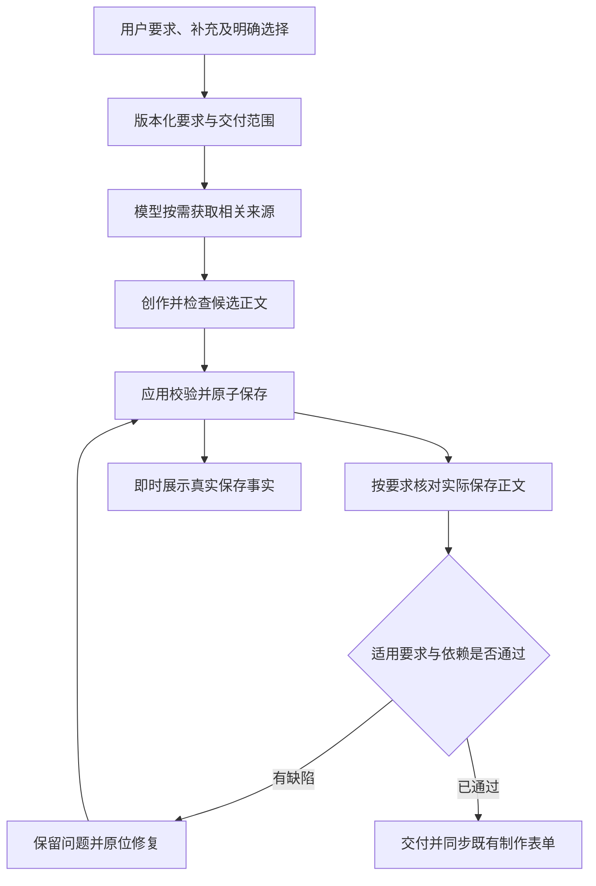

# 整个会话链路的质量、可靠性与效率专项优化计划

> 2026-11-09 剧本一键生成业务调整：用户已确认改为整套提示词与绑定的候选生成、集中核验、统一提交和独立读回，新增音色样本提示词交付。对应[代码审计](./code-traces/2026-11-09-one-click-bundle-code-audit.md)与[整包实施计划](./ONE-CLICK-PRODUCTION-BUNDLE-IMPLEMENTATION-PLAN.md)仅完成审计规划，未实施。下文是原链路的优化及失败证据，不代表新流程已完成或已提速；通用质量、检索、生命周期与本地存储要求继续有效。

日期：2026-11-09。状态：源码机制与构建已实施，最终回归验收记录见文末；真实模型内容复验、配对性能实验与运行实例生效未完成。

2026-11-09 完整原始要求真实调用已取得失败终态：两次隔离 Native 执行分别持续 72 分 02.326 秒、23 分 45.848 秒，于北京时间 18:46 因供应商 `403 insufficient_user_quota` 失败，保留 4 场 8 镜、4 场 12 镜，均未完成资料、绑定与独立验收。新样本仍有指定分区、正文相对秒数及整场投影缺项。已根据证据补修小批验收就绪、后续计划导致无关覆盖失效、阶段指引与问题级修参，最终 Worker 1,579 项和最新打包离线检查通过；这些后续补修尚未真实模型复验。两次运行重叠且均未完成，不能推出提速结论；继续使用已有四路独立只读并发。恢复原供应商额度后才能完成剩余真实闭环；见[真实闭环与耗时记录](./code-traces/2026-11-09-one-click-real-closed-loop.md)。

新截图现场补修：发现场次参数恢复不足，以及通用交付缺项遮住制作阶段核验动作。按现有阶段顺序修复，不撤销最终绑定义务、不补写创作正文；独立取证、回归与生效边界见[暂存恢复与阶段调度记录](./code-traces/2026-11-09-stage-recovery-and-phase-dispatch.md)。

本计划依据用户最新明确的范围制定：优化整个会话链路，尤其解决实践中“生成的提示词内容没有达标”的问题；同时处理重复执行、上下文增长、交付可靠性和响应缓慢。小说大纲延迟审计是其中一组证据，不代表已完成整个会话的内容质量审计。

本轮实施源码与隔离回归，不操作正在运行的用户任务或项目数据。逐阶段记录实现、专项测试和真实业务验收；只有实际完成后才能勾选，不能以已有测试通过代替内容达标。

## 1. 目标与当前证据

### 1.1 优化目标

1. 用户提出的适用要求能从原始输入一路追溯到实际交付正文，遗漏、冲突和不适用项有明确处理依据。
2. 镜头、角色、场景、道具等提示词的质量，以实际保存并进入制作表单的内容验收；任务正常结束或模型自报通过不能代替验收。
3. 长会话、用户补充、连续创作、整理交接和重启恢复后，要求、版本、未完成项和有效审查仍保持一致。
4. 参数错误通过有界修复解决，减少重发全文、重复检索和只为同步事实而产生的模型请求。
5. 分别展示创作、保存、内容核验和待用户操作的真实状态，分别计量模型、传输、本地保存和界面展示耗时。

### 1.2 已证实与待核查事项

| 类型               | 当前证据                                                                                   | 本计划的处理                                         |
| ------------------ | ------------------------------------------------------------------------------------------ | ---------------------------------------------------- |
| 已证实的可靠性缺口 | 章节创建 Schema 与业务规则不一致；章节候选复用、交付登记和精确读回覆盖不完整；失败分组过细 | Q1 统一能力与合同并修复                              |
| 已证实的上下文问题 | 同一会话约束随大纲、第一章、第二章至少重复传输 2／3／4 份                                  | Q2 保留原始要求，修正请求投影                        |
| 已测得的延迟       | 大纲 324.113 秒／7 次请求；第一章 1,010.242 秒／23 次；第二章 394.845 秒／18 次            | Q0 冻结基线，Q5/Q7 分段优化                          |
| 已测得的本地保存   | 三次成功 Result Store 调用生命周期约 23／20／21 毫秒                                       | 继续测量，不把分钟级停顿归给 SQLite                  |
| 已有的质量机制     | 最终 prompt 覆盖指导、版本化审查、问题闭环、制作输入一致性及部分流程的阶段门禁已经存在     | 查清实际调用、覆盖范围和证据；补齐缺口，复用现有机制 |
| 已确认的内容缺项   | 最近制作任务 12 镜均未落实指定分区与正文相对秒数；4 场只有摘要；部分场次时长与镜头合计不同 | 纳入 Q0 冻结样本，Q3/Q4 逐对象核对正文和依赖         |
| 已确认的审查偏差   | 模型最终四次提交无问题的 passed，仍漏掉明确要求；Worker 全部拒绝，0 次有效审查             | Q4 对实际正文核对，区分模型误判与系统实际接受        |
| 尚未验证的下游     | 任务已于 11:40:59 失败；未实际填充或提交媒体表单                                           | 终态、离线消费已核；真实表单与媒体效果待验           |

来源：[2026-11-09 延迟与可靠性审计](./code-traces/2026-11-09-agent-latency-reliability-audit.md)及其脱敏证据。三个小说样本不代表所有会话、所有模型或提示词质量的统计结论。

最新质量现场见[提示词质量核查](./code-traces/2026-11-09-conversation-prompt-quality-audit.md)及其冻结证据。用户截图对应任务在 11:37:25 仍为 running，83 条模型请求账本包含恢复前后的请求，不能视为纯生成时间。最终终态为 failed（AGENT_TASK_CONTINUATION_STALLED），92 请求、4 次审查被拒。该样本还暴露把 `requiredTexts` 清单规则误当正文禁令、审查标识／就绪条件反复更正等问题。

## 2. 范围与既定边界

### 2.1 覆盖范围

覆盖普通会话与已有快捷入口的同一条执行链：输入与补充、语义理解、资料选择、上下文编译、工具加载、创作、IR／文档保存、内容审查、原位修复、制作表单消费、进度反馈、取消和恢复。验证样本覆盖普通问答、小说／文档、镜头视频提示词、角色／场景／道具图片提示词及多步骤制作资料。

提示词文字是否达标、参考素材是否正确、下游图片／视频效果是否达标分别记录。文本验收通过不证明生成模型的实际画面效果已经通过。

### 2.2 必须遵守的合同

- 自由文本的意图、适用范围、剧情、字段选择和语义审查由 LLM 判断。应用校验真实 ID、项目、类型、版本、权限、CAS、事务、依赖和回执；不恢复关键词路由，不通过程序拼接或改写创作正文。
- 复用统一 Runtime、ContextManager、Task State、Result Store、Evidence、业务执行回执与本地项目 SQLite；不新增平行执行器、候选仓库或质量状态库。
- 项目文档、章节、项目记忆、约束文档和 IR 正文继续按需读取；目录仅作导航。用户主动提交的会话要求完整保留。聊天附件不自动进入检索索引，草稿／正式同库且显式标注。
- `ProductionAuthoringIR.prompt` 是制作创作正文。`data` 是开放补充，`references` 是真实资料引用，`timing` 是显式时长映射；不以填齐固定创作模板作为通用合格标准。
- 用户明确要求的格式、分区、镜内流程、对白、起止状态等，在适用对象的实际正文中验收。不得把只出现在备注、计划、`data` 或最终回复中的要求算作已经进入提示词。
- 保存、读回、语义验收和用户审阅各自有独立含义。Agent 不自动发布或取消发布，不改变既有付费／高风险操作边界。
- 保留原始输入、历史结果和既有产物。不同要求、明确修正及真实重复补充不能因去重丢失；不设置用户输入长度限制，不用任务总调用硬上限制造提速。
- 保留用户指定的 512K fallback 规划参考及明确模型能力优先级；不把规划值宣称为供应商实测能力，不静默换模型或降低创作要求。

依次遵循：[项目检索计划](./PROJECT-LIBRARY-RETRIEVAL-IMPLEMENTATION-PLAN.md)、[项目内容 IR 计划](./PROJECT-CONTENT-IR-IMPLEMENTATION-PLAN.md)、[LLM 语义与执行边界](./LLM-INTENT-EXECUTION-PLAN.md)、[统一执行生命周期](./AGENT-EXECUTION-LIFECYCLE-IMPLEMENTATION-PLAN.md)。

已有[执行效率改造](./AGENT-EXECUTION-EFFICIENCY-PLAN.md)、[上下文管理重构](./AGENT-CONTEXT-MANAGEMENT-REFACTORING.md)、[制作输入一致性](./PRODUCTION-INPUT-CONSISTENCY-REPAIR-PLAN.md)继续复用。`script-to-media` 的“镜头逐一保存验收 → 制作资料逐份生成验收 → 逐镜绑定与最终验收”执行顺序遵守[一键制作计划](./ONE-CLICK-PRODUCTION-IMPLEMENTATION.md)，不以通用提速策略跳过。该流程的阶段限制也不扩张为所有会话的强制步骤。

本计划不修改素材库产品决策；新计划仅维护 Markdown。实施若实际触及素材库行为，先按 AGENTS.md 阅读其两份方案，再处理相关实现与文档同步。

## 3. 目标业务流程与责任

上述是交付类任务的逻辑关系，不要求每个框单独调用一次模型。普通问答和查询可以直接回答；明确的一份文档可合并最小声明与首次提交；多产物任务使用显式依赖。必须独立读回或逐项审查的任务保留对应步骤。

| 业务事实       | LLM 责任                                                     | 应用责任                                                   |
| -------------- | ------------------------------------------------------------ | ---------------------------------------------------------- |
| 要求及适用对象 | 从原文理解义务、否定、顺序、例外和冲突；为适用性判断给出依据 | 保存原文、来源、顺序和版本；保护已确认义务，不接受静默降级 |
| 创作与资料     | 按需选择来源，创作符合目标的正文                             | 提供当前可见且有精确版本的资料，执行授权和写入校验         |
| 内容质量       | 对照源要求判断正文、动作、对白、连续性和参考用途是否合格     | 校验审查对象、版本、读取完整性、证据与问题生命周期         |
| 交付结果       | 解释实际结论、缺陷和未完成项                                 | 提供原子保存、稳定产物身份、回执、状态及实际消费文本       |

## 4. 质量验收设计

### 4.1 要求到正文的可追溯覆盖

在现有任务要求、目标图和不可变审查快照中增量记录：原始来源／原文定位、要求版本、适用对象或范围、目标版本、核对结论、正文证据和未解决问题。实际字段在 Q1 按现有类型扩展，不另建一套状态。

区分“全任务”“指定产物集合”“单个对象”和有条件适用。例如，全任务对白总计出现一次，不能被误解为每个镜头都复制一遍；用户要求每个镜头都写起止状态，则不能只在总计划中写一次。语义范围由模型判断并保留依据。

对每项适用要求保留“满足／缺失／冲突／待核实”的结论。不适用必须说明来源和理由；用户义务只能依据用户明确修正或可核对的范围事实变更，模型不能通过删项、改数量或改成不适用绕过验收。原始要求与模型拆解并存，独立验收必须能发现拆解时漏掉的义务。

### 4.2 提示词质量维度

| 维度       | 核对内容                                                       | 合格依据                                           |
| ---------- | -------------------------------------------------------------- | -------------------------------------------------- |
| 用户要求   | 指定格式、内容、语言、禁项和细节是否进入适用正文               | 原始要求与实际正文逐项对照                         |
| 来源忠实   | 剧情、对白、说话者、顺序和明确保留内容是否正确                 | 精确版本来源及语义判断；逐字保留项另做精确检查     |
| 可执行性   | 对适用的视频提示词核对动作／对白／时间流程、起止状态和可实现性 | 内容与时长相容；字段存在或关键词命中不足以证明合格 |
| 跨产物一致 | 相邻镜头、角色设定、环境、道具和依赖是否一致                   | 对应对象版本及必要邻接证据                         |
| 素材匹配   | 描述的输入图、身份、用途、顺序是否与最终选用素材相符           | 实际选择快照；未看图不能声称基于像素检查           |
| 最终消费   | 保存正文、IR、表单和提交快照是否保持预期内容                   | 内容 hash／显式转换差异及用户最终编辑记录          |

这些是核对维度，不要求所有类型套用同一模板。图片提示词不被强制套入视频时间流程；普通讨论不被强制登记制作验收。

### 4.3 审查与修复原则

- 审查以原始要求、相关源版本和实际保存正文为证据。完整读回只证明取得正文，精确字符串出现只证明字面事实；两者都不能独立证明语义满足。
- 复用当前会话所选模型和 Runtime，区分创作输入与审查输入，减少作者解释或既有“已通过”描述对判断的影响；不静默另选评审模型或新建执行链。
- 未核实发现、引用错误和被拒的审查继续保留，不能因证据校验失败而变成“没有问题”。修复、复查和撤回均有显式证据。
- 正文、用户要求、来源或相关依赖改变后，只使受影响的验收失效。无关目标继续复用有效覆盖；真实依赖不能为减少调用而省略。
- 自动回归验证机制，真实内容对照验证判断质量。独立验收从用户原文出发，不只检查模型自己列出的清单，避免漏声明也被算通过。

## 5. 实施阶段与顺序

严格按 Q0 → Q8 实施。上一阶段的实现与专项验证通过后再进入下一阶段；质量结论与性能结论分别登记。阶段门禁是实施要求，不增加逐阶段向用户确认的流程。

### Q0：冻结整个会话的失败样本与双基线

- [x] 记录实际运行版本／构建、协议、模型、入口、任务链及当前工作区差异，识别源码与运行构建的差别。
- [x] 根据用户指定的最近调用日志及截图，取得真实任务的原始要求、源版本、保存正文、Skill 与审查记录，冻结 4 场／12 镜现场证据。
- [x] 补齐该样本的候选到保存对照、最终消费文本及最终任务结论；不能以中间产物缺项推断最终结果。
- [x] 为每个缺项标注首次断点：未理解／未带入上下文／未写入正文／保存消费偏差／误判通过；证据不足时标为待核实。
- [x] 冻结离线质量反例、正常例、长会话例和性能样本。保留首次失败，不通过改短输出、删要求或挑选成功运行改善指标。

完成条件：形成可复现的质量对照表和分段耗时记录；内容失败与纯参数失败可以区分。原小说三任务继续作为性能基线，不冒充提示词质量样本。

### Q1：统一要求、交付能力与提交修复合同

主要模块：`agent-tool-registry.ts`、`agent-tool-definitions.ts`、`agent-task-deliverables.ts`、`agent-draft-submission-service.ts`、`agent-prepared-arguments.ts`、`agent-context-budget.ts`、`library-search-service.ts`。

- [x] 在现有 Registry／合同中统一声明交付登记、候选复用和读回能力，覆盖章节，逐步替换分散的工具名单；领域锁与类型检查仍由原服务负责。
- [x] 统一要求的适用对象、字段和验收依据。明确逐字检查清单的格式规则不等于提示词正文禁令；正文要求、结构化时间、音频计划和素材引用分别校验，保留原始要求。
- [x] 创建、续写、重写的参数规则在 Schema 与业务入口保持一致；错误返回动作、字段路径、错误分类及可执行的更正方式。创建禁止的 CAS 字段包括 null，不静默剥除。
- [x] 章节候选复用既有 Result Store；增加显式、有限的顶层字段删除协议。原参数 → 删除声明字段 → 应用更正 → 全量校验；同一字段同时删除和覆盖时拒绝。未知／危险字段和服务端身份字段不可删除。
- [x] 校验同项目、同任务、同工具及原参数 hash；目标变化重新验证绑定与权限，真实 CAS 冲突保留。原始候选不可变，参数修复保持正文 hash，内容修复保留新旧版本关系。
- [x] 保留完整调用指纹，另按工具、动作、目标、错误字段与相关版本识别连续无效修复。只改正文或无关字段不能重置同一参数错误；新证据和有效修复可推进，不增设全任务轮数上限。
- [x] 成功回执作为产物身份的共同依据，支持章节精确读回并保留项目、任务、分支、当前版本与草稿／正式校验；保存不自动等于审查通过。
- [x] 明确 `reviewId`、Result Store ID、内容 hash 与业务版本的区别；按当前阶段返回就绪缺项、准确版本和可执行的下一步读取／修复动作，避免把最终绑定义务误当前置许可或反复提交过期 review。

完成条件：真实失败参数离线重放能够定位字段、复用原候选并有界修复；章节参与交付与读回，跨域权限／版本错误继续拒绝，文档和场镜既有能力无回归。

### Q2：修复整个会话的要求传递与上下文连续性

主要模块：`agent-context-manager.ts`、现有 Task State／Evidence、Context 编译与运行恢复链。

- [x] 将原始输入、会话要求的适用版本、当前补充及项目按需来源分清来源，保留明确修正的顺序和关联；跟进任务引用适用版本。
- [x] 仅在模型请求投影中去除可证明来源相同、版本相同、文本相同的要求副本。新链避免把约束重复拼进每个父任务要求；旧拼接内容不能安全拆分时保留并标明兼容边界，不按关键词或摘要删原文。
- [x] 每轮创作与审查携带当前适用要求、未完成义务和有效证据入口，已取得的版本化正文按现有工作集复用；没有读取过的项目正文继续按需获取。
- [x] 覆盖“继续”、任务中补充、明确撤销／修正、并行分支、长历史整理、交接、取消和重启；旧任务不能误用新分支要求或覆盖新的用户修正。

完成条件：连续至少十次跟进中，同一约束版本不会因继承链重复增长；真实新输入可正常增加。完整原文可恢复，补充与失效依赖均在后续创作和审查中生效。

### Q3：提示词创作与最终消费一致

主要模块：`agent-policy-instructions.ts`、`agent-workflow-guidance.ts`、`production-authoring-guidance.ts`、`production-skills.ts`、IR 写入、`production.ts`、现有媒体准备与 Desktop 表单。

- [ ] 审核最终实际发送的说明、Skill、工具 Schema 和历史模板，消除重复及冲突指导；区分各类入口的明确合同。不能只修改默认文本而忽略当前保存模板及运行构建。
- [x] 创作前核对适用要求及目标范围；在候选正文中落实要求，再执行当前需要的保存前检查。资料、时间流程、对白或否定项只进入辅助字段时不得算正文完成。
- [ ] 覆盖视频、角色／场景／道具图片和独立静态参考图的不同要求，检查把文字设定误当视觉观察、把候选图误当选用图等问题。
- [ ] 验证保存正文、IR 权威内容、表单填充、整场／分段编译和最终提交快照。确定性边界／参数映射保留可解释差异，不做语义补写；用户最终编辑和素材顺序保持权威。
- [x] 回归截图现场：场次摘要不能作为完整整场生成正文；在当前完整正文合同下，由 Agent 保存包含对应镜头内容的整场提示词。整场时长与同范围镜头合计核对，镜头变更后使相关整场正文／验收待更新，不在应用内自动语义重写。
- [x] 体积或输出限制导致不完整时，保留全部义务并按现有分页／分段机制继续；不得截掉要求后保存为合格结果。

完成条件：冻结质量样例中，每项适用要求能在正确对象的实际消费正文中核对；未读取来源、未看图和内容截断有真实状态，不虚报已经验证。

### Q4：实际保存正文的语义验收与问题闭环

主要模块：`agent-task-review.ts`、`agent-task-checkpoints.ts`、`agent-task-artifacts.ts`、`production-skill-validation.ts` 及现有完成门禁。

- [x] 将要求到目标的覆盖证据接入现有审查快照／事件，按目标、版本、依赖及适用要求核验；保存、读回、结构 ready、模型空 passed 均不能替代规定审查。
- [x] 证据明确对应字段／正文片段：要求进入 prompt 时，不能引用 `timing.beats`、`data` 或聊天说明作为已满足证据。冻结反例覆盖 12 镜无正文时间、4 场仅摘要及错误扩大清单规则。
- [ ] 审查直接核对实际保存正文，检查“有分区但内容空泛”“对白存在但说话者或顺序错误”“负面提及被误认为已执行”“总时长正确但动作不自然”等语义反例。
- [x] 缺失、冲突和待核实项保持开放，修复使用既有 ID/CAS 并复查受影响对象；明确撤回误报，防止一次证据错误清空整个问题集合。
- [ ] 保留用户义务与任务要求，验证模型漏登记、减少目标、提前结束或仅部分目标通过时，既有可验证范围不会被判为全部完成；独立样例检查仍能发现模型漏解的语义要求。
- [x] 按精确内容依赖使旧审查失效，保留有效的增量覆盖；落实各显式工作流原有阶段顺序。

完成条件：离线反例中不得出现“正文有明确缺陷但任务被判全部通过”；真实样本的通过结论经原始要求独立核对。应用不宣称能程序化证明开放创作的全部语义质量。

### Q5：在质量门禁完整的前提下减少模型往返

主要模块：现有 Provider Gateway／Loop、Pi Runtime、工具加载、交付登记与执行回执。

- [x] 普通讨论／查询直接回答，明确单交付可将最小声明与首次提交合并，多产物继续使用显式依赖；自由文本仍由模型判断，不能由关键词分流。
- [x] 合并声明与提交时，声明验证、稳定输出槽位、写入和回执在同一事务成立；失败不留下伪成功，重放不重复创建。缺少完整交付范围或必需审查时仍阻止全部完成。
- [x] 把应用已确认的保存事实、数量和后续状态随业务结果同步，减少仅用于登记保存事实的模型请求；模型继续负责内容结论及未完成项。
- [x] 复用有版本的导航、已加载工具和相关证据；模型已确定的独立读取使用现有多读能力。按 `truncated/nextOffset` 判断分页终点，避免完整读取后再探测空页。
- [x] 保留规定的逐镜创作／验收、必要资料读取及顺序依赖。不得为了减少轮数合并有真实依赖的读写或跳过审查。

完成条件：在等量产物、相同要求和检查义务下减少流程维护请求；逐项说明节省来自哪里，不能以减少检查或输出量计为收益。

### Q6：整段会话的状态、质量反馈与交付体验

主要模块：`ChatPanel.tsx`、`App.tsx`、`agent-resource-refresh.ts` 和既有文档／制作页面。

- [x] 业务进度区分“理解／取资料、创作、草稿已保存、内容核验、修复、完成／部分完成／待用户操作”，使用真实事件；`waiting_review` 不展示成仍在生成。
- [x] 继续由保存回执及资源变化驱动刷新，不等待最终聊天总结；保持本地未保存编辑和项目／会话身份保护。
- [x] 已保存内容有已保存标记，未完成审查有未核验标记；候选预览若实施，明确其未保存状态，失败、取消和重试后不冒充正式草稿。
- [x] 对应回复展示实际交付、质量结论和缺口；可定位到受影响的对象／版本及具体要求，避免只显示泛化的“已完成”。问题与原要求只按显式引用关联，无引用时保留完整原要求供核对，不推断语义关系。打开的是当前正文，历史问题版本不同会明确提示。

完成条件：用户能区分“写好了并保存”与“已核验达标”；取消、切换和刷新失败不展示虚假状态，已保存内容与对应任务关联正确。

### Q7：模型与传输的分段计量及条件优化

主要模块：既有请求账本、`native-provider-bridge.ts`、`apps/desktop/src-tauri/src/llm_stream.rs`。

- [x] 扩充现有脱敏计量：请求准备、排队、连接／发送、首包、流式输出、重试和完成；跨进程使用关联 ID 与各自单调时钟，不混减不可比较的时间戳。
- [x] 当前同步 WinHTTP 边界无法可靠拆出的连接／TLS／代理／供应商时间明确标为不可分辨，不将整个请求窗口称为推理耗时。
- [ ] 在相同输入、输出要求、模型设置和协议下对照。先测业务链精简后的剩余瓶颈；对连接复用、缓存稳定性等只在有证据时实施。
- [ ] 传输改动验证取消、项目／凭据隔离、并发、错误恢复及断流；模型对照单独记录文字质量，不能用更短或漏项的输出宣称提速。

完成条件：能解释主要等待发生在哪一段；未证实的网络／模型原因不作为结论。此计划阶段不执行付费实验或更换用户模型。

### Q8：整个会话的回归、真实内容与交付验收

- [x] 运行下节完整矩阵的定向回归及仓库最终门禁，准确记录既有问题和新增问题；文档格式另显式检查。
- [ ] 冻结构建后，在隔离项目复现质量失败样本，并运行普通会话、连续创作和完整制作链。真实内容必须从原始用户要求独立核对，失败与修复过程均保留。
- [x] 真实模型／协议未覆盖项、样本数、模型设置、成本与环境限制明确记录；不把 mock、单模型或单次结果当作全部实测。
- [x] 形成质量与性能两份对照、实际构建指纹、兼容／恢复结果和未完成项；更新本计划清单与相关检索衔接说明。

完成条件：内容质量、业务正确性、恢复能力和性能分别通过对应验收。源码、构建通过与当前运行实例生效分别记录，不能仅因自动测试通过宣布专项完成。

## 6. 指标与验收口径

| 指标                   | 基线或现状                              | 专项验收目标                                                              |
| ---------------------- | --------------------------------------- | ------------------------------------------------------------------------- |
| 提示词适用要求覆盖     | 已知 12 镜正文缺项、4 场摘要            | 冻结样例的明确必需项全部满足或明确报告未通过；缺项不得报全部通过          |
| 语义误通过             | 4 次模型漏判，Worker 未接受             | 专项已知反例 0 次误通过；新增真实缺陷保留并纳入回归，不宣称总体误差为 0   |
| 审查与实际版本一致     | 已有版本化机制，待核各入口覆盖          | 要求／正文／相关依赖变更后不复用过期通过；有效范围可增量复用              |
| 正文到最终消费一致     | 离线实际消费与保存正文一致              | 非语义映射和用户编辑均有依据；没有未经确认的丢失、补写或错序              |
| 纯参数修复重复生成全文 | 第一章多次，第二章同正文重发 1 次       | 对正文未变的参数修复，完整正文重传为 0，正文 hash 保持一致                |
| 相同约束重复传输       | 三样本至少 2／3／4 份                   | 可证明同源同版本约束在相关请求投影只传一份；不丢真实新要求                |
| 标准大纲模型请求       | 7 次                                    | 同等交付和检查义务下，目标降至不超过 5 次；这是优化目标，不是运行时硬上限 |
| 完整制作链请求与耗时   | 先冻结质量相同的样本                    | 质量通过后再比较，单列必要审查和修复成本，不预设通用减半目标              |
| 本地保存耗时           | 单次约 20–23ms，非 P95                  | 持续验证无分钟级等待；充分采样后报告分位数和机器环境                      |
| 保存到界面可见         | 尚未采集，已有 400ms 刷新机制           | 同机无脏编辑场景目标 P95 ≤ 1 秒；脏编辑保留内容并及时显示保存事实         |
| 主生成速度             | 大纲主请求 219.222 秒，约 24.4 Token/秒 | 分离首包与输出吞吐，固定质量与输出要求比较；不承诺一分钟完成              |

覆盖率分母以冻结的原始要求及独立核对结果为准，不能只数模型自己登记的条目。质量不合格的运行继续计入失败样本和成本，不参与“合格交付提速”的成功收益。

真实对照至少覆盖三组大纲→第一章→第二章链及代表性提示词失败样本；新性能结论以同构建、同入口、同模型／协议和等量输出要求比较。原始三次观测作为历史参照，不能冒充配对实验。小样本报告逐次值、中位数与范围；P95 需单独充分采样，不从三次任务推算。

## 7. 必需验证矩阵

| 场景                         | 必须验证的结果                                                                             |
| ---------------------------- | ------------------------------------------------------------------------------------------ |
| 普通问答、讨论与查询         | 无不必要制作流程；不读入整库正文，不虚报保存                                               |
| 明确单文档／新章节           | 声明与提交一致，错误字段可定位，保存／读回／内容状态准确                                   |
| 长会话及连续十次跟进         | 要求完整、同源约束不重复增长；补充与撤销正确传播                                           |
| 视频提示词遗漏／错序／空泛   | 对应要求及实际正文可核对，缺陷不能靠字段存在或空 passed 绕过                               |
| 角色／场景／道具图片提示词   | 对象类型和提示词用途正确，适用要求落实，不强套视频模板                                     |
| 有对白的多镜头制作           | 说话者、顺序、跨镜重复、自然时长及起止状态按要求核对                                       |
| 多阶段制作与绑定             | 固定阶段顺序、全部目标、资料类别及最终逐镜引用正确                                         |
| 整场／选段／媒体表单         | 消费实际正文及对应素材，范围、顺序、相对时间和最终编辑正确                                 |
| 参数失败、CAS 与重复调用     | 候选可复用，正文不重发，冲突不自动刷新，幂等不重复保存                                     |
| 用户修正、内容编辑、来源变更 | 相关审查失效并复核，无关已通过目标可继续复用                                               |
| 整理交接、重启及损坏快照     | 原文、候选、未决问题和有效进度可恢复，终态不误复活                                         |
| 取消、切会话／项目、并行分支 | 旧回调不能串写、串显或跨范围复用资料／审查                                                 |
| 两种工具协议                 | Responses 与 Chat Completions 在现有统一入口行为一致；多读合法，混合／多写仍按现有规则拒绝 |

机制验证使用临时数据库、模拟供应商和故障注入；已有相关测试优先扩展。开放创作的质量另以冻结原文和真实输出独立验收，不通过编写只检查实现细节的测试替代。

最终门禁按仓库脚本执行：`pnpm test`、`pnpm typecheck`、`pnpm lint`、`pnpm format:check`、`pnpm build`、`git diff --check`。涉及 Native 时增加 Rust 格式／检查／相关测试；涉及独立 Worker 或安装包链时运行对应 sidecar 与构建验收。`docs/` 被默认 Prettier 忽略，计划和证据文件须额外显式检查。

## 8. 兼容、风险与交付记录

- **既有改动：** 当前工作区已有其他生产流程修改。实施从最新实际状态出发，核对重叠模块并保留已有工作；不把本次读取的源码自动当作运行实例已加载的代码。
- **数据兼容：** 优先以现有持久快照／结果的可选版本字段增量实现。确需迁移时独立说明历史投影、事务回滚、重复打开及旧失败记录恢复；不改写历史审计为通过。
- **质量形式化风险：** 字段齐全、引用正确、精确文字出现和模型自检都可能与内容达标脱节。验收从原始要求核对实际正文，并保留未知与误判边界。
- **流程负担风险：** 质量核验若全面复制来源和要求可能变慢。采用目标范围、精确版本、增量失效和已有证据复用；不撤销必需审查。
- **指标失真风险：** 不同输出长度、模型波动、缓存和协议分别记录。质量未达标、重试和被中断样本不能从统计中隐去。

每阶段完成记录：改动模块、解决的具体问题、定向验证命令／结果、真实内容证据、用量与耗时、未覆盖项及运行生效条件。代码修复完成、真实内容通过、性能目标达成分别标记。

### 2026-11-09 实施记录

勾选表示相应实现和自动/隔离机制验证完成；Q3/Q4 的开放语义独立验收、Q7 的真实性能对照、Q8 的真实模型完整链以及运行生效继续未勾选。不得据此宣布全部内容与速度目标已达成。

| 阶段 | 实施结果                                                                                          | 验证及边界                                                                                                           |
| ---- | ------------------------------------------------------------------------------------------------- | -------------------------------------------------------------------------------------------------------------------- |
| Q0   | 补终态、候选/保存 hash 与离线消费对照；冻结 4 场/12 镜完整 IR 和 3 条要求摘录；保留小说三任务基线 | 原文已在首次本地配置中；exact wire 未证明。终态92请求/4拒绝/failed。原11:37 JSON未另外保留，终态JSON明确注明刷新边界 |
| Q1   | 统一章节能力、Schema/业务合同、候选删除协议、直接读回和无效修复监督；明确审查ID和阶段许可         | 双协议保存/回放、跨范围拒绝、CAS/锁保护、原候选不可变；新review协议纳入进展                                          |
| Q2   | 来源/版本/继承身份，投影只去同源确证副本                                                          | 十次跟进、补充/修正、重开和恢复回归；不删原文、附件不入库                                                            |
| Q3   | 正文/辅助字段指导、Skill6、整场全文投影和时长一致性                                               | 摘要/错序/旧文拒绝及实际消费读取通过；模型语义和真实表单未验                                                         |
| Q4   | 快照v3/event5、原始要求×目标证据、问题闭环及增量依赖失效                                          | 空passed/timing-only拒绝；已知反例门禁通过，不证明复合语义无误判                                                     |
| Q5   | 单交付声明与首次保存原子合并，成功回执同步保存事实                                                | 失败回滚、重放一次、两章显式独立槽位；保留多产物计划和镜头→资料→绑定顺序                                             |
| Q6   | 已保存/未核验/需修复/已核验和待用户操作状态；只读质量投影；交付对象/版本、问题和原始要求导航      | Desktop交互/资源刷新回归及新构建隔离读回通过；未保存编辑和异步身份保护保留；UI P95未测                               |
| Q7   | 请求关联ID、两进程独立单调计时、阶段首次观测                                                      | Native本地HTTP和账本回归；未更换模型或网络实现，WinHTTP细项不可拆                                                    |
| Q8   | 全仓门禁、dist真实服务临时项目及新sidecar重启验证；冻结最终构建指纹                               | 全部结果、首轮失败/修正、忽略项与未实测项分别登记于交付记录                                                          |

具体模块、质量与性能对照、测试命令和生效条件见[专项实施交付](./code-traces/2026-11-09-conversation-optimization-delivery.md)及[机器可读验收/指纹](./code-traces/2026-11-09-conversation-optimization-verification.json)。本轮新增供应商调用为0，未修改用户项目或重启应用。

保留初始diff备份包含的16个tracked文件已有修改；最终构建指纹对应合并工作树。未改变确认产品要求，Markdown专项记录无需同步产品DOCX。

### 2026-11-09 新截图补修检查表

- [x] 从实际任务、候选、保存回执和运行时定义取证，保留上一轮审计。
- [x] 修复场次字段错误恢复；真实候选离线修参保持正文、目标与 CAS。
- [x] 统一当前制作阶段动作与最终交付义务，保护首阶段逐字项与结构检查；136 项定向回归通过。
- [x] 前端 806 项、存储 101 项、适配器 80 项分包全量通过，首次失败另记。
- [x] 最终 Worker 全量 1,555 项通过；按包合计 2,630 项通过。类型、lint、格式、构建、最新 sidecar 与隔离重启通过，最新指纹见补修机器记录；两次根测试失败及修正过程保留。
- [ ] 当前运行实例加载此次补修；真实模型按完整要求交付并通过独立验收。

### 2026-11-09 一键制作执行可靠性补修

- [x] 已知同类计划/验收参数错误按稳定定位监督；旧失败兼容、持久恢复、新证据和相关保存/验收机会分别验证，不设总轮数上限。
- [x] create 义务保持原意图，字段级修参信息传到模型；有效目标按完整要求矩阵分批接收，错误目标待办，不放松阶段门禁。
- [x] inspect 首屏提供同任务当前事实、全过程耗时与分页完整性；只读冻结数据确认 79.26 分钟、4 场 13 镜、零验收通过。
- [x] 将非空原始要求/会话约束矩阵及错误目标恢复纳入两协议完整阶段集成测试，保留无关目标、证据、CAS、来源和项目保护。
- [x] 全仓 2,651 项及最终 24 项重叠定向复核通过；类型、Lint、格式、完整构建、独立 Worker 打包/离线 IPC/临时项目重开验证完成。
- [ ] 运行实例加载及真实模型完整交付、内容独立验收和配对性能复验。

本轮源码、构建、隔离验证与最终门禁见[执行可靠性补修](./code-traces/2026-11-09-one-click-production-repair.md)和[机器记录](./code-traces/2026-11-09-one-click-production-repair-verification.json)。未改写原审计结论、未新增供应商调用。
