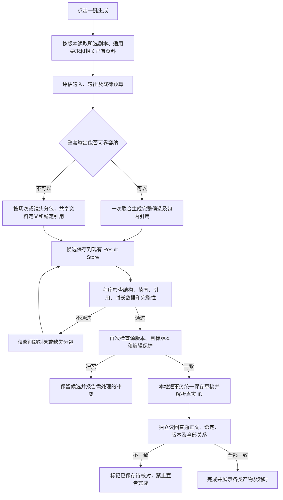

# 剧本一键生成：整套提示词与绑定实施计划

2026-11-10 revision 34：Worker 全量 1,556 项、类型检查、Lint、格式和 workspace 构建通过。首次 Native 真实供应商运行用时 6 分 19 秒；12 个候选对象通过结构校验、单事务保存和 Worker 关闭后的独立 SQLite 读回，0 结构错误、0 待办、`quick_check=ok`、外键错误 0。15 次模型请求中有 1 次同输入传输重试、5 次结构化参数失败后由 Agent 自动修正；未做内容审查。无声／无道具样本、强制分包样本和第二个成功样本仍未完成。证据见[revision 34 真实验收](./code-traces/2026-11-10-one-click-bundle-revision34-real-acceptance.md)。

日期：2026-11-10。方案版本：2。状态：**提示词／绑定业务已按用户确认推倒重建；P2／P3 的主结构保存路径和 P7 的首个真实完整结构闭环已通过。P7 的无声／无道具、强制分包及重复成功样本仍未完成；未替换安装实例。**

当前数据边界以[提示词与绑定重建计划](./PROJECT-CONTENT-IR-IMPLEMENTATION-PLAN.md)为准：所有创作内容为普通文本，只有明确 ID 关系使用绑定 IR。下方历史验收记录仅证明当时的实现和失败，不恢复旧内容 IR／制作 IR 设计。

本计划落实用户已确认的业务调整，适用于剧本页“一键生成制作资料”。它取代[原计划](./ONE-CLICK-PRODUCTION-IMPLEMENTATION.md)中针对新任务的“镜头先通过 → 资料再通过 → 最后绑定”流程；章节改编、历史任务和既有媒体制作能力保留各自合同。原计划的完成记录不能作为本计划的完成依据。

依据：[代码审计](./code-traces/2026-11-09-one-click-bundle-code-audit.md)、[41 文件指纹证据](./code-traces/2026-11-09-one-click-bundle-audit-evidence.json)、[此前真实闭环失败记录](./code-traces/2026-11-09-one-click-real-closed-loop.md)。

## 1. 已确认的交付目标

点击一键生成后，LLM 联合规划和编写整套候选，经过检查、修复、统一保存和独立读回，最终得到可编辑的草稿及真实绑定。无需用户逐项审核，不自动发布，不创建媒体表单或生成图片、视频、音频。

| 产物           | 必须保存的内容                                             | 必须建立或验证的关系                                           |
| -------------- | ---------------------------------------------------------- | -------------------------------------------------------------- |
| 场次／镜头     | 顺序、完整镜头提示词、自然时长、必要的整场提示词与本次要求 | 源稿来源、所属场次、实际可见角色／地点／道具、说话者及声音用途 |
| 场景资料       | 地点／环境的完整可用提示词，与剧情场次区分                 | 各镜头使用的真实场景资料                                       |
| 道具资料       | 独立道具的完整可用提示词                                   | 各镜头实际使用的道具；无道具可为空                             |
| 角色资料       | 完整可用的角色视觉提示词及适用设定                         | 镜头实际出镜人物；需要声音时的默认音色文字对象                 |
| 音色样本提示词 | 音色描述与试音文本，两者均可编辑和按版本读回               | 角色／旁白／画外说话者与音色文字对象，台词与镜头的对应关系     |
| 辅助文档       | 用户明确要求另存的分析、分镜表等                           | 与本次来源及交付清单关联，不能代替真实场镜或制作资料           |

音色样本提示词不是实际声音文件，不能伪造 `audioId`、`voiceProfileId` 或已选供应商音色。没有对白或旁白时，音色与台词集合可为空，但必须有适用性依据，不能用空数组掩盖遗漏。无声出镜人物不强制生成音色；仅说话、未出镜的人物不因此加入画面角色引用。

## 2. 已确认的业务流程

“一次生成”指减少创作往返，不承诺总共只有一次模型请求。源读取、结构修复、最终保存及结束仍可能需要额外轮次。按用户确认，本流程只做结构化校验，不做提示词内容或语义审查。分包时也是一个任务、一个整体交付清单和一次业务提交。

## 3. 固定架构与兼容边界

实施必须遵守以下既定计划；用户本次已改变旧的两阶段顺序，其余已确认要求继续有效：

- [项目内容 IR](./PROJECT-CONTENT-IR-IMPLEMENTATION-PLAN.md)、[LLM 意图执行](./LLM-INTENT-EXECUTION-PLAN.md)：LLM 决定创作与语义；程序验证结构、项目、类型、ID、版本、CAS、依赖和执行边界，不按姓名猜绑定，不拼接改写创作正文。
- [项目检索](./PROJECT-LIBRARY-RETRIEVAL-IMPLEMENTATION-PLAN.md)：正文按需读取，不向普通会话自动注入全库正文；草稿与正式同库、结果明确标识；聊天附件不自动索引。
- [Agent 生命周期](./AGENT-EXECUTION-LIFECYCLE-IMPLEMENTATION-PLAN.md)：复用同一个 Agent／Runtime／ContextManager／Task State／Result Store／Evidence／业务回执，不新增平行执行器或质量状态库。
- [音色与配音](./CHARACTER-VOICE-DUBBING-IMPLEMENTATION-PLAN.md)、[素材库产品要求](./ASSET-LIBRARY-OPTIMIZATION-PLAN.md)及[实施计划](./ASSET-LIBRARY-IMPLEMENTATION-PLAN.md)：实际音频继续在独立音频库，图片／视频素材库行为不变，人工媒体选择和显式禁用不被覆盖。
- 项目 SQLite 是运行时事实源，GitHub 只管理源码和审阅。候选、输入清单、引用映射和回执均不得依赖 GitHub 存储或同步。
- 不自动覆盖已发布内容、取消发布、解锁时长或覆盖未保存编辑。已有资料只读复用与修改草稿必须明确区分，写入继续遵守领域服务保护。

建议新任务由 Worker 冻结 `productionWorkflowVersion=2`，继续使用 `script-to-media` Skill ID，并独立记录 Skill revision。模型不能自行切换版本。没有该字段的存量任务按旧版恢复；不能把旧空引用草稿自动认作新包通过。P1 已固定合同，P2–P5 已接入源码；冻结构建与真实验收分别按 P6／P7 记录。

## 4. 数据与执行合同设计

### 4.1 输入快照与要求覆盖

保存所选源对象 ID、版本、正文 hash、`draft/published` 状态和选择范围。保留完整原始会话要求及其来源，再由 LLM 明确适用对象、不适用依据和冲突；不得只保留一句泛化总则。完整正文通过现有检索／读取能力按需取得，按版本续读所有必要页面，目录不能代替正文。

已有资料由 LLM 选择和读回，记录真实 ID、类型、当前版本／hash、复用或修改方式及 CAS。复用内容不需要复制成新资料，同名不同对象不自动合并。源稿或资料变化时，按依赖撤销对应候选／审查效力，禁止偷偷改用另一份源稿完成。

输入快照还记录当前模型、协议、预算来源、必要生成配置、用户锁定的时长及保护状态。用户临时追加要求必须产生新的输入修订和受影响范围，不能在后台改变已经审查的含义。

每次 Provider 请求前估算本轮完整请求的输入 Token，并结合模型窗口动态整理上下文；不设置任务累计输入 Token 上限，不截断完整用户输入或所选资料。轮数、输出量、经过时间和无进展错误仍按任务合同限流。

### 4.2 候选包与临时引用

使用同一 Result Store 存储不可变候选结果，Task State 只引用其定位、版本和 hash，避免每轮把全部正文复制进上下文。候选不得进入制作实体表、项目文档索引或 UI 的“已保存业务产物”计数。

合同至少包含：

- `bundleId`、候选修订、输入快照 hash、工作流版本、完整性清单及分包目录。
- 每个场次、镜头、制作资料、辅助文档及声音对象的稳定 `localKey`、类型、内容和版本／hash；修改已有对象另带真实 ID 与期望版本。
- 显式判别的新对象 `localKey` 引用或已有对象 `existingId` 引用，禁止一个自由字符串同时承担两种含义；类型和项目检查不能省略。
- 场镜结构、来源、独立数值时长、普通提示词、视觉绑定、声音关系及用户额外要求的交付项；不再定义 beats 或结构化创作字段。
- 每个分包的完整／截断／待补状态。完整清单必须覆盖本次所选范围；单纯声明“完成”不能补足未返回的对象。

同一输出槽位和同一候选修订的重放必须幂等；重复 `localKey`、引用不存在对象、错误类型、循环／非法层级和跨项目引用均应定位到具体对象与字段。模型不能控制持久层新 ID 分配。持久化的正文语义不得因 ID 解析被程序改写。

### 4.3 音色文字与说话者

现有文档／版本体系保存 `voice` 资料。正文保存普通音色描述，`sampleText` 是同版本独立可读写的普通试音文本；不定义音色内容 IR，不建立独立内容库。

2026-11-10 用户确认音色提示词应位于对应角色的提示词页面：角色页按明确 `voiceDocumentId` 直接加载和编辑音色描述、试音文本，使用页面保存入口及音色自身的 CAS／只读保护。独立版本存储与角色视觉提示词保持各自字段。

声音关系须区分：

1. 角色默认音色文字引用，以及必要的镜头／台词级音色选择。
2. 可见对白、画外角色和旁白的身份／音色绑定；台词、声音用途、情绪及时间写在普通镜头正文。
3. 既有真实音频参考版本和供应商音色配置；这类真实配置继续沿用原合同，不由文字样本替代。

上述明确 ID 关系使用唯一 `PromptBindingIR` 保存并校验；正文描述不会自动建立引用。角色生图正文不混入音色提示词；视觉角色绑定始终代表实际出镜人物。多个镜头可以复用一个声音对象，同名说话者不能仅凭名称自动绑定。

首版完成的是文字与关系，不增加音频生成表单，不要求真实音频存在才算文字交付完成；后续实际配音继续使用原有音频导入、准备及确认链路。

### 4.4 工具与状态

建议在统一工具注册、授权和执行账本中增加 `production.bundle` 的候选提交／读取／修补／检查／提交／状态能力，最终名称与拆分在 P1 固定。不创建第二个 Agent 循环，不让候选写入绕过现有工具授权。

业务状态至少区分：候选不完整、候选已就绪、结构检查通过、提交冲突、业务已提交、读回已验证。它们映射到现有 Task State 和业务回执，不建立另一套任务终态。UI 不得将以下状态混同：

| 事实                              | 不能推断的结论           |
| --------------------------------- | ------------------------ |
| 候选存入 Result Store             | 业务资料已保存           |
| `readyToSubmit=true`              | 业务资料已保存           |
| Agent 报告任务完成                | 结构校验与独立读回通过   |
| 业务事务提交                      | 独立读回与最终交付已通过 |
| 任务 `completed` 且交付为 partial | 一键生成完整成功         |

### 4.5 结构校验与局部修复

程序只校验可确定的结构事实：候选清单、层级、绑定、类型、项目、ID、版本、CAS、尺寸和数值时长范围。提示词正文作为普通文本保存；不评判其内容、语义、创作质量或对用户要求的落实程度。

结构错误必须定位到候选 key 和字段。只修复结构不合法或缺失的对象；分包仍使用稳定引用、当前修订和完整清单，禁止通过删除或摘要候选来绕过结构校验。完整正文与绑定仍由独立读回确认和候选完全一致。

错误回执包含候选 key、字段、影响依赖和修复状态。仅要求模型修结构错误对象；不重写无关正文。修复产生新候选修订，仅撤销该对象及真实受影响依赖的结构状态；共享资料变化须重验使用它的镜头，其他结构有效对象保留。

## 5. 统一提交、读回与恢复

提交前，Worker 再次核对当前项目／会话／任务、源版本、输入 hash、候选依赖、目标 CAS、活动对象、发布／锁定／编辑保护。全部结构核验通过才进入事务；冲突时保留候选并返回准确目标，不能自动取消发布或覆盖用户改动。

使用有界的本地外层短事务，复用领域保存原语，按下列依赖顺序完成：

1. 为所有新对象预分配真实 ID，生成不可歧义的 key→ID 映射。
2. 保存全部资料／辅助文档的普通 Markdown、同版本绑定、试音文本及来源；保存场次、镜头、独立数值时长与结构。
3. 解析并保存视觉引用、角色默认音色、台词说话者与音色关系；不得残留临时 key。
4. 同事务更新必要检索索引、输出槽位绑定、资源变更序号和唯一业务提交回执。提交回执记录候选修订、映射、全部目标版本与内容 hash。

统一提交复用文档与场镜领域原语和同一事务边界。候选区仍是原 Result Store，不能用会提前落地业务表的旧场次暂存替代。内存刷新及事件在事务成功后执行，防止回滚后出现假刷新。

事务内不得包含模型／网络请求、媒体操作或用户等待。任意文档、镜头、关系、索引或回执写入失败，回滚本次全部业务写入；候选仍保留在 Result Store，允许恢复。

提交后，通过独立读取路径按回执 ID／版本读回所有普通正文、绑定、试音文本、数值时长及来源，对实际内容进行全量比较，仅允许临时 ID→真实 ID 转换及非创作元数据变化。不能只看数量、保存回执、当前目录或沿用内存候选。源或被复用资料若在此期间发生变化，也不能按旧审查宣布成功。

只有读回一致、结构合法且没有待办项，才能标记完整交付并结束。读回失败表示“已保存，核对未通过”，不能声称事务已经回滚，也不能重新盲目创建一套对象。

恢复须覆盖三个窗口：候选阶段中断继续缺失工作；事务失败重试不重复建对象；事务成功但回执响应丢失／进程退出时，依据持久唯一回执恢复原映射并补读回。取消与提交竞争要有明确线性化点：提交前取消不落业务数据，提交后取消保留已保存事实并准确反馈，禁止以取消为由删除用户产物。

## 6. 分包、时长和并发

### 6.1 分包预算

一次联合创作只用于预算允许的小样本。先分别估算本次必要输入、全部提示词与 IR／绑定的输出 Token，并预留检查／调用包装开销。依据模型实际输出配置与能力，不把未知能力的回退窗口或“输入能放下”当作整包可输出的证明。

遵守绑定 32 KiB、场镜 `prompt` 20,000 字符、普通文档正文 1,000,000 字符、普通 Sidecar 2 MiB 和实际工具参数边界；模型请求的 64 MiB 信封不是普通工具信封上限。分包按实际 UTF-8 字节检查，不能只估字符数。

超预算时由 LLM 按剧情依赖安排场次／镜头和共享资料；跨包沿用稳定 key、来源和资料版本。后续包只补必需对象，不反复生成整套定义。输出截断、漏包和不完整 JSON 进入待补状态，不能自动修剪后标为完成。

单个最终普通文本或绑定仍超限时，要求模型在不损失本次要求的前提下重新规划，或明确报告无法兼容的范围。用户要求完整整场正文时，必须按顺序包含所属每镜全文各一次，不能静默退回摘要或投影。传输分包不能掩盖最终存储冲突。

### 6.2 首版并发策略

保留现有最多四路独立只读。候选分包默认串行，统一写入由单一提交协调；首版不引入多 Agent 或并行模型创作。这是为先验证减少往返的收益与整包一致性，不是永久禁止并发。

后续评估创作并发必须有真实阶段账本，证明生成阶段仍为主要瓶颈，并具备稳定共享定义、配额与成本上限、取消和局部失败语义。只有离散、依赖满足的场次才适合评估；不能并行写同一角色／音色或同时提交业务数据。并发优化不作为首版完整交付的前置条件。

### 6.3 必须记录的时间与停止条件

按任务及模型请求记录以下里程碑：点击、开始源读取、发出请求、首包、末包、候选就绪、结构检查、局部修复、事务提交、独立读回、UI 可见、最终完成。每项保存 UTC 时间，界面按北京时间显示；同进程区间使用单调时钟，跨进程时间不伪称精确子阶段测量。

分别报告完整交付耗时、首稿耗时、模型／传输等待、本地检查／保存／读回、修参轮次、内容修复轮次、输入／输出／缓存 Token。重叠请求的累计耗时不能直接当作墙钟耗时；同步工具相同起止戳也不能当作真实保存测量。供应商未提供细分信息时，不编造“纯阅读时间”或成本；费用只有有效账单规则与用量证据齐备时计算。

修复次数、相同错误无进展次数及总预算必须有界，具体默认值在 P1 固定并写入任务快照。额度／授权失败、取消和重复无进展应停止有效执行并保留事实，不无限修复、不自动充值、不更换模型或账号。只有真实成功样本积累后才给一般耗时区间；单次成功不能推出 P95 或 SLA。

## 7. 顺序实施清单与退出条件

每阶段完成后更新本清单，并记录源码／构建身份、验证命令和结果。阶段退出条件未达到时不得勾选；不以 mock 通过替代真实模型验收。

### P0 · 代码审计与计划

- [x] 追踪入口、旧门禁、IR、音色、保存、审查、完成和 UI，冻结 41 个源文件指纹。
- [x] 区分此前失败样本、当前可复用能力与新方案未实现部分。
- [x] 制定合同、分阶段工作、事务与故障窗口、真实验收及耗时口径。
- [x] 检查文档格式、链接、源锚点、diff 和指纹一致性，记录在[规划验证记录](./code-traces/2026-11-09-one-click-bundle-planning-verification.json)。

退出条件：审计与计划可审阅，不触碰功能源码或运行实例。

### P1 · 固定新合同与兼容迁移

- [x] 固定工作流版本和显式引用合同；工具定为 `production.bundle`，版本 2 仅由受信入口选择，未声明版本仍为旧版。
- [x] `voice` 文档、同版本试音文本、角色默认音色及镜头声音绑定已接入。v77 迁移保留文本、关系及版本后实际删除旧 IR 列；历史候选只读，不继续执行旧合同。
- [x] 音色描述仅在文档正文，试音文本仅在同版本 `sample_text`；画外说话者与可见角色分离。
- [x] 分包 256 KiB、整包 8 MiB、最多 1000 对象／128 分包、内容修订 12 次；文本／绑定／Sidecar 分别遵守各自限制，模型输出服从实际预算。
- [x] 合同测试 13 项与真实临时 SQLite 重开测试 1 项通过，覆盖旧 IR、UTF-8 超限、判别引用、声音身份和无音频保存；Worker 类型检查通过。

退出条件：Schema、存储和授权边界可执行且兼容；新增合同不代表已有生成闭环。

### P2 · 候选生成、预算与持久恢复

- [x] `production.bundle.submit` 只接收一个 `prompts` 列表：每项显式 kind，全文统一在 prompt，地点资料 location 与剧情场次 scene 明确区分。旧公开 documents/scenes/shots/contentMarkdown 字段拒绝，不保留兼容转换。内部按明确类型投影到已有领域集合；不猜内容或关系。中间分包省略 `complete`，只在最终分包传 `complete=true`；提交与封包在同一事务。分包、幂等、局部修复、CAS、原文保存及回滚聚焦通过。

- [x] 在同一 Runtime 和工具授权中接入新版输入快照、按需读取、输出预算与候选能力。
- [x] 小样本联合生成；大样本共享资料定义、按稳定 key 分包；不提前提交场镜或资料。
- [x] Result Store 保存全文与版本，Task State 引用；支持分页、截断补齐、同槽位重放与重启恢复。
- [x] revision 34 真实 Native 运行中，5 次结构参数拒绝均未执行写入；Agent 后续修正后恢复，最终只产生一次事务提交。另有 1 次 `WINHTTP_RESPONSE_HEADERS` 传输失败，以相同输入 hash 重试后成功。
- [ ] 真实取消、供应商额度错误及超过单次 12 对象上限的多批提交仍需单独验收；revision 9／10 的失败保留为历史记录。
- [x] 11 月 10 日补齐 `production.bundle` prepared arguments 与显式局部补丁、预校验事件门禁和批量读回；新增回归及两协议打包离线闭环通过。真实复验已观察到 10,793 字节失败包仅用 280 字节补丁恢复；完整闭环仍按 P7 另验，见[修复记录](./code-traces/2026-11-10-one-click-bundle-recovery.md)。
- [x] 测试断流／截断、遗漏分包、重复提交、超大单项、已读源变化、恢复和取消；断言候选阶段没有业务实体、索引、媒体任务或表单写入。

退出条件：完整候选可恢复、可读回，尚未声称业务保存或内容合格。

### P3 · 结构校验与局部修复

- [x] 校验候选类型、必需字段、数量／字节上限、场镜层级、明确 ID 引用、版本和项目范围；错误定位到对象与字段。
- [x] 提示词和试音文字始终按普通文本保存；程序不判断语义、创作质量或原始要求的落实情况。读回只比较候选与实际持久化版本是否一致。
- [x] 两种 Provider 协议覆盖完整包、分包、结构错误、显式补丁、CAS、恢复和无进展保护；Worker 全量及 revision 34 真实 Native 闭环通过。
- [x] revision 34 真实调用保存 12 个对象；结构检查 `structureReady=true`、错误 0；事务回执唯一，关闭 Worker 后独立读回全部 12 个对象且失败 0。
- [ ] 无声／无道具样本及超过单次 12 个对象的真实分包样本。

退出条件：结构合同、事务保存和独立读回一致；不设置内容或语义审查门禁。

### P4 · 统一事务提交与独立读回

- [x] 抽取文档／IR／场镜／关系的领域保存原语，纳入同一本地外层事务，不复制另一套 SQL 引擎。
- [x] 实现 ID 预分配、引用解析、CAS／发布／锁定检查、索引、输出绑定和唯一提交回执。
- [x] 提交后独立全量读回和规范比较，只有一致才允许完整交付；事件与资源通知在提交后发送。
- [x] 故障注入第 N 个资料、镜头、声音关系、索引和回执写入，断言业务全部回滚，候选仍可恢复。
- [x] 测试提交成功后响应丢失／进程退出、重复提交、读回失败及取消竞争，断言不重复建对象、不谎报回滚／成功。

退出条件：所有业务实体与关系一致提交且独立读回，失败／恢复窗口均有可验证事实。

### P5 · 一键入口、完成判定和编辑体验贯通

- [x] 新任务使用新版 Skill／工具与完成合同；历史任务继续旧版。审计所有旧阶段门禁，禁止旧工具成为新版提前写入的旁路。
- [x] 更新完成评估、任务检查、检查点、业务回执、交付反馈和资源刷新，以同一事实区分候选、已保存、已核验与完整完成。
- [x] 接入音色资料目录、编辑／读回和角色／说话者跳转，展示各类产物数量和绑定；实际音频导入与媒体制作链路继续原有入口。
- [x] 2026-11-10 按用户确认将音色描述与试音文本直接放入对应角色提示词页面，接入页面保存、CAS、只读和未保存修改保护。Desktop 92 文件／831 项测试及前端构建通过，见[页面调整记录](./code-traces/2026-11-10-character-voice-prompt-page.md)。
- [x] 保护 dirty 编辑、项目切换、已发布资料、锁定时长、手动媒体选择／禁用和取消；支持进程重开后查看同一产物。
- [x] UI／Worker 集成覆盖可复用资料、无道具无声音、画外客服、部分完成、冲突、失败和恢复，禁止“任务已终止”直接显示完整成功。

退出条件：用户可从同一按钮完成、查看和编辑真实结果，状态与内容一致。

### P6 · 离线集成、仓库门禁与构建生效验证

- [x] 两种现有 Provider 协议的完整工具链集成，使用明确标注的 mock，覆盖长包／分页／分包与恢复。
- [x] 运行阶段聚焦测试及全仓 `pnpm test`、`pnpm typecheck`、`pnpm lint`、`pnpm format:check`、`pnpm build`、`git diff --check`；显式检查本计划及审计文档格式。
- [x] 若涉及 Native，则执行相应 Rust 测试；验证实际构建内新版合同、工具和完成逻辑，不能只测试源码。
- [x] 在冻结打包 Worker／隔离 Native 路径执行现有 M7 检查，另增加五类产物与绑定全量保存、独立重开读回的新版端到端场景。
- [x] 同步相关 IR／音色／生命周期／一键文档的新增合同；若实际改变素材库产品规则，必须同步其 Markdown 与 DOCX，否则不得顺带扩范围。
- [x] 记录构建指纹与“已构建／隔离运行／用户安装实例生效”的区别，不自动安装或替换用户运行实例。

退出条件：离线机制与冻结构建均通过，仍须 P7 才能宣布真实业务验收通过。

### P7 · 原完整输入真实闭环与耗时验收

- [x] 用户明确要求直接真实验收后，使用原供应商实际调用，已返回多轮有效响应；历史 `insufficient_user_quota` 不再作为本次调用不可用的依据。没有自动充值或更换供应商、模型、账号。
- [x] 历史 revision 10／11 运行冻结了当时的 8,547 字要求和 workflow 2 的 414 字入口请求；其失败证据保留，不代表 revision 34 的输入范围。revision 34 使用 9,034 字完整提示词、相同提示词 hash／原供应商／模型和所选源稿版本，单个被选源版本；没有缩短本轮要求、人工代写或调用媒体，从按钮相同 RPC 启动，未物理点击桌面 UI。
- [x] 通过 Native 宿主的 Desktop 同一 `agent.run` 入口完成真实调用；结构封包完整且 0 错误，单事务保存，关闭 Worker 后重新打开 SQLite 执行独立读回；检查真实 ID／版本映射、终态、`quick_check` 与外键。按用户决定不做正文或语义审查。物理 UI 点击与用户安装实例生效仍未验证。
- [x] 记录零媒体任务／表单／音频，不人工改成功状态；本次 task 与 generation 由 Runtime 正常完成，隔离数据库保存了 7 份新资料、2 个场次和 3 个镜头。
- [ ] 无声音／无道具的小样本和必须分包的长样本分别覆盖适用性与规模边界。
- [x] 首轮失败样本记录 39 次真实请求、Token、9 次失败及候选／业务产物差异；当时旧构建触发 2M 累计输入上限。该上限仅为历史行为，现行合同不设置任务累计输入 Token 上限。见[首轮真实验收](./code-traces/2026-11-09-one-click-bundle-real-acceptance.md)和[机器证据](./code-traces/2026-11-09-one-click-bundle-real-acceptance.json)。
- [x] 冻结参数恢复修复构建，以相同完整输入于 11 月 10 日真实复验：14 分 27.807 秒、25 次模型请求，17 候选、0 业务产物、0 被接受审查，因三次非法 review 结论有界失败。独立全文内容审读也不通过，见[第二次真实验收](./code-traces/2026-11-10-one-click-bundle-real-acceptance.md)与[机器证据](./code-traces/2026-11-10-one-click-bundle-real-acceptance.json)。两次失败不用于推导成功提速比例。
- [x] revision 10 同完整输入第三次真实复验已跑到 failed：25 分 56.596 秒（任务自身 25 分 41.300 秒）、35 次模型请求、2,056,983 输入 Token，19 候选、11 个目标审查被接受但整包未通过、0 业务产物、0 成功返修，预算耗尽。冻结构建／源码和原输入未变；独立内容审读仍不通过，见[复验与输出合同审计](./code-traces/2026-11-10-one-click-bundle-revision10-real-acceptance.md)和[机器证据](./code-traces/2026-11-10-one-click-bundle-revision10-real-acceptance.json)。
- [x] revision 11 第四次复验继续使用完整约束、三份原版本源正文／IR及原供应商／模型，按钮当前请求为 442 字，原 580 字历史请求保留。宿主启动至终态约 9 分 41.252 秒，28 次真实请求、1,555,892 输入 Token，21 候选、0 被接受目标、0 成功返修、0 业务产物，因无进展失败。独立正文审读仍不通过；102 条要求回执超限在终态后修复，未追加付费重跑。见[第四次真实验收](./code-traces/2026-11-10-one-click-bundle-revision11-real-acceptance.md)及[机器证据](./code-traces/2026-11-10-one-click-bundle-revision11-real-acceptance.json)。
- [x] 获得一个新流程真实成功耗时：revision 34 从任务创建到终态 377.530 秒，Native 测试墙钟 379.25 秒。单个样本仅记录实测，不据此推导 SLA 或与范围不同的历史失败样本比较。
- [x] 保留此前失败记录；revision 34 的 5 次参数校验失败和 1 次传输失败未造成错误业务写入，最终一次提交和独立读回成功。未人工修改任务状态。
- [ ] 无声音／无道具的小样本、超过单次 12 个提示词对象的强制分包样本及第二个完整成功样本。

退出条件：真实结构闭环、独立数据库读回及构建证据通过；补齐无声／无道具和强制分包样本，并取得更多可比较的成功耗时。内容与语义审查不属于本流程验收。

## 8. 必须保留的验收反例

| 场景                                       | 预期结果                                   |
| ------------------------------------------ | ------------------------------------------ |
| 五类中漏掉必要音色或镜头漏绑               | 候选不完整／核验失败，不靠目录计数通过     |
| 画外客服、旁白、只被提及的人、无声背景人物 | 按实际画面与声音分别建关系，不机械全绑     |
| 同名角色／地点或同名不同声音               | 不自动合并；真实类型、key／ID 与来源明确   |
| 无道具、无对白／旁白                       | 有依据的空集合合法，不创建占位对象         |
| 要求只出现在总则／data、镜头正文仍遗漏     | 内容不合格，修对应正文                     |
| 输出中断、JSON 截断、长包缺最后一场        | 待补候选，不保存半包业务数据               |
| 单 IR 超限但网络分包成功                   | 仍不允许提交；不静默裁字或摘要             |
| `localKey` 残留、错类型、跨项目、失效对象  | 程序阻断并定位错误，不按名称猜修           |
| 源稿／复用资料／写入目标被修改或发布       | 版本冲突或保护性拒绝，候选保留             |
| 第 N 次实体／关系／索引写入失败            | 本次所有业务写入回滚，候选可恢复           |
| 事务已提交、响应丢失或重启                 | 恢复原回执和映射，不重复创建               |
| 读回失败、版本变化、内容与候选不一致       | 明确已保存但未完成，不重复提交掩盖问题     |
| 音色文字完整但没有真实音频                 | 文字交付合法；不能显示已生成实际音频       |
| 额度失败、取消或修复无进展                 | 有界停止，保留已保存事实与剩余工作         |
| 历史旧版任务恢复、普通会话和章节改编       | 不隐式迁移、不注入整库、不受新流程门禁误伤 |

## 9. 风险、回退与完成口径

主要风险是输出超限、结构／引用错误、共享资料引起跨包不一致、跨实体事务遗漏、旧任务兼容及 UI 虚假完成。分别由分包、类型与 ID 校验、依赖版本、故障注入、版本路由和独立读回控制，不能用增加 Agent 数量替代。

新版应可按入口版本关闭，仅影响尚未启动的新任务。回退不删除已保存草稿、不丢弃音色文字、不把新版字段强行交给旧版，也不撤销既有发布／媒体配置。已提交包恢复以唯一回执为准；存量任务保留其工作流身份和候选证据。

交付报告分别说明合同／源码、离线测试、冻结构建、真实模型闭环、用户安装实例生效五个层面。仅 P0 完成时只能说“审计与计划完成”；P1–P6 完成后可说“实现与离线验证完成”；P7 完成后才能说“新业务真实闭环验收通过”。

revision 31 之前的离线和真实失败记录仍由各自证据文件保留；它们按当时合同执行语义审查与累计输入预算，不能代表当前要求。当前用户已确认只做结构校验，且不设置任务累计输入 Token 上限。revision 34 的 Worker 全量测试 98 文件／1,556 项、类型、Lint、格式和 workspace 构建通过；Native 真实闭环和关闭 Worker 后独立读回通过，见[revision 34 验收](./code-traces/2026-11-10-one-click-bundle-revision34-real-acceptance.md)。未安装；P7 仍待无声／无道具、强制分包和更多成功样本。

## 10. 初始规划验证记录（实施前历史）

- 仅新增审计、计划与验证证据，并在旧计划中建立衔接；保留既有工作区修改。
- 41 个已审计源文件指纹一致；未做新的产品功能测试、模型调用、媒体调用或真实项目写入。
- 文档显式格式、相对链接／代码锚点和 diff 检查结果见[规划验证记录](./code-traces/2026-11-09-one-click-bundle-planning-verification.json)。
- 初始规划时进度仅 P0 完成。实施默认值、Schema／工具名在 P1 固定；新流程尚无可承诺的一般耗时。

## 2026-11-09 剧本整包合同衔接

P1–P5 已接入同一 Runtime、工具授权、Result Store 和业务回执。production.bundle 提供候选、分页读取、分包、局部修复、统一提交、独立读回和映射恢复；每次提交最多 12 个提示词对象，整包最多 256 KiB／8 MiB／1000 对象／128 分包，12 次修复、3 次同类无进展错误、128 轮／60 分钟／256K 输出 Token 上限冻结到任务。任务没有累计输入 Token 上限；每次 Provider 请求前估算本轮 Token，并按模型窗口动态整理上下文。创作与业务写入串行，只读最多四路。Desktop 已提供五类产物与绑定编辑、数量及点击后耗时，启动准备计入总时间。已有顺序保留，新对象追加，冲突返回 BUNDLE_ORDER_CONFLICT；读回同时检查位置。timing.locked 是可持久化布尔保护标记。历史实现与失败证据见[实施记录](./code-traces/2026-11-09-one-click-bundle-implementation.md)及[机器证据](./code-traces/2026-11-09-one-click-bundle-implementation-verification.json)。revision 34 首个真实结构闭环及当前规则以[最新验收记录](./code-traces/2026-11-10-one-click-bundle-revision34-real-acceptance.md)为准。

revision 34 真实调用由 Native Worker 完成 12 个提示词对象的结构检查、一次事务提交和独立重开读回；按用户确认没有做正文或语义审查。供应商账本、估算输入 Token、实际用量、错误恢复和工具触发序列见[机器证据](./code-traces/2026-11-10-one-click-bundle-revision34-real-acceptance.json)。用户安装实例未替换；P7 仍待边界样本和更多成功数据。
