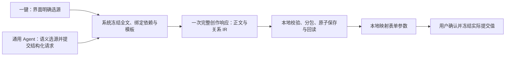

# 提示词生成统一实施计划

2026-11-17 后续用户确认：新任务移除通用模板，仅使用按产物类型的专项模板；历史任务保留冻结合同。当前决策和实施记录以[专项模板计划](./PURPOSE-ONLY-PROMPT-TEMPLATES-PLAN.md)为准，下文通用模板相关内容为前一版合同记录。

日期：2026-11-17。用户授权顺序：先审计，再形成方案，再实施；本计划记录本轮确定的业务边界。状态：源码、离线验证及四份隔离真实供应商验收完成；未覆盖当前安装实例。真实验收局限与调用用量见[真实验收记录](./code-traces/2026-11-17-prompt-generation-unification.md)。

## 审计结论

- `App.runProductionSkill` 已取得所选文档，但只把版本定位交给通用 Agent；`productionSkillPrompt` 仍要求模型读 Skill、取正文、开始候选包、切换用途，存在大量可以由系统完成的调用。
- `ProductionBundleService` 已提供候选、关系类型与源版本校验、原子保存及独立回读，应复用，不能再建一套业务存储。
- `PromptBindingIR` 已只表达关系；普通完整提示词字符串无需改为内容 IR。`sceneKey` 是剧情场次归属，`bindings.sceneDocumentIds` 是地点资料引用，二者必须分开。
- `useProductionAuthoring` → `production.compile` → `compileProductionParameters` 已本地生成表单参数；表单提交保留当前编辑值，媒体执行使用冻结参数，没有在该链路内补写提示词的 LLM 调用。
- 普通助手仍需系统目录、工具合同及按需检索。查询、小说写作、已有对象的显式 CAS 修改有各自职责；不能用关键词把全部业务强制切进提示词生成器。

## 目标合同

1. 一键制作由系统自动准备请求。普通 Agent 以结构化 `prompt.generation.request` 声明所选真实文档版本、复用资料及生成用途，然后进入同一个生成器。
2. 专用创作请求携带所选版本完整正文、已声明复用资料完整正文、原始用户要求、冻结通用模板和按用途标记的专项模板。只暴露结构化结果提交工具，不再要求理解系统目录或操作保存流程。
3. 正常路径一次返回全部完整提示词及显式绑定关系；Worker 生成分包键、版本、用途切换及封包操作。只解析字段、解析引用并保存，不从正文抽取或重写内容。
4. 校验包括 schema、唯一键、用途、引用类型/范围、来源版本、目标 CAS、事务与回读。它们不能证明创作语义正确。只有保存和独立回读通过才正常完成；失败不伪装为成功。
5. 超长输入不静默裁剪或摘要；遵守实际模型容量。模型截断、结构错误允许有界修复，不能把正常多轮补写藏在“一次生成”下。
6. 保存后按所选媒体模型 schema 本地映射技术参数；未选模型时不能预先承诺具体 Provider 字段。打开、刷新、切换模型和提交表单均不调用 LLM。保留手工覆盖与已冻结提交值。

## 表单参数的生成时点

| 参数 | 来源与时点 |
| --- | --- |
| 完整提示词、绑定、镜头预计时长 | 同一次创作响应返回并保存；绑定只做真实 ID 解析 |
| `prompt` / `content`、参考图与音色输入 | 打开/填充表单时，从保存正文和显式绑定本地映射到已选模型 schema |
| 比例、分辨率、水印等技术字段 | 从项目生成设置、模型默认值和用户表单选择本地适配；不从提示词正文猜测，不请求 LLM 补全 |
| 最终实际提交参数 | 以用户确认后的表单值冻结；提交时不再次创作或覆盖人工正文 |

因此“一次生成”指完整创作结果一次生成。选模型后的本地字段映射可以重复执行，不能把它误认为第二次 LLM 创作；尚未选模型时也不能预先冻结所有供应商专有字段。

## 与旧计划的关系

本轮用户选择将新的一键制作和显式提示词生成请求改为“一次完整创作响应”，替代旧模板修复计划中由模型串行切换用途的编排。专项模板按对象用途分区，同轮不把角色图片版式套入视频正文。历史任务继续按其冻结合同恢复；普通助手正文仍按需取，只有明确选源的专用创作请求自动注入这些来源。项目 SQLite、附件和草稿/正式规则不变。

## 实施顺序与验收

- [x] P0：审计并记录业务边界和本计划。
- [x] P1：共享请求/结果 schema、冻结源正文与模板、系统初始化候选包；测试真实版本、越界/过期、模板空值与完整正文。
- [x] P2：两个入口接入统一生成器；普通助手先选源；专用请求仅提交结果，两协议一致；保留历史任务兼容。
- [x] P3：系统分用途/字节分包、结构校验、原子保存/回读、幂等和有界失败；成功后本地结束，无额外模型收尾请求。
- [x] P4：回归表单本地映射及手工覆盖，运行聚焦测试及全仓质量门禁；记录真实供应商与运行实例验证边界。
- [x] P5：用户批准真实调用验收；用隔离 SQLite 和 Native Windows 凭据/HTTP 边界覆盖一键、通用 Agent 各两份独立样本，核对请求次数、完整正文与模板、绑定、回读、表单双模型映射、用量和媒体任务数量。覆盖范围小，不代表大规模内容稳定性或当前安装实例验收。

每阶段完成后在此补充实际执行的检查，不将模拟输出或历史记录写成本轮真实供应商验收。不自动安装或替换用户正在运行的应用。

## 阶段验证记录

2026-11-17：实施阶段 `prompt-generation.test.ts` 21 项聚焦用例通过，包括两入口 × 两协议 Worker 授权/上下文/保存集成、失败候选恢复与保存后0次模型收尾。真实验收前为动态用途 schema 增加越界 kind 和 requestHash 限定，聚焦文件现为22项并通过。空模板、完整正文、IR引用、回滚、分包、幂等与调用上限均覆盖。普通上下文/Runtime 94 项和媒体表单相关 71 项回归通过。

打包 Worker 两协议离线闭环通过：完整输入与模板、执行期间模板修改隔离、强杀重启恢复、结构错误整包回滚、修复后自然结束、无模型收尾请求、独立 SQLite 重开回读及无媒体任务。Rust 库测试 226 项通过，11 项 opt-in 验证未执行。构建通过，未安装或替换当前运行实例。

P4：实施阶段全仓 `pnpm test` 2,854 项通过（Worker 1,679、Desktop 887、其余包288）。后续真实验收修正动态用途 schema 后，整个 Worker 测试1,681项通过，`prompt-generation.test.ts` 22项通过；全仓 `pnpm typecheck`、`pnpm lint`、`pnpm format:check`、`cargo fmt --all -- --check` 与 `cargo test --lib` (226 passed / 12 ignored) 也复验通过。更新 Worker 的打包 sidecar 和 `validate:production-bundle-sidecar` 均通过。第一次全仓构建及其余门禁见[实施与验收记录](./code-traces/2026-11-17-prompt-generation-unification.md)。

四份真实样本只对其内容做有限人工核对，未执行长期稳定性、压力或性能对照，也没有验证超大制作任务的一次输出容量。结构通过不能证明剧情/画面质量全面正确；旧模板修复计划 R6 的历史真实问题仍继续保留。

2026-11-17 P5 真实验收：`ergou-gpt-chat` / 配置模型 `gpt-5.6-terra`；两份一键各1次模型请求并自然结束，两份通用 Agent 分别8和11次，其中创作提交各1和3次（后一任务在两次绑定/镜头引用校验错误后修复成功）。四份都在隔离项目完成业务写入和独立读回；选源正文及模板版本准确且无关文档正文未进入专用请求；提交提示词与各保存对象逐字一致，绑定 localKey 均解析到实际业务 ID。角色、地点、视频镜头、静态图的所选产物之间未发现已确认的服装/空间连续性冲突。四份的同一视频正文分别本地映射到两个视频适配器，结果相同且无校验问题；回读后及表单编译均为0模型请求。0媒体任务。最终四份合计21次供应商请求，配置模型报告 input 289,743 / cached input 123,442 / output 10,190 tokens。此前为厘清全请求合同和修正 schema 所作的隔离诊断另有30次请求，其中4个任务失败并被上限停止，未留下业务对象；诊断与正式四份合计51次、input 648,012 / cached input 231,434 / output 36,061 tokens。没有已证明的供应商定价，故不折算费用；完整请求数、逐请求用量、错误和内容见真实验收记录。模型人物五官细节仍偏概括，未把结构读回当作内容质量全通过；一键入口覆盖的是产品默认用途，不包含静态图。验收通过仅指这四份隔离样本和本次 Worker build，不表示物理点击 UI 或已安装实例生效。
