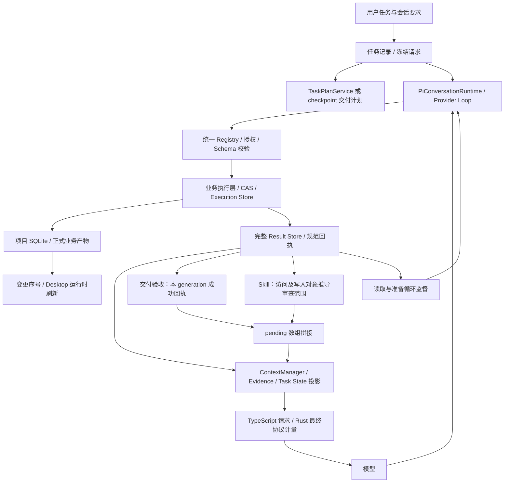
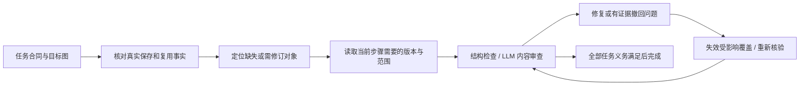

# Agent 业务架构复审：任务范围、验收、审查与长任务执行

日期：2026-11-06。性质：架构审计；本轮没有修改生产业务逻辑。

后续状态：上句及本文缺陷描述对应复审时点。用户随后授权先写方案再实施，已按[生命周期计划 R0–R6](../AGENT-EXECUTION-LIFECYCLE-IMPLEMENTATION-PLAN.md)推进；实际代码、兼容迁移、测试及未验证范围见[任务合同实施记录](./2026-11-06-agent-task-contract-delivery.md)。6 项缺陷脚本已转为修复回归；保留本文原始审计事实，不将历史结论冒充当前行为。

## 1. 结论

**是，当前 Agent 上层业务编排和验收存在架构问题。** 数据持久化、统一写入、结果回传、上下文管理已经有实质实现，但“任务到底包含哪些对象、已有产物怎样算完成、什么变化算进展、修改后应该重审谁”没有统一的业务定义。

多个模块分别计算自己的完成状态，最终把结果拼接交给模型解释。因此会出现：真实库里有镜头，交付计数仍为 0；任务声明要处理 11 镜，审查范围只有已读的 10 镜；模型可以增加不可撤回的逐字义务；审查已经产生有效进展，监督器仍按没有保存进展累计读取次数。

应调整这些职责与状态规则，复用现有 Runtime、ContextManager、Result Store 和 Execution Store。继续逐项加提示词、扩大窗口或者放宽重读次数，无法建立一致的业务闭环。

本报告覆盖 Agent 请求入口、任务计划、授权与工具网关、业务执行、SQLite 提交、工具结果、上下文投影、验收与审查、失败恢复、Desktop 刷新，以及 Rust 最终协议请求。它不是对资产库、媒体编码等全仓功能的逐文件审计。

## 2. 审计方法与边界

- 复核当前源码，不直接沿用先前两份报告的结论。
- 对截图对应项目 SQLite 使用只读连接及只读事务导出任务、请求账本、完整结果、工具调用和业务变更记录；没有通过 ProjectService 打开或迁移该真实项目。
- 用当前 Worker 源码运行 6 项隔离复现：内存 SQLite 加一个可丢弃临时项目，不访问用户项目，不调用模型供应商。
- 重跑相关现有测试 269 项，全部通过。通过表示这些已有行为没有回归，**不表示新发现的架构问题已经修复**。
- 工作区已有大量修改，本轮保留原状。新增内容仅为本报告和审计复现脚本。
- 现场导出保留于系统临时目录，包含业务正文，没有复制进仓库。下文仅列核查所需任务 ID、行号和统计。

复现脚本：[audit-agent-business-architecture.ts](E:/p22/xlngaiforwindowsP22/apps/worker/scripts/audit-agent-business-architecture.ts)。脚本断言当前缺陷行为，后续修复后应更新为相应回归测试，不能把“复现成功”计为“修复通过”。

## 3. 截图现场：本次不是预算超限

任务 `eca4b99f-edbc-468e-92aa-578425d9794c`，generation `b2ebe0bf-3f3d-4805-a369-e93af07bbdce`。

用户选择了一份真实剧本计划，执行 script-to-media：按需读取，复用已有资料，补全制作草稿与镜头绑定，不调用媒体 API，不发布、不请求审核。

| 项目           | 已确认事实                                                                                                       |
| -------------- | ---------------------------------------------------------------------------------------------------------------- |
| 开始／结束     | 2026-11-06 22:10:29 至 22:22:34，UTC+8，约 724.6 秒                                                              |
| 请求账本       | 71 条，均为 complete；70 条明确标记 requestKind=model，1 条未标记                                                |
| 工具调用审计   | 67 次，66 成功、1 失败；tools.load 不在此表计数内                                                                |
| 工具类型       | checkpoint 6、Skill 读取 4、项目上下文 1、结构查询 4、搜索 12、library.read 12、scene.read 2、production.read 26 |
| 本任务业务变更 | agent_resource_changes 为 0，没有执行业务写入工具                                                                |
| 内容审查提交   | 没有 operation=review 提交                                                                                       |
| 已有业务对象   | 4 场、11 镜、8 份人物／场景资料                                                                                  |
| 最终停止原因   | AGENT_REPEATED_READ_STALLED                                                                                      |
| 终态           | task.status=failed，phase=recovering；具体监督错误保存在 error_message 中                                        |

第一镜相同版本、相同结果读取 4 次，完整结果位于 agent_context_results 的 rowid 885、1045、1176、1275，版本均为 `d59d174903bde42a679144f84fb617eb7d5b0a3e2e33a38fa8f839baf8003773`。第 2～5 镜各读 3 次，第 6～10 镜各读 2 次，第 11 镜没有读取。

这说明**监督器确实检测到了实际重复读取**。不能将本次事件简单说成“四次阈值误判”，也不能把下面另行复现的“有效审查进展未被监督器识别”当作现场原因：现场根本没有审查提交。

### 同一任务中的验收冲突

模型最初把场次 ID 和镜头 ID 混填进结构交付项，被正确拒绝。随后 rowid 857 注册了一个镜头交付项：

- key 为 `script-to-media:episode-structure`。
- toolName 为 `scene.update_shot_prompts`，minimumCount 为 11。
- targetIds 为 11 个真实镜头 ID，requireReferences=true，requiredTexts 为 15 条台词。

终态任务状态同时包含：

| 检查来源       | 返回给 Agent 的状态                                                                                            |
| -------------- | -------------------------------------------------------------------------------------------------------------- |
| 交付项计数     | persistedCount=0、savedCount=0、remainingCount=11，全部目标与 15 条台词均记为缺失，nextAction=continue_outputs |
| Skill 完成检查 | semanticReview.ready=true，nextAction=review_outputs，reviewScope 为 18 份产物：10 镜与 8 份资料               |

最早在 **22:14:15，runtime.checkpoint.state 的 rowid 934**，Skill 已经 ready=true，当时只读过两镜，其范围是 2 镜加 3 份资料。随后每读更多对象，审查范围继续扩大。这不是固定 11 镜清单上的检查进度。

`ready=true` 本来只是“允许审查当前范围”，并不等于任务完成。问题是当前范围本身由访问痕迹推导，缺少与任务完整目标清单的核对。

### Token 和费用事实

最后一份请求：

| 口径                  | 数值                                                               |
| --------------------- | ------------------------------------------------------------------ |
| Worker 本地输入估算   | 62,800 Token                                                       |
| Rust 最终请求本地估算 | 104,510 Token                                                      |
| Rust 分段估算         | System 28,128、工具 Schema 23,160、消息 53,222                     |
| 实际请求体            | 225,373 字节                                                       |
| 输出预留              | 16,000 Token                                                       |
| 能力来源／处理方式    | fallback / advisory_fallback                                       |
| 供应商最后一轮 usage  | inputTokens=87,730，其中 cachedInputTokens=42,823；outputTokens=68 |

70 条 usage 累计 inputTokens=5,704,969、outputTokens=8,312。累计输入包含缓存和重复请求，不能视为新增正文量，也不能直接换算费用。

这些请求实际发出并完成了。本次没有触发旧的 `59,243 > 58,752` 本地拦截。当前 fallback 的 64K 是建议参考，不是已确认的供应商硬限制。

本次仍有大量政策、Schema 和任务状态反复发送，存在效率问题；两套本地估算也有偏差。**估算偏差、请求开销和本次业务循环是不同问题**，不能只修改预算数字来解释全部现象。

## 4. 当前真实架构



主要模块与现状：

| 模块                                              | 现有职责及本次判断                                                                   |
| ------------------------------------------------- | ------------------------------------------------------------------------------------ |
| pi-conversation-runtime.ts                        | 模型／工具循环、可见流、续接、上下文接线。应保留                                     |
| agent-provider-loop-service.ts                    | 授权工具执行、审计、请求状态、终态验收，职责较重；需要消费一致的业务状态             |
| task-plan-service.ts                              | 结构化计划及交付流程；需要与普通 checkpoint 计划共享业务语义，避免再造第三套计划服务 |
| agent-task-deliverables.ts                        | 模型计划、回执分配、计数、正文要求、完成检查；本次主要冲突点                         |
| production-skill-validation.ts                    | Skill 最低要求、真实对象核验、读回检查、审查范围；范围权威需要调整                   |
| agent-task-review.ts                              | 不透明 reviewId、版本快照、问题与解决记录、显式覆盖；已有实现应保留，补依赖关系      |
| agent-context-manager.ts                          | 状态持久化、完整结果归档、证据引用、请求投影、恢复和监督；需要当前业务步骤的工作集   |
| agent-context-budget.ts                           | 预算与循环监督两类职责同时存在；监督依赖的进展语义需统一                             |
| agent-system-tool-service.ts / DomainToolGateway  | 参数、身份与权限边界、统一执行接线；已有统一路径                                     |
| AgentExecutionStore                               | 本地业务事务、规范回执、重放／冲突、业务变化序号；应保留                             |
| AgentContextStore                                 | Task State、完整 Result、版本化 Evidence、检查点；应保留                             |
| ContextService / task-history.ts                  | 初始上下文编译与历史可见边界；历史取 12 条不能替代任务状态，但任务原文已有独立持久化 |
| app-settings-service.ts / model-context-policy.ts | 按模型的能力配置、来源与回退；不是所有模型统一硬卡 64K                               |
| llm_stream.rs / llm_context_meter.rs              | 最终协议组装、计量和已知能力校验；本地估算与供应商 usage 分开                        |
| AgentResourceRefresh / App.tsx                    | 按业务变化序号在任务执行中刷新，失败不确认序号；不是只在终态才保存／刷新             |

旧 `agent-task-context.ts` 已不存在；当前 Worker、Context、Persistence 源码没有 `workingEvidence` / `protectedEvidence` 两份旧正文区域。不能用旧实现描述当前架构。

## 5. 已确认问题与根因

### F1 · P1：验收依据偏向本轮写入，缺少“复用／核验”语义

位置：[agent-task-deliverables.ts:41](E:/p22/xlngaiforwindowsP22/apps/worker/src/agent-task-deliverables.ts:41)、[agent-task-deliverables.ts:485](E:/p22/xlngaiforwindowsP22/apps/worker/src/agent-task-deliverables.ts:485)。

计划主要描述 toolName、数量、目标 ID、引用与逐字要求。计数依赖当前 generation 的成功写回执；targetIds 固定对象，却没有单独表达“这些对象已经存在，本任务要验证、复用，只有确有缺陷时才修订”。

**隔离复现 A：** 数据库有一个真实镜头，登记该目标并读取后，persistedCount 仍为 0，nextAction 仍为 continue_outputs。现场正是 11 个真实镜头、0 本轮写入回执的形态。

这不意味着“只要数据库里存在就应该完成”：对象可能不满足用户要求，必须经当前版本与适用要求的可信核验。缺少的是明确的对象认领及验证路径，而不是跳过验收。

还有一处合同错配：计划给更新镜头的工具返回 creationBinding，并提示使用 outputId；[agent-business-execution.ts:96](E:/p22/xlngaiforwindowsP22/apps/worker/src/agent-business-execution.ts:96) 又明确拒绝此工具的 outputId。复现 A 同时验证了该拒绝。**现场未发生这种写入错误，不能把它认作实际失败原因。**

根因：用“调用什么工具并取得什么回执”替代了“用户要求怎样的业务结果”。

### F2 · P1：任务范围与审查范围不是同一个权威

位置：[production-skill-validation.ts:123](E:/p22/xlngaiforwindowsP22/apps/worker/src/production-skill-validation.ts:123)、[production-skill-validation.ts:327](E:/p22/xlngaiforwindowsP22/apps/worker/src/production-skill-validation.ts:327)、[agent-task-deliverables.ts:830](E:/p22/xlngaiforwindowsP22/apps/worker/src/agent-task-deliverables.ts:830)。

Skill 根据读／写记录寻找产物，读到哪个既有镜头，哪个镜头才进入范围。结构就绪条件要求范围内对象可用，没有强制与计划的完整目标清单一致。

`assessTaskCompletion` 将“模型交付项检查”和“Skill 检查”的 pending 数组直接拼接，没有统一协调这些检查的范围和依赖顺序。

**隔离复现 B：** 明确登记 11 个已存镜头，只读第 1 镜与完整来源，Skill 就返回 ready=true、reviewScope=[第1镜]。其余十镜没有进入该范围。现场最初 2 镜就绪、最后只覆盖 10 镜，与源码机制一致。

当前全局交付检查仍会拦住任务，所以不能说“已经漏验通过了整个任务”。已确认的是：**各检查器向模型提供了不同范围、不同含义的下一步，当前没有统一协调者。**

根因：访问审计同时承担了业务目标识别；任务范围不应取决于模型碰巧读过谁。

### F3 · P1：模型推断的义务与用户硬约束混淆

位置：[agent-task-deliverables.ts:90](E:/p22/xlngaiforwindowsP22/apps/worker/src/agent-task-deliverables.ts:90)、[agent-task-deliverables.ts:246](E:/p22/xlngaiforwindowsP22/apps/worker/src/agent-task-deliverables.ts:246)。

requiredTexts 可以由模型自行登记，没有要求其关联具体用户要求、来源和适用目标；登记后，即使提供 revisionReason，也不能撤回其中的误加文字。targetIds 和 requiredReferences 也存在只增不减的保护。

**隔离复现 E：** 模型自行增加一条逐字要求，随后明确说明误加并修订同一计划，仍报 Cannot weaken registered deliverables。

保护用户原始约束是必要的，但保护模型假设应该采用不同规则。模型对数量、目标、逐字文本、引用范围的错误推断需要可审计地修订，不能永久升级成用户命令。

根因：缺少要求来源和义务类型；不是所有计划字段都应使用同一不可弱化规则。

### F4 · P1：版本化审查有对象版本，没有产物依赖图

位置：[agent-task-review.ts:63](E:/p22/xlngaiforwindowsP22/apps/worker/src/agent-task-review.ts:63)、[agent-task-review.ts:149](E:/p22/xlngaiforwindowsP22/apps/worker/src/agent-task-review.ts:149)。

每份产物有自身 key，全局 dependencyHash 包含来源、要求和决策。这能处理自身修改、来源变更及未关闭问题，但无法表示“计划产物影响哪些镜头”“人物资料影响哪些绑定镜头”“前镜终态影响哪个后镜”。

**隔离复现 C：** 计划产物与镜头均显式通过后，仅更新计划产物的版本和内容哈希，reviewScope 只有计划，镜头仍保留覆盖。此复现验证失效机制，不声称已经证明某份真实镜头内容错误。

根因：产物之间没有可计算的依赖边；自身版本正确不代表与已变化的上下游仍一致。

不能通过“改一个无意义字刷新文档版本”解决。版本由真实业务修改产生；审查应根据实际依赖与变化失效，误报应有证据地撤回，避免无意义写入。

### F5 · P1：工作集、业务进展和循环监督采用不同标准

位置：[agent-context-manager.ts:667](E:/p22/xlngaiforwindowsP22/apps/worker/src/agent-context-manager.ts:667)、[agent-context-manager.ts:903](E:/p22/xlngaiforwindowsP22/apps/worker/src/agent-context-manager.ts:903)、[agent-context-budget.ts:507](E:/p22/xlngaiforwindowsP22/apps/worker/src/agent-context-budget.ts:507)、[agent-context-budget.ts:606](E:/p22/xlngaiforwindowsP22/apps/worker/src/agent-context-budget.ts:606)。

正常请求最多选最近 8 个工具轮次，恢复阶段更少。明确用户选择的原文和约束可以另外保留，完整结果也存在 Result Store；其他已读取正文主要依赖近期历史及按 ID 重读，没有当前业务步骤的完整工作集和逐项审查游标。

**隔离复现 F：** 已确认 1M 窗口且 11 轮短结果远未到容量限制，实际仍仅投影最近 8 轮，11 份完整结果均已持久化。这是任务相关选择不足，**不是完整数据丢失**；8 轮窗口本身也不能单独证明现场遗忘原因。

监督器按同证据键累计读取次数，真实写入或新用户指令会重置；新的不同资料只清部分准备／失败计数，不重置其他证据的读取次数。有效审查覆盖、问题关闭和计划纠错没有进入统一进展定义。

**隔离复现 D：** 三次不同目标的有效审查通过并持久化后，第四次读取相同来源仍触发 AGENT_REPEATED_READ_STALLED。现场没有 review 提交，因此这里只证明另一类合法任务可能遭遇的组合缺陷。

[recordExecutionDirective](E:/p22/xlngaiforwindowsP22/apps/worker/src/agent-context-manager.ts:138) 的续接基线同样主要观察提交、资源变化、新读取及要求数量，没有审查覆盖等进展。

根因：系统保留完整数据，却缺少“当前步骤需要什么”和“当前步骤推进了什么”的统一模型。不能只把 8 改成 32，或者把 4 改成 10。

### F6 · P2：终态与恢复语义不统一

位置：[agent-provider-loop-service.ts:4231](E:/p22/xlngaiforwindowsP22/apps/worker/src/agent-provider-loop-service.ts:4231)。

终止任务会写入 failed／cancelled 等终态，同时固定 phase=recovering。本次具体错误只出现在 error_message，error_code 为通用 failed。phase 名称并不能证明系统正在自动恢复。

现有 Runtime 能恢复检查点、完整结果和未完成工具状态，也有有界上下文恢复；不能说“没有恢复机制”。缺少的是基于业务步骤、已验证义务和类型化故障的统一恢复决策。重读监督状态持久化后，不能靠清空模型历史解除，应先修复导致无进展的业务状态，再有界恢复。

### F7 · P2：统一执行已有核心实现，工具语义仍靠名单

位置：[agent-system-tool-service.ts:160](E:/p22/xlngaiforwindowsP22/apps/worker/src/agent-system-tool-service.ts:160)、[agent-business-execution.ts:7](E:/p22/xlngaiforwindowsP22/apps/worker/src/agent-business-execution.ts:7)、[agent-business-execution.ts:126](E:/p22/xlngaiforwindowsP22/apps/worker/src/agent-business-execution.ts:126)、[agent-tool-registry.ts:17](E:/p22/xlngaiforwindowsP22/apps/worker/src/agent-tool-registry.ts:17)。

System 写工具已接入统一执行层，文档／结构创建、按 ID 的主要更新具有 Worker 业务身份；Domain 路径也使用 Execution Store。其他操作可能只取得 task scope，重放语义仍依赖工具类别和已有服务。

Registry 统一了风险、授权、执行通道和 Schema，尚没有完整声明业务操作身份、产生／消费的产物、恢复方式及可验证进展。创建工具名单、交付计数规则、进展工具名单分别维护，前述更新工具收到创建绑定就是这些规则漂移的具体例子。

不能据此声称所有工具都重复创建，也不能给外部媒体请求虚构本地事务能保证的 exactly-once。应在统一层逐项声明执行合同，保留外部提交 unknown 状态的核查规则。

## 6. 现场因果链与未证明部分

可确认的链条：

1. 用户允许复用，模型也表达了复用已有资料的方向。
2. 模型注册 11 镜的更新工具交付项；计划不具备可信的既有产物核验认领语义。
3. 本轮没有业务写入，所以交付检查始终报告 0／11。
4. Skill 同时将已经读到的部分产物认作当前审查范围，先是 2 镜，最后是 10 镜，允许审查这个子集。
5. 模型没有提交审查，也没有进行业务修改，而是不断重读同版本镜头。
6. 第四次相同镜头读取触发监督终止，任务失败。

已证实的是：任务定义与验收状态矛盾，以及实际无进展重复读取。不能仅凭日志证明模型每一次重读的内部原因。工作集退出、指令负担、模型执行能力可能共同影响，需要修复统一状态后再做业务对照验证。

没有证据证明本次数据因压缩丢失、供应商拒绝、余额不足、网络异常或真实 64K 硬限制导致失败。也不能证明当前运行进程所有模块与此刻源码逐字相同：现场缺少持久构建指纹；实际 Worker 的 dist 文件时间与任务起点接近，不宜武断归因“用了旧版本”。

## 7. 应保留的实现和不能重复报告的问题

| 能力          | 当前核实情况                                                                                                 |
| ------------- | ------------------------------------------------------------------------------------------------------------ |
| 三层分离      | Task State、完整工作结果／证据、模型请求投影已经分层，主要问题在跨模块业务语义                               |
| 完整工具结果  | Result Store 保存正文与 arguments；可 resultId 分页、按 hash 校验、按任务隔离读取，不只是审计摘要            |
| 工具结果回传  | Agent 能收到执行状态、必要关键字段和外置结果引用；需要正文时可读取，不应改成禁止结果反馈                     |
| 核心本地幂等  | 业务身份、同事务保存与回执、重复返回真实结果、冲突不另建已有实现                                             |
| 本地保存时机  | 核心业务写入即时提交，Desktop 按变化序号刷新；不能笼统说“必须整项任务结束才保存”                             |
| Evidence 版本 | 新版本替代旧 active、保留历史、防历史重放复活已有实现                                                        |
| 模型能力      | 按模型配置能力及来源，区分输入、输出、窗口；fallback 为建议，已知能力由最终协议层校验                        |
| 审查 v3       | 不透明 reviewId、显式 reviewedTargetIds、精确证据、问题 ID、修复与撤回、保留历史已有实现                     |
| 恢复          | 检查点校验、回退有效历史快照、未确认外部执行核查、完整结果恢复已有实现                                       |
| 动态工具      | tools.load 与按工作流策略选择已有实现；不能沿用“单独加载 document.submit_draft 必然灌入全部生图政策”的旧结论 |

上述不等于所有业务路径都完成了真实验收，但它们是应复用的基础，避免再次创建功能相同的服务。

## 8. 推荐的整体调整顺序

以下为建议，**尚未在本轮实施**。

### 第一步：统一任务合同和业务对象清单

复用 Task State、现有计划服务及交付记录，建立一致的任务合同投影：

- 用户原始要求／用户确认决策：保留来源，不允许模型自行降低。
- 模型计划与推断：版本化、可说明原因修订，保留变更审计。
- 每项义务明确 create／reuse／revise／verify，以及目标范围、适用要求和产物关系。
- 对已有对象显式认领真实 ID 和版本；Worker 核验存在性、范围、结构及适用证据，LLM 判断内容语义。
- 任务范围变化要记录计划修订，不能因为刚好读过某个对象就自动扩大或缩小范围。

验收：已存在且符合要求的 11 镜无需通过重复写入获得本轮回执；不符合要求的镜头明确进入修订，而不是全体记为不存在。

### 第二步：统一任务状态求值和下一步

保留交付检查与 Skill 检查作为专业校验器，统一输入同一目标清单，由一个协调入口输出一致的业务状态及下一步。



这里表达依赖顺序，不要求整集所有产物完成后才准保存或审查；独立对象可以边保存边核验，最终完成依据必须覆盖整个任务。

### 第三步：补审查依赖和义务覆盖

为来源、计划、素材、镜头、相邻镜头建立显式依赖。先做到对象级失效，再按需要细化字段；修改计划只失效真正依赖该计划的目标，不全局清空所有审查，也不保留未经证明仍有效的覆盖。

### 第四步：以业务步骤组织工作集与监督

当前步骤保存目标 ID、依赖版本、必要范围、未审项目、已完成覆盖及下一操作。ContextManager 根据它选择资料、工具和近期历史；完整正文仍从既有 Result/Evidence Store 按需取用，不默认灌全库。

由统一状态求值产生可信进展事件：成功业务提交、新有效目标认领、不同目标审查覆盖、问题实际解决／撤回、有效计划纠错等。重复同一事件不能算进展；单纯改写 checkpoint 说明不能重置监督。无进展时先做有限的状态修复，再按类型停止或保留可恢复检查点。

### 第五步：统一工具执行声明与恢复

逐工具声明操作身份、产物关系、结果和恢复策略，统一层决定重放／冲突／核查。清除创建与更新的绑定错配。补任务、generation、业务步骤和进程构建指纹，区分终止、待恢复、恢复中。

本地提交仍使用既有事务与 CAS，外部提交继续核查 unknown；不给每个工具单独发明去重逻辑。

### 第六步：用真实业务验收架构闭环

同一套“整集分镜提示词”分别验证新建、全部复用、部分修订、源资料变化、中途压缩、模型切换及 Worker 重启。核验完整目标覆盖、内容一致性、可见保存、幂等与恢复，记录真实请求数和输入输出；模拟供应商的脚本不能替代此验收。

## 9. 兼容与迁移风险

- 原始用户输入、正文、工具结果、旧版本、检查点、审查问题均保留；采用新增合同版本及兼容读取，不删除历史。
- 旧计划缺少意图／来源时保留为 legacy，不自动把模型逐字假设标为用户要求，也不把所有历史产物一律认领为本任务完成。
- 只有实际 ID、可信业务关系、当前版本和已有提交事实才可迁移绑定；不按标题相似度或正文相似度合并对象。
- 旧审查覆盖缺少依赖边时，不凭空宣称已满足新合同；保留问题与历史，针对必要目标补核验，避免强制重新生成全部产物。
- 新旧任务模式可先适配到同一求值接口，逐步收敛，不能让旧校验器和新校验器同时输出相互矛盾的权威状态。
- 不为“刷新版本”而修改有效文档；CAS 版本与审查快照 ID 分别管理。
- 检索仍遵守项目库既定规则：正文按需、草稿／正式同库且标记、附件不自动入索引、本地 SQLite。

## 10. 本轮验证记录

| 验证                          | 本轮结果                                        | 能证明什么                                                                               |
| ----------------------------- | ----------------------------------------------- | ---------------------------------------------------------------------------------------- |
| 真实失败现场只读核查          | 已核查上述任务、请求、结果、回执与状态          | 失败模式及验收矛盾真实存在；没有证明优化后业务成功                                       |
| 隔离审计 A～F                 | 6／6 复现成功                                   | 当前代码能稳定产生所述组合行为；没有修复生产逻辑                                         |
| Worker 七组相关测试           | 231／231 通过                                   | 预算、交付项、Skill、ContextManager、40 工具轮次归档、System 工具、Provider 网关已有行为 |
| Worker Runtime 与 Domain 网关 | 25／25 通过                                     | 当前流式执行及 Domain 事务等已有行为                                                     |
| Persistence                   | 11／11 通过                                     | Result／Evidence／检查点与 Execution Store 已有行为                                      |
| Desktop 运行中刷新            | 2／2 通过                                       | 刷新队列及失败后重试已有行为                                                             |
| 合计                          | 269 项，12 个测试文件通过                       | 不是全仓最终门禁，也不是真实模型业务验收                                                 |
| 审计脚本类型与格式            | 独立 TypeScript noEmit 检查及 Prettier 检查通过 | 仅验证本轮审计产物，不代表全仓门禁                                                       |
| 本轮新真实业务运行            | 未执行                                          | 没有新增付费请求；没有把模拟或旧业务结果说成此次验收                                     |
| 本轮生产修改                  | 未实施                                          | 本轮完成的是架构审计与证据交付                                                           |

命令在对应 package 目录运行：

```powershell
# apps/worker：隔离架构审计
pnpm exec tsx scripts/audit-agent-business-architecture.ts

# apps/worker：现有专项测试
pnpm exec vitest run src/agent-context-budget.test.ts src/agent-task-deliverables.test.ts src/production-skill-validation.test.ts src/agent-context-manager.test.ts src/agent-context-runtime-lifecycle.test.ts src/agent-system-tool-service.test.ts src/agent-provider-tool-gateway.test.ts --maxWorkers=2 --minWorkers=1 --testTimeout=15000
pnpm exec vitest run src/domain-tool-gateway.test.ts src/pi-conversation-runtime.test.ts --maxWorkers=2 --minWorkers=1 --testTimeout=15000

# packages/persistence
pnpm exec vitest run src/agent-context-store.test.ts src/agent-execution-store.test.ts --maxWorkers=1 --minWorkers=1

# apps/desktop
pnpm exec vitest run src/agent-resource-refresh.test.ts --maxWorkers=1 --minWorkers=1
```

## 11. 尚需后续验证

1. 完成上述统一业务合同与求值后，模型是否仍重读，以及每次读取对应哪个未完成步骤。
2. 外部 UI 修改资料后，所有 active Evidence 是否及时失效；当前已确认新读取／任务写入会处理版本，本轮未独立复现所有外部编辑路径，不列为已证明的现场根因。
3. 失败任务显式续接与同一任务恢复之间的要求继承：当前 completed 父任务的显式 follow-up 有继承逻辑，不能据此推断所有失败续接路径已经等价。
4. 各类媒体、章节、维护工具在统一执行声明中的覆盖范围，以及最终协议估算的跨模型校准效果。

本报告交付的是可复核的架构诊断与调整顺序。统一业务状态、实施迁移及完整长任务业务验收仍未完成，不能用本轮通过的测试代替这些工作。
