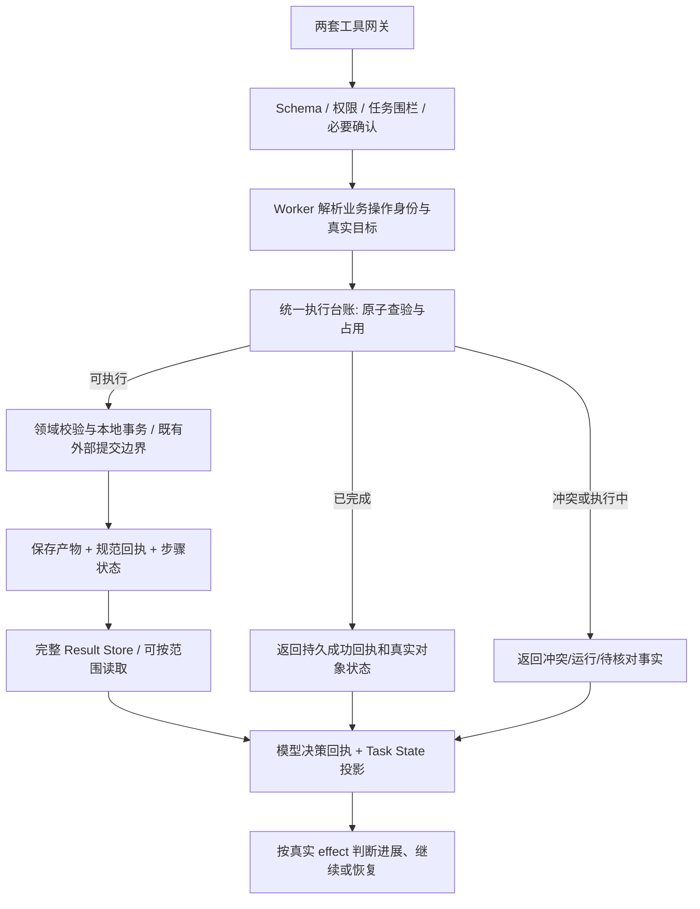

# Agent 业务执行架构审计（2026-11-06）

本轮按用户“先审计代码、不要让每个工具自行决定是否重复创建”的要求执行。只新增审计报告；未修改生产实现、项目数据、桌面程序或 Token 配置，未调用真实模型供应商。

审计基于工作区当前源码，HEAD 为 `f680f60b6e72c5692e7725cc49b420d4c8233c8c`。工作区有大量既有未提交修改，不能用 HEAD 单独代表本次审计版本。隔离复现使用当前源码、临时项目 SQLite 和模拟供应商配置。

## 1. 结论

当前系统已经有参数验证、Worker 授权、任务运行状态检查、事务、CAS、完整工具结果存储以及部分幂等实现。缺少的是**跨工具、跨调用、跨恢复的一致业务执行边界**。

三个需求的实际状态：

| 用户要求 | 当前状态 | 审计结论 |
| --- | --- | --- |
| 工具执行前校验参数、权限与当前任务状态 | 已实现，分布于网关、Provider Loop、领域服务 | 不能据此认为某个业务步骤已经完成就会被统一拦截或复用 |
| 创建前识别目标是否已存在，同一业务操作不能重复创建 | 部分实现，规则各异 | 尚未形成统一保证；直接场次提交重复创建已隔离复现 |
| 真实结果回传 Agent，由其据实决策 | 正常成功路径已实现，完整结果可持久化读取 | 故障路径存在“保存成功、回传失败”；结果、步骤状态、运行进展没有共同的事实契约 |

问题涉及业务身份、事务边界和状态一致性，独立于模型上下文窗口或 Token 阈值。本轮证据不足以把历史长任务的全部循环归结于其中任意一项。

## 2. 当前真实链路

```mermaid
flowchart TD
  A[PiConversationRuntime] --> B{request.mode}
  B -->|short-drama| C[DomainToolGateway]
  C --> D[TaskPlanService: ready → in_progress]
  D --> E[领域服务保存产物]
  E --> F[另行登记 deliverable succeeded]
  F --> G[另行登记 tool call succeeded]
  B -->|普通会话| H[AgentProviderToolGateway]
  H --> I[AgentProviderLoopService: 授权与运行态校验]
  I --> J[AgentSystemToolService]
  J --> K[文档 / 场次 / 镜头等领域服务]
  K --> L[各服务独立的复用与幂等规则]
  L --> M[工具回执与完整 Result Store]
  M --> N[ContextManager 投影给模型]
```

- `apps/worker/src/pi-conversation-runtime.ts:347`：只有 `request.mode === 'short-drama'` 使用固定计划链路。普通会话调用 `createProviderGateway(..., false, ...)`。
- 同文件 `:849`：`TaskPlanService.beginStep/recordStepSuccess/recordStepFailure` 只在 `planned=true` 时接入；当前普通链路不启用这些 hooks。
- `apps/worker/src/task-plan-service.ts:185`、`:223`：固定计划有依赖、ready 状态和 CAS 占用。
- `apps/worker/src/agent-task-deliverables.ts:46`、`:100`：普通会话另有模型登记交付项、从成功回执重算完成度的机制。这是验收/状态核对，不是执行前的业务操作占用台账。
- `apps/worker/src/agent-context-manager.ts:399`：根据上述验收结果维护 pendingSteps。

因此，已有 TaskPlan 状态机并不等于所有普通 Agent 写入都受它约束。固定计划的交付类型和普通会话的多产物任务也不能直接一一替换。

## 3. 已确认的问题与代码依据

### F1 · P1：调用身份代替了业务操作身份，无法统一阻止重复创建

普通系统工具重放查询位于 `apps/worker/src/agent-provider-loop-service.ts:1788`，按 `taskId + attemptId + providerStepId + providerCallId` 找回执。真实索引定义在 `packages/persistence/src/migration-v14.ts:535`。它解决同一次调用的重放，不能覆盖模型换 callId、换 step 或恢复后再次执行同一业务操作。

当前不同写入路径：

| 路径 | 当前身份/复用依据 | 边界 |
| --- | --- | --- |
| `document.submit_draft` | 同父任务、kind、title、scope、bindingRole、当前正文/hash；IR 深比较 | 精确相同可复用；正文或标题变化可另建；IR 不同会要求 CAS 更新 |
| `scene.structure.stage` | 项目 + 会话 + 模型提供的 executionKey | 同 key 可恢复；换 key 可新建 stage，没有共同业务步骤身份 |
| `scene.submit_structure` | 显式 sceneId 表示更新，否则 create；内含 shots 为新建 | 新调用重交无 sceneId 的相同内容会另建场次和镜头 |
| `scene.update_shot_prompts` | 项目会话 + taskId + 规范化请求 hash | 可精确重放、检查无变化、按真实 ID/CAS 更新；不是创建对象的稳定身份 |
| `scene.update_shot_timings` | 项目会话 + taskId + 请求 hash | 同上；规则仍在另一个工具服务单独实现 |
| 付费媒体提交 | 持久 job、提交幂等身份、确认与 submission_unknown | 应保留这一专用外部副作用边界 |

代码位置：

- `apps/worker/src/agent-draft-submission-service.ts:55`、`:284`、`:338`：artifactKey 默认依赖 toolCallId；已有精确正文复用，不应误报为完全无查重。
- `apps/worker/src/scene-structure-submission-service.ts:124`、`:138`：stage key 查重。
- 同文件 `:583`、`:600`、`:602`：直接场次提交产生 create items。
- `apps/worker/src/change-set-service.ts:139`、`:161`：saveDraft 创建新 change set 并应用，没有业务操作占位身份。
- `apps/worker/src/shot-prompt-service.ts:70`、`apps/worker/src/shot-timing-service.ts:61`：两套精确请求 receipt。

**已复现：**同一任务、同一场次/镜头参数，两次新 provider step/call ID 提交，均返回 `scene_structure_saved`，最终 2 场、2 镜，实际 ID 不同。Responses 与 Chat Completions 均复现。

**不能使用的替代方案：**按标题全局合并、按 taskId 限制一个产物、把正文 hash 当业务对象身份。标题可重名，一个任务本就需要多个产物，内容修订也不应偷偷变成新对象。

### F2 · P1：文档已保存，但结果校验失败时可向 Agent 报 rejected

`apps/worker/src/agent-provider-loop-service.ts:1973` 的顺序：

```text
外层 executeSystemTools transaction
  内层 transaction/savepoint：systemTools.execute → 业务写入
  内层 transaction 返回
  serializeResult → 可能抛结果校验异常
  catch → 记录 failed + rejected
  document.submit_draft 等分支 continue
外层 transaction 提交
```

结果序列化位于业务保存点之外。`:2010` 的 catch 对文档提交错误不重新抛出，导致已经释放保存点的业务变更随外层提交，审计和 Agent 回执却记录失败。

**已故障注入复现：**调用真实 `AgentSystemToolService.execute` 写入文档后，在返回对象增加 `Number.NaN`，让真实 Registry 校验抛 `AGENT_TOOL_RESULT_INVALID`。两个协议均得到：

- documents 中有 1 份已保存正文版本；
- agent_tool_calls.status 为 failed；
- 模型侧 continuation 输出为 rejected，不含成功保存的文档 ID。

这是对事务边界的隔离故障复现，**不是已证明历史现场存在 NaN**。首次试探使用 undefined，实际 Registry 会忽略该字段，未触发故障；随后改用确实不合法的非有限数值完成验证。

正确边界应当让本地业务写入、可持久化的规范回执、业务步骤完成在同一事务成立。传输投影失败必须能从已提交回执恢复；不得把“结果投影失败”直接描述为“业务没发生”。

### F3 · P1：固定计划链路的产物与完成状态分事务，恢复存在断层

`apps/worker/src/domain-tool-gateway.ts:250` 先占用 deliverable，`:255` 单独提交业务写入，`:324` 再调用 `recordDeliverableSuccess`，`:110` 的外层流程最后另行 `finishToolCall`。

**已故障注入复现：**真实保存大纲后，在 `recordDeliverableSuccess` 注入异常，关闭并重新打开临时项目：

- 正式工作数据仍有 1 份大纲草稿；
- deliverable 为 in_progress，entity_id 为 null；
- 工具调用为 failed；
- 去掉故障，用新 call ID 重试原操作，被拒绝 `The tool is not authorized for this deliverable state.`。

证明持久数据和状态机之间的间隙会留下“有产物却无法按步骤继续”的状态。该测试是异常注入与 SQLite 重开，未模拟操作系统级 Worker 进程被杀。

当前重启基础设施确实存在：`generation-service.ts:882` 恢复运行时，`handler.ts:866` 启动可恢复任务；ContextManager 也会提示检查无完成回执的调用。这些机制仍无法自动补齐上述领域对象与未绑定 deliverable 的事实关系。不能把这个缺口表述为“整个系统没有恢复功能”。

### F4 · P2：成功调用的重复执行，两套网关返回语义不同

- 普通执行：Provider Loop 查到旧回执时返回旧结果（`:1797`）。
- 固定计划：`domain-tool-gateway.ts:175` 查到 succeeded 后抛 `DuplicatePiToolCall`，而不是返回已有成功结果。该异常在 `beginToolCall` 中抛出，发生在本地 execute 的 try 之前（`:110`）。
- 现有 `domain-tool-gateway.test.ts:175` 明确期望同 callId 重复成功调用报 already completed。

已有数据不会因此重复创建，但 Agent 接收到的是异常，且不同路径对“已经成功”含义不一致。应由统一层回放已提交事实，并明确 reused/replayed，不要求模型靠错误文字猜测。

### F5 · P1：运行时进展依据新参数，不依据真实业务 effect

`apps/worker/src/pi-conversation-runtime.ts:137` 对工具名和 arguments 生成 hash；`:597` 的 afterToolCall 只检查 `!isError` 和 hash 是否首次出现，就设置 taskProgress。

包括 stage begin/put/checkpoint/finalize 的调用可被计为进展；没有读取结果中的 reused、changedCount、savedSceneThisCall、实际实体版本或验收缺陷变化。

`:1193` 停滞检查依赖这个布尔值和 continuation instruction 是否相同。更换参数或产生准备状态，未必推进最终交付，也可能使该检查继续放行。

这是静态代码确认的判定缺陷；本轮未用真实模型重演长任务，也未证明历史全部 164 次请求均由此触发。统一进展应允许可证明的中间推进（如新增已持久化分段），但重复 checkpoint、复用回执或无变化写入不应被当成新的业务推进。

### F6 · P2：结果回传已存在，但执行关键事实没有统一保留合同

`apps/worker/src/agent-provider-tool-gateway.ts:542` 取出相应 callId 的输出并返回模型；小结果可以原样回传。`:575` 的 details 固定为 completed，未区分新建、复用、无变化、部分成功、未知。

`apps/worker/src/agent-context-results.ts:56` 对大型结果持久化后投影，`:71` 的通用字段筛选通常省略嵌套 error、shots、sceneIds 等对象/数组。全文可以通过 resultId 按范围读取，**不等于完整资料丢失**；问题是没有定义哪些结果字段是当前决策必须立即保留的事实。

`AgentContextManager` 已使用更接近业务保存的判定及 `reused !== true`（`:213`、`:385`），与 Runtime 的参数 hash 进展判定又是一套规则。状态、模型回执与停止条件缺少共同来源。

### F7 · P2：Registry 尚未声明统一业务执行语义

`apps/worker/src/agent-tool-registry.ts:17`、`:64` 和 `packages/contracts/src/index.ts:1344` 注册 Schema、风险、确认策略与执行通道，没有业务操作身份、输出槽位、复用/修订/新增意图、恢复方式等描述。

因此执行器只有通用授权信息，业务服务只能各自尝试查重，Prompt 继续要求模型“先查有没有、沿用稳定 key”。这些提示可以辅助模型，但不能作为并发、恢复和唯一性的最终保证。

## 4. 已有保护与可复用基础

| 基础 | 当前能力 | 重构时用途 |
| --- | --- | --- |
| AgentToolRegistry / Provider Gateway | Schema、风险、确认、顺序写入/并行读取 | 保留安全检查，扩展业务命令描述；加载 Schema 仍不等于授权 |
| AgentProviderLoopService | 项目/会话/attempt/step 围栏，授权 CAS，占用运行任务，调用审计 | 在既有执行链上收敛统一入口，不重写 Runtime |
| TaskPlanService | 持久计划、依赖、步骤状态、CAS | 可复用步骤身份/状态迁移基础，但不能强制所有普通会话先套固定四类产物计划 |
| agent-task-deliverables | 持久计划声明与真实产物验收 | 保留业务验收，迁移为使用可信操作/产物绑定，避免再从两套回执推断不同事实 |
| agent_write_receipts | project + execution_key 唯一，保存请求与完整结果 | 优先评估增量扩展；当前缺占用、运行、未知、失败恢复状态 |
| 领域服务和 ChangeSet | 项目关系校验、草稿/正式边界、业务事务、真实 ID/CAS | 保留领域规则；统一层不替代领域校验 |
| AgentContextStore | 完整工具结果、Task State、Evidence、Runtime checkpoint | 完整结果存储和模型投影；不承担业务对象的唯一性裁决 |
| 媒体编排提交边界 | 持久 job、单次确认、未知提交结果处理 | 沿用既有 paid boundary，避免另建外部提交机制 |

关键保护依据：`agent-provider-loop-service.ts:1764`、`:4478`、`:4594`；`agent-draft-submission-service.ts:466`；`agent-provider-tool-gateway.ts:443`。

`agent_write_receipts` 表定义：`packages/persistence/src/migration-v62.ts:220`。现有写入与对应本地业务更新可以同事务完成，这是可复用的基础，不应再为每个工具创建另一种回执表。

## 5. 推荐统一架构（尚未实施）

统一边界放在 **Worker 的授权/任务围栏之后，领域业务写入之前**。两套网关都进入该边界。可从现有 Provider Loop 执行职责抽取公共实现，类名不是目标。



### 5.1 三种身份必须分开

1. **调用身份**：provider callId、attempt、step，用于传输重放、审计和授权，不决定是否新建业务对象。
2. **业务操作身份**：项目、持久任务/流程步骤、输出槽位/绑定目标、操作意图及明确修订关系。由 Worker 管理，跨 callId、模型、checkpoint、Worker session 保持稳定。
3. **内容版本**：请求 hash、正文 hash、CAS、产物版本，用于识别同请求、变更和冲突，不能单独充当业务身份。

模型可以建议计划、目标和新增意图；Worker 验证并分配稳定步骤/输出身份。不能允许模型仅换随机 executionKey 就绕过已完成输出。新用户任务、同名独立对象、用户明确另建版本又必须能够正常新建。

“创建前查询已有对象”由统一流程调用领域查询器取得事实，并结合持久绑定、目标版本作出 reuse/update/create/conflict 决定；不能把查询结果交回每个工具，让它各自选择规则。仅在 Prompt 中要求 Agent 先 search 也不能保证执行安全。并发安全必须依赖事务、唯一约束与 CAS，不能用一次普通 SELECT 代替。

### 5.2 权责分界

- **Registry**：声明操作类别、领域解析器、目标/输出身份契约、确认和恢复策略；不为每个工具另写判重算法。
- **统一执行层**：拥有业务身份映射、查验/占用、重放、冲突、完成登记和恢复的唯一裁决权。
- **领域服务/解析器**：读取真实对象，验证领域约束，执行 create/update 和 CAS，返回真实 effect；不再自行造幂等 key 和状态机。领域唯一约束仍保留。
- **ContextManager**：选择回传事实和资料引用；不决定业务是否执行。
- **Runtime**：消费可信回执继续任务，既不以新参数当完成证据，也不以 Context 摘要代替持久操作状态。

所有变更工具都必须声明并接入执行契约，不能在缺少契约时回退为直接调用领域服务。只读调用可以不占用写操作台账；确认/权限仍由原有 Worker 策略控制。不同协议仅负责调用格式适配，不应决定业务幂等语义。

无写入副作用的搜索/读取继续按当前目标版本执行，不因工具名和参数相同就全局缓存旧事实。

### 5.3 统一结果与进展

规范回执至少包含：operationId、业务步骤/输出身份、执行状态、effect、真实 target/artifact IDs 与版本、replayed/reused、完成/缺失部分、结构化错误、retry/reconcile 依据，以及完整 resultId。

要区分：created、updated、unchanged、replayed、partial、conflict、failed-before-write、unknown。上述名称是建议语义，最终字段应兼容现有业务 status。

Agent 每次必须收到足够决策的真实事实；大正文留在完整结果存储，并通过引用读取。没有写入、写入成功但投影失败、外部提交结果未知，这三者不能统一返回一个“失败请重试”。

Task State、进展判断、产物验收和模型回执消费同一份可信 effect。真正新增的持久分段/产物、有效修订、已修复的验收问题可以推进；重复回执、重复加载、无变化 checkpoint 不推进。当前验收不是只统计“保存了几份”。

### 5.4 本地事务与外部操作

- 本地 SQLite 写入：产物、业务操作完成回执、步骤/输出绑定应同事务提交；规范回执校验失败应回滚该次本地写入，或在已提交事实可恢复时返回明确状态。
- 已提交之后：网络/模型传输失败只重放/重投影持久回执，不重做写入。
- Worker 恢复：先 reconcile 操作、产物和步骤，再重建模型上下文；不能只回放聊天。
- 外部 API：沿用现有 job、提交幂等 key 和 unknown/reconcile。超时不能直接推断未执行，lease 过期也不能授权盲目重复提交。不能声称对任意外部系统实现无条件 exactly-once。
- 完成回执引用的产物被后续合法修改/归档时，应区分“历史操作已成功”和“对象当前状态”；不能用历史回执掩盖现在的 CAS/生命周期冲突。

## 6. 兼容迁移与旧逻辑退出

1. 优先扩展/收敛 `agent_write_receipts` 和现有计划/步骤基础；先确定共享权威模型，再增加必要字段/关联，不先建立多套同义服务。
2. 增量迁移，保留原始调用审计、结果、正文版本、历史计划。旧调用身份与新业务 operationId 建立可追踪关联。
3. 旧记录只有可靠目标 ID、步骤/输出绑定、有效回执才能自动关联。身份不明标记 legacy/unresolved，由真实对象和来源恢复；不按标题或语义相似自动合并，不删除重复历史资料。
4. 每条迁移过的写路径只保留一个幂等裁决入口。旧 key 可以作查找别名；不得让新台账和旧工具判重同时成为权威并各自写状态。
5. 普通会话与固定计划分别接入共享入口并验证，再移除领域服务里的私有幂等分支及 Runtime 旧参数 hash 进展分支。事务/CAS/权限/领域校验应保留，不能误当旧逻辑删除。
6. 付费媒体的确认与提交状态机由共享入口委托现有实现，不能因统一改造绕开用户确认或重复计费。

## 7. 建议实施次序与验收（本轮均未实施）

| 阶段 | 工作 | 必须先通过的验证 |
| --- | --- | --- |
| A | 确定业务身份、回执 effect、旧数据映射；扩展现有台账 | 同名独立对象、多产物、内容修订、旧数据不误合并 |
| B | 本地写入接共享执行边界，两网关同一裁决；移除对应私有判重 | 换 callId/step、相同 key 不同请求、并发、跨工具同一输出、CAS |
| C | 写入/完成登记原子化；恢复 reconcile；结果投影故障可重放 | 本轮 F2/F3 的故障用例转为验证正确行为；重启不重写产物 |
| D | Runtime/Task State/验收消费统一 effect，退出旧进展判定 | reused/unchanged 不推进，真实部分保存可推进，计划修订保留已完成绑定 |
| E | 有界真实整集业务验收 | 读取→生成→检查→保存，跨阶段/模型/Worker 恢复；人工质量检查及不重复保存 |

额外矩阵：业务已写但模型请求失败、完整结果回读、投影遗漏字段、确认复放、外部超时未知、任务取消、项目切换、归档/发布目标、源版本更新、用户明确另建、Provider 限流/余额/网络错误不误判成上下文问题。

不能以普通技术回归通过替代 E 的真实业务和内容质量验收。这里不建议通过调小/调大预算来替代执行修复。

## 8. 本轮验证结果与边界

| 验证 | 结果 | 证明范围 |
| --- | --- | --- |
| 既有文档提交专项，两个协议 | 6 passed、93 skipped | 精确正文复用、IR 冲突要求 CAS、不同内容/标题/任务独立 |
| 直接结构新 callId 重复提交 | 2/2 复现 | 同一任务相同结构创建了第二套真实对象 |
| 文档写后结果校验失败注入 | 2/2 复现 | 产物存在但 Agent 收到 rejected，审计 failed |
| 固定计划完成登记失败注入，SQLite 重开 | 1/1 复现 | 有产物、步骤 in_progress 未绑定，新调用无法继续 |
| 既有 DomainToolGateway 专项 | 1 passed、3 skipped | 多产物成功流程，以及成功同 callId 重放仍报错的现有合同 |
| 真实供应商/整集业务任务 | 本轮未执行 | 未产生付费调用，不声明真实业务验收通过 |

临时审计测试共 5 项通过，断言的是**现有问题能够复现**，不是修复通过。没有运行全仓质量门禁，因为本轮没有生产代码变更。临时测试已移出仓库，源码和日志保存在：

- `C:/Users/MSI/AppData/Local/Temp/p22-execution-architecture-audit-reproduction.test.ts`
- `C:/Users/MSI/AppData/Local/Temp/p22-execution-architecture-audit-reproduction.log`
- `C:/Users/MSI/AppData/Local/Temp/p22-execution-architecture-audit-tests.log`
- `C:/Users/MSI/AppData/Local/Temp/p22-execution-architecture-audit-domain-baseline.log`
- `C:/Users/MSI/AppData/Local/Temp/p22-execution-architecture-audit-manifest.json`

复现脚本的相对导入按 `apps/worker/src` 解析；需要复跑时，将保留脚本复制到该目录的临时 `.test.ts` 文件，再使用单 Worker 的 Vitest 命令运行。它仅建立临时项目，测试结束关闭并删除自己的项目目录，不接触用户项目。保留日志只包含隔离生成的 ID 和测试资料。

**交付状态：**架构审计已完成；源码依据和 3 类隔离问题已验证；统一业务执行重构、数据迁移与修复后真实业务验收尚未实施。
