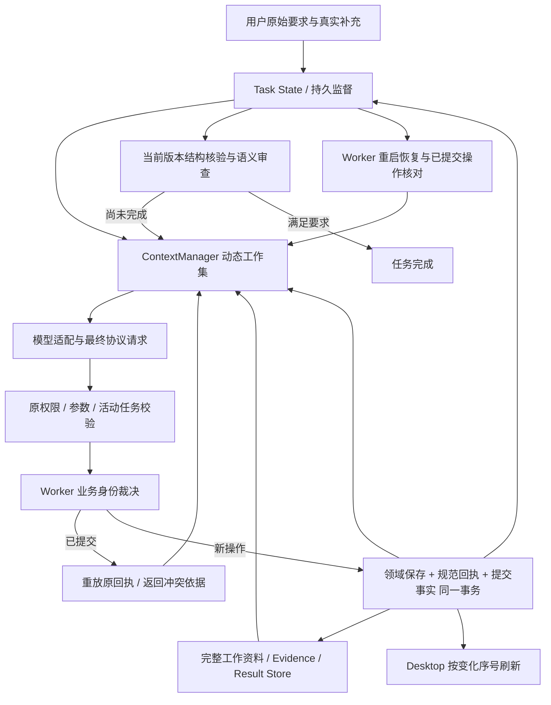

# Agent 统一执行与长任务生命周期实施记录

日期：2026-11-06。实施依据：[实施计划](../AGENT-EXECUTION-LIFECYCLE-IMPLEMENTATION-PLAN.md)、[业务执行审计](./2026-11-06-agent-business-execution-audit.md)、[长任务审计](./2026-11-06-agent-long-task-audit.md)。

状态：主体代码已实施，自动化质量门禁通过；P6严格真实业务未通过。本记录区分源码实现、隔离测试和真实供应商验证；尚不能据此宣布全部长任务已验收。

工作区原先已有大量修改和未跟踪文件。本次增量不等于整个 `git diff HEAD`；基线 HEAD 为 `f680f60b6e72c5692e7725cc49b420d4c8233c8c`，关键文件基线保存在 `C:/Users/MSI/AppData/Local/Temp/p22-execution-lifecycle-1l1EBM`。没有修改用户运行时项目，没有安装或替换桌面程序。

## 1. 问题与根因

| 审计问题 | 实际原因 | 本次调整 |
| --- | --- | --- |
| 换 callId 后重复创建 | 传输身份、正文 hash 和模型 executionKey 被当作业务身份 | Worker 持久输出槽位与真实目标/CAS 统一裁决 |
| 已保存却返回失败 | 业务写入、结果校验、步骤成功分事务 | 同步 SQLite 边界同时提交保存、回执和完成事实 |
| 重复准备和反复续执行 | 参数新颖、指令措辞和短期内存被当作进展 | 持久提交序号、有效证据、用户要求与监督基线 |
| 运行中说已保存、页面不更新 | Desktop 主动刷新绑定 generation 终态 | 已提交资源变化序号驱动执行中刷新 |
| 读取即视为质量通过 | 没有对应当前版本的语义审查记录 | 版本化审查清单、结论、问题和失效机制 |
| Pi 内存与快照持续增长 | 模型工作集裁剪未同步运行内存；每次重复完整快照 | 协议整组工作集、不可变引用与周期完整快照 |
| 生产任务无法保存用户要求的分析文档 | 将所有文档误限为 character/scene/prop | 保存普通辅助文档，真实制作完成约束继续单独核验 |
| 恢复后猜测输出 ID | 输出绑定仅存在于较早计划回执，未持续投影待办 | 待办携带 Worker creationBinding，身份错误返回当前合法绑定 |
| 分镜创建错误命中分析文档 | 兼容隐式产物被下一个显式调用认领，未验证实际交付分配 | 共同执行边界按已保存对象 ID 和交付分配认领，不按下一次调用猜测 |
| 交换同类型产物保存顺序后完成项错位 | 完成分配按保存顺序分配同类回执，未优先识别输出身份 | 完成检查优先使用Worker outputId归属，显式目标可共享，旧无身份回执保留兼容分配 |
| 已读取章节在短历史外消失 | 用户章名与检索的“编号+章名”完整标题不相等 | 已按需读取的章节核对项目内真实sourceId及规范标题，再选择有效版本正文 |
| 部分目标绑定占用其他输出 | 有任意 targetIds 就绕过整行归属检查，其他输出仍可补足数量 | 按每个真实对象检查输出归属；只有明确列出的共享目标可以跨项使用 |
| 只剩复核仍收到通用保存指令 | 制作完成检查不区分缺失结构、修复、读取与语义审查阶段 | 从当前提交与读取事实派生 nextAction；读回完成后提供当前 manifest 的审查入口 |
| 截止后取消报 SQL 错误 | 中断正文保留路径查询不存在的 attempts.ordinal | 按当前 assistant_message_id 绑定实际 attempt，使用真实时间字段排序；保留全文及身份回归 |
| 分段入口与计划声明互相拒绝 | 完成交付把一次提交/分段提交视为同类，输出台账却用具体工具名裁决身份 | 统一入口族契约；同槽位切换入口保留 outputId，已执行参数不同时返回原 stageId 冲突，不能另建 |
| 编辑已保存分镜可能补足缺失分析 | 归属只检查当前回执，按真实 ID/CAS 编辑的回执丢掉初次创建归属 | 从明确输出创建事实恢复资源归属，后续编辑沿用；显式 targetIds 仍可共享实际目标 |
| 多个分段输出先后完成时归属错位 | begin 使用outputId，后续保存只用stageId，最终scene回执没有直接输出槽位 | 根据begin的可信绑定建立stageId→输出归属，再传递到实际资源和后续CAS编辑；逆序完成回归先失败后通过 |
| 审查提交反复使用过期或缺位版本标识 | 拒绝回执没有当前可操作清单，state的动作混在分页旧记录中；模型反复复用旧hash | state实时投影顶层pendingActions；本轮改为不透明reviewId，Worker持久快照负责版本，不再让模型复制hash |
| 流程问题强迫修改正文、无关产物变化消除问题 | 自由字符串issues与全局artifactsHash同时承担流程和内容裁决 | 本轮以独立就绪状态、逐目标问题ID/版本、修复证据及误报撤回替代旧权威路径；真实验收另列 |

辅助文档、绑定缺失与误认领由真实业务复验暴露，分别保留失败记录；保存顺序与部分目标归属问题由回归先复现，章节问题由调用轨迹及清空历史回归核实。20分钟运行还出现反复读回后重写时长、未提交审查；通用指令与阶段不一致已在代码确认，但不能据此认定全部模型循环只有一个原因。取消SQL错误独立复现。最新构建再验收，不使用旧运行证明后续源码。没有扩大窗口或增加固定调用额度来绕过这些问题。

## 2. 重构后的链路

复用现有 Runtime、Registry、Provider Loop、Domain Gateway、TaskPlan、ContextService、AgentContextStore、项目 SQLite、CAS 和外部媒体 job。没有新建第二套 Agent 或检索库。

## 3. 实现与验证状态

| 能力 | 已实现 | 已测试 | 真实验证 | 尚未覆盖或限制 |
| --- | --- | --- | --- | --- |
| Task State | 原始要求、决策来源、待办、产物引用、恢复与监督分层持久化 | 压缩、重新构造 Manager、SQLite 重开、用户/运行时来源区分 | 普通业务已杀 Worker 后自动完成 | 未验证所有模型与协议的真实恢复 |
| Evidence Store | 复用 source/version/range/hash/resultId 引用，旧版退休 | 重复、更新、过期重放与多页证据 | 业务读取来源与恢复已有资料 | 本轮没有另建 Evidence 服务 |
| Result Store | 完整结果和参数留存，精简回执保留关键事实，按 ID/范围/哈希读取 | 大结果、失败参数、隔离与哈希错误 | 普通业务已有产物跨重启保留 | 历史只有摘要而没有正文的记录不能凭空补回 |
| ContextManager | 统一组装、任务状态与绑定投影、整组工作集 | 清空历史、工具批次与实际 Pi 40 轮 | 最新冻结v2严格业务恢复并自然完成，内容一致性未通过 | 最大单个工具批次可以超过目标消息数，以保协议完整；效率仍待优化 |
| Token Budget | 复用模型能力、输入/输出分离、来源与 Rust 最终请求计量 | 64K/128K/1M、切换、两协议及错误分类 | 本次请求分别记录估算与供应商 usage | 不把本地估算称为供应商精确 Token；本轮不扩大能力配置 |
| 统一执行 | 核心文档/场镜创建、阶段、提示词与时长更新；固定计划网关事务 | 两协议、换调用身份、冲突、序列化/完成登记故障、回放 | 普通保存与恢复通过 | 不是全部注册工具都已有语义重放合同，见第8节 |
| 运行中刷新 | 文档/场镜变化序号、合并、重试、作用域与 dirty 保护 | Desktop 运行中保存、项目切换及过期请求 | Rust 真实 Worker 验证执行中变化序号 | 完整桌面可视化人工验收尚未执行 |
| 语义审查 | Worker reviewId、就绪与内容分离、逐目标 issueId、修复／撤回、明确审查范围 | 过期／缺读、无关修改、部分审查、旧记录兼容及两协议集成 | 冻结v2构建真实完成问题登记→原位修订→关闭；独立内容核对不通过 | 随后v3取消默认覆盖全部目标，最终源码尚未另做真实供应商验收；模型语义漏项仍可能存在 |
| 检查点 | v2 不可变引用、配置复用、每16份完整快照、坏状态回退 | 损坏 JSON、结构残缺状态、损坏引用、历史兼容 | 普通业务强杀 Worker 后自动完成 | 当前行仍有完整状态；未设总存储配额 |
| 阶段交接 | 产物/证据引用与持久待办；不复制全篇到 System | 历史清空后无正文膨胀、版本退休、绑定恢复 | 普通业务含显式 checkpoint 与重启 | 超长原文多次模型切换的真实组合待扩展 |

## 4. 业务执行与幂等边界

`AgentExecutionStore` 复用 `agent_write_receipts`，新增输出绑定、提交事实、执行作用域和资源变化日志。新建用 Worker 签发的 outputId/index；修改用实际对象 ID 和当前 CAS；分段操作用真实 stage、页位置与版本。参数 hash 只用于校验同一业务身份下的请求是否一致。

相同操作回放原 ID/版本，`execution.replayed=true`。同一输出不同内容返回 `AGENT_BUSINESS_OPERATION_CONFLICT` 和已保存依据，要求按真实 ID/CAS 修订。明确新增对象必须有独立输出槽位。不按标题全局合并，不通过换调用 ID 新建另一份。

输出槽位已消费后不能缩减掉已提交部分；不同业务输出类型不能在同一槽位下切换。`scene.submit_structure` 与 `scene.structure.stage` 属于统一创建入口族，Runtime 根据请求大小选择入口不改变 outputId；新隐式调用也共享族身份，兼容查询先复用已有旧入口绑定。未将不同领域的 novel.episode 工具机械合并。一次提交与 begin 参数不同，已经执行后切换入口会返回冲突及原 stageId，不能再创建。后续分段操作继续由真实 stage/cursor/version 裁决。

隐式旧调用只允许一个显式槽位认领，认领依据是交付计算分配的真实对象 ID；登记计划及后续创建前统一核对，不能把分析认领到随后调用的分镜槽位。待办持续提供 creationBinding，恢复不依赖模型记住旧计划回执。已明确创建归属的资源在 CAS 编辑后继续归属原输出；只有显式列出的 targetIds 才可共享。两协议覆盖入口切换、begin 重放、禁止重复直接创建及隐式认领；资源编辑归属有先失败后通过回归。原“多个独立场次”测试改为两个明确输出槽位，仍验证一项未完成就不能结束，没有放宽隐式重复创建保护。

冻结空项目验收期间又复核了多stage归属链：分段后续请求不再带outputId，旧分配会把后完成的第二个输出算给第一个待办。新增逆序完成＋后续按实际资源编辑回归先失败，完成检查改为从begin的可信结果继承stageId归属后，交付测试42项通过。此项源码未混入正在运行的冻结Worker；最终重新构建和全仓复验后交付，真实范围明确为已运行构建的单个结构输出，不能声称多个分段输出已经真实供应商验收。

本地业务写入、结果序列化校验、固定计划交付绑定、回执及变化事实在同步事务内。失败回滚，不再出现新产物已提交却只留下 rejected 的正常故障注入路径。外部付费副作用继续使用既有 job/unknown/reconcile，不宣称跨网络的全局 exactly-once。

已移除迁移路径中以完整正文、标题或私有请求 hash 作为权威判重的旧分支，以及 Runtime 的参数新颖进展和续执行文本比较。保留的旧 key 是兼容映射，历史数据继续可读。

## 5. 数据迁移

项目迁移 v76 为增量迁移：保留旧表与正文，新增 `agent_execution_outputs`、`agent_execution_commits`、`agent_execution_output_adoptions`、`agent_execution_scope`、`agent_resource_changes` 及必要索引/观察触发器。

观察 documents/scenes/shots/scene_structure_stages 的真实 insert/update；仅时间戳或 row_version 变化不算业务进展。普通 UI 写入也可留下项目变更，未伪造 Agent 任务归属。执行作用域随同步事务恢复，不跨异步悬挂。

旧任务没有可靠业务绑定时不从标题或助手文字推断身份；要求先定位真实产物。旧完整检查点继续可读，新引用检查点与旧格式共存；最新记录损坏时逐条回退，不删除历史。仅有旧审计摘要的完整正文无法自动复原，必须如实报告。

降级重建测试会临时删除新版观察器后执行历史 DDL；真实旧 schema 升级时先清除不适用的未来观察器，成功进入 v76 后重建。没有通过删除用户表或旧记录来通过测试。不支持把已升级项目直接交给不识别 v76 的旧二进制写入；需要回滚软件时应使用升级前项目备份。

## 6. 测试与真实业务记录

阶段定向测试保留在临时目录，统计存在重叠，不能相加当成独立用例：P1 310通过；P2 134通过；P3 Desktop122通过；P4/P5 有52项专项通过；持久化全套100通过；实际 Pi 40轮/41次模型请求工作集回归通过。

最新全仓复验通过 **2,539项 / 220文件**：Worker1,459、Desktop812、Persistence100、GenerationAdapters80、Contracts48、LLM32、Context8；包含统一入口族、资源编辑归属、多stage逆序完成归属、部分目标归属、规范章节标题、阶段动作、取消保留与审查恢复修复。命令 `pnpm -r --workspace-concurrency=1 --if-present test --maxWorkers=2 --minWorkers=1`，退出0；日志 `p22-lifecycle-review-workspace-final.log`。测试前已完整构建依赖及最新Worker，真实验收期间冻结dist，因此没有使用会重新构建依赖的根 `pnpm test`。新增断言的类型安全写法经47项专项与lint复验通过，不改变构建业务代码。此前标准命令基线2,523通过；入口族修复前全仓2,532通过，统一入口族后全仓2,535通过，多stage归属后全仓2,536通过，均保留历史口径。

最新 Rust 全量 **203 passed / 5 ignored**（`p22-lifecycle-rust-acceptance-final.log`），包括验收脚本对表格镜号/标题镜号及数字边界的回归；此前生产代码全量202项通过。生产Rust源码未变，沿用该门禁。忽略项需显式调用真实供应商，不能计为普通门禁通过。最新全仓typecheck、lint、format:check及完整build通过；最新Rust格式和diff检查通过。日志为 `p22-lifecycle-review-{typecheck,lint-final,format-check,final-build,rustfmt,diffcheck}.log`（build实际文件名为`p22-lifecycle-review-final-build.log`）。最终记录修改后再核对文档格式与diff。五文件专项209项初次208通过、1项旧双隐式身份测试失败；明确双槽位后只因完成校验先返回计划待办而非旧提示失败，修改为核对真实待办与运行态后通过，并已纳入上述完整全仓复验，不以失败专项声称209全部通过。

真实任务均为隔离临时项目，使用当前 Rust host 和 Node Worker，设置通过只读 SQLite backup 复制、凭据通过既有系统边界取得。未导出凭据，未写用户项目，没有生成图片、视频或音频。

| 运行 | 结果 | 证据与限制 |
| --- | --- | --- |
| 普通完整文档业务 | 通过；241.42秒；强杀 Worker 后自动恢复，三份指定 plan 文档各一份，父任务自然 completed | `C:/Users/MSI/AppData/Local/Temp/p22-execution-real-HenyZ5`；验证文档业务，不等于严格制作审查通过 |
| 首次严格制作业务 | 未通过；582.04秒；55次模型请求；保存三份制作资料后停滞 | `C:/Users/MSI/AppData/Local/Temp/p22-structured-real-r9r1JF`；暴露辅助文档禁止保存的公共规则冲突 |
| 修正辅助保存后的严格业务 | 未通过；约246秒；31次请求；Worker 已恢复、三份指定 plan 文档保留，随后猜错输出 ID | `C:/Users/MSI/AppData/Local/Temp/p22-structured-fixed-HtCJ4i`；暴露待办输出绑定缺失 |
| 修正绑定投影后的严格业务 | 未通过；254秒快照、27次请求；分析文档跨重启保留，但分镜命中错误认领 | `C:/Users/MSI/AppData/Local/Temp/p22-bound-output-real-SNHrLC`；暴露兼容隐式产物认领错误 |
| 修正实际对象分配认领后的严格业务 | 未通过；20分钟截止；重启后3份指定plan各一份，独立资料与6镜/60秒已保存，无已提交语义审查 | `C:/Users/MSI/AppData/Local/Temp/p22-allocated-output-real-XI5gFt`；截止快照122次请求，SQLite124条记录，两种口径不得混同。取消又暴露SQL错误；此构建不含最后的标题/阶段等修复 |
| 完成归属、规范标题、阶段动作与取消修复后的严格业务 | 574秒快照时因一次/分段入口身份冲突停止测试宿主，保留原任务；不是自然失败或完成 | `C:/Users/MSI/AppData/Local/Temp/p22-final-lifecycle-real-lrGdaR`；原构建哈希 worker-build.json，原快照 live-report-before-tool-family-fix.json |
| 同任务加载入口族修复后恢复 | 任务自然completed；恢复段约778秒，累计执行快照1,351秒；generation/原分析ID不变，3份指定plan各1份/1版，1场6镜/60秒，两句原对白各一次，审查needs_revision后原地修订并passed | 同目录 acceptance-resume.log、worker-build-resume.json、resumed-business-verification.json。验收测试exit1源于表格镜号误判；不能记为opt-in测试通过。只读复核确认业务终态和数据；独立人工核对仍有末镜固定/后移运镜差异及旧镜头标题，不能宣称产物一致性全部合格 |
| 修正验收表格识别后从空项目启动 | 未通过；1,042秒，以AGENT_TASK_CONTINUATION_STALLED自然失败；当前产物已保存、待提交审查，但没有成功落库的review | `C:/Users/MSI/AppData/Local/Temp/p22-lifecycle-clean-real-sKgBky`；全程冻结dist，强杀Worker后恢复；三份plan各一份、1场6镜/60秒、对白各一次，仍不能算业务通过 |
| 审查恢复回执补修后从空项目启动 | 未通过；最后快照1,200秒，测试宿主20分钟截止取消，cargo exit101；非Runtime自然失败或完成 | `C:/Users/MSI/AppData/Local/Temp/p22-lifecycle-review-real-hbWsEY`；Worker实际强杀后恢复；三份plan各一份/一版、独立人物/场景/道具资料、1场6镜/60秒、有效引用保留；两次needs_revision落库，四镜原位修订，无passed复审。10份业务构建与Rust验收源码哈希一致 |

失败运行资料完整保留；失败不记为完成验收。业务用例还断言运行中 `resourceChanges.documentSequence>0`，并核对重启前后的分析文档 ID 相同。

空项目失败的只读核验在同目录`business-verification.json`：UI会计94次请求，SQLite96条、93条有usage，实际输入18,116–102,571 Token；没有本地64K拦截。错误包括过期hash及漏最后一位的63字符hash，不能归因于预算。最终ready=true、nextAction=review_outputs，仍无任何成功审查提交。新修复没有放宽64字符版本校验、完整读回或未解决问题检查，也没有自动批准或提高续执行次数。新增三项回归先失败，修复后gateway与production验证共47项通过；日志`p22-lifecycle-review-recovery-{before,after}.log`。全量build退出0，日志`p22-lifecycle-review-final-build.log`；最新typecheck、lint及专项日志为`p22-lifecycle-review-typecheck.log`、`p22-lifecycle-review-lint-final.log`、`p22-lifecycle-review-focused-final.log`。首次lint发现三处测试断言的any赋值，调整为类型明确的断言后复验通过，未改业务构建。

最新冻结空项目的机械核验为`business-verification.json`，独立内容审查与终态核验为`business-review.json`。UI快照108次请求；SQLite110条、106条有usage，实际输入16,066–100,696 Token，没有本地64K拒发。最后live快照是取消前streaming；数据库generation与父任务已由测试宿主取消，Context Task仍标recovering，不能混写成自然失败。没有该隔离目录的Node Worker残留。第一次needs_revision识别了第二镜缺船票引用、对白镜头分配与计划不一致等问题，随后原位修改镜2/3/4；第二次却把“需要刷新manifest”的流程说明登记成内容缺陷，当前hash已通过Worker验证，之后passed被TASK_REVIEW_UNRESOLVED拒绝。这说明可操作回执补修已支持实际审查提交，但尚未解决审查协议与内容问题混淆；继续修改镜1后截止，最终还缺该新版本读回和合格复审，不能算通过。

独立内容核对仍发现：两份计划的镜1可见周岚，真实镜1明确只让林澈入画；镜5计划为双人中近景/摇移，真实镜头为中景/横移；镜4仍保留旧“船票与目光”标题。完整prompt字面出现两句对白3/2次，其中包括负面约束和上一镜承接引用；实际dialogue节拍各一句，不能把全文字符串计数直接称为角色说了3/2次。没有生成音视频验证。模型把总时长要求自行登记成精确requiredText，又制造了不必要的字面修订；真实时长始终核算为60秒。内容检查、用户义务来源和审查问题建模仍有未完成项，本轮不再用反复付费重跑代替架构修正。

恢复运行的最终UI会计快照为104次请求，SQLite账本为107条、101条有usage，跨中断/attempt口径不同，不能混写。恢复段另有一次checkpoint参数流持续约288秒，最终以不完整JSON失败（Native错误诊断96,033字节，最后账本进度95,980字节）；它没有执行工具，现有有界参数修复随后成功提交短审查并自然结束。请求声明maxOutputTokens=16,000，finishReason未知，不能据字节数推断供应商真实输出Token或简单认定供应商忽略限制。该次失败未误分类为上下文超限，完整业务产物未丢失；其延迟仍属效率风险，不能说最新真实执行毫无循环或异常。

## 7. 本次增量文件清单

以下为本生命周期计划涉及的文件；许多文件在本轮之前已经修改，不能将其全部内容归为本次新增。

| 范围 | 文件 |
| --- | --- |
| 持久化实现 | `packages/persistence/src/migration-v76.ts`、`agent-execution-store.ts`、`agent-context-store.ts`、`database.ts`、`schema.ts`、`index.ts` |
| 持久化测试 | 同目录 `agent-execution-store.test.ts`、`agent-context-store.test.ts`、`database.test.ts`、`scene-character-repository.test.ts`、`production-lifecycle-migration.test.ts` |
| 合同 | `packages/contracts/src/index.ts`、`production-skills.ts` |
| Worker 统一执行 | `apps/worker/src/agent-business-execution.ts`、`agent-system-tool-service.ts`、`domain-tool-gateway.ts`、`agent-provider-loop-service.ts`、`agent-draft-submission-service.ts`、`scene-structure-submission-service.ts`、`shot-prompt-service.ts`、`shot-timing-service.ts` |
| Worker 上下文与监督 | 同目录 `agent-context-results.ts`、`agent-context-budget.ts`、`agent-context-manager.ts`、`agent-context-working-set.ts`、`pi-conversation-runtime.ts` |
| Worker 任务与验收 | 同目录 `agent-task-deliverables.ts`、`agent-task-checkpoints.ts`、`agent-task-checkpoint-schema.ts`、`agent-tool-definitions.ts`、`agent-provider-tool-gateway.ts`（审查参数恢复反馈）、`agent-saved-production-receipts.ts`（统一创建入口族）、`production-skill-validation.ts`、`document-workflow-service.ts`、`partial-artifact-service.ts`（取消时当前attempt定位） |
| Worker 回归 | 同目录 `agent-system-tool-service.test.ts`、`domain-tool-gateway.test.ts`、`agent-provider-loop-service.test.ts`、`agent-provider-tool-gateway.test.ts`、`agent-context-budget.test.ts`、`agent-context-manager.test.ts`、`agent-context-working-set.test.ts`、`agent-context-runtime-lifecycle.test.ts`、`pi-conversation-runtime.test.ts`、`agent-task-deliverables.test.ts`、`production-skill-validation.test.ts`、`agent-pipeline-remediation.test.ts`、`partial-artifact-service.test.ts`、`shot-prompt-service.test.ts`、`shot-timing-service.test.ts`（后者仅格式整理） |
| Desktop | `apps/desktop/src/agent-resource-refresh.ts`、`agent-resource-refresh.test.ts`、`App.tsx`、`App.test.tsx`、`use-document-workspace.ts`、`use-document-workspace.test.ts` |
| 真实业务测试 | `apps/desktop/src-tauri/src/context_e2e.rs`（保留先前长输入用例，新增本轮恢复/严格审查用例） |
| 计划/记录 | `docs/AGENT-EXECUTION-LIFECYCLE-IMPLEMENTATION-PLAN.md`、本文件；既有统一上下文与检索计划只同步实施状态 |

## 8. 剩余风险与未完成范围

1. 语义重放已覆盖上述核心文档与场镜写入。其余同步工具接入共同事务/任务归属，但尚未全部声明稳定业务身份；不宣称所有工具已实现跨调用 exactly-once。媒体付费任务保留原有专用幂等协议。
2. 审查由模型判断语义，Worker 核查版本、完整读取、结论及问题状态。本轮已替换字符串／全局hash裁决，按目标绑定issueId和修复证据，详见第9节。程序核验引用存在和范围，不能据此保证模型判断正确；尚未实现独立的第二审查模型。
3. 输出绑定当前校验工具和槽位，documentKind 仍由原参数/领域与交付验收验证，没有成为输出台账的独立不可变字段。
4. 检查点引用结果校验 hash；历史完整状态主要使用 JSON/结构校验，没有为所有旧快照增加独立校验和。Task State 当前行、证据索引和资源变化日志仍可能随长期使用增长；未实施历史删除或磁盘配额。
5. Desktop 的小说元数据监听仍经既有异步事件，刷新协调器只确认其直接文档/场镜查询；任务刷新 Map 在项目会话切换时清空，没有长期同会话容量上限。
6. 真实供应商验证只覆盖当前可用模型/协议与文本业务。不同供应商、真实限流/余额/网络故障、超长原文和连续多次模型切换，不能由单元测试或短任务替代真实验收。
7. 尚未打包安装、重启或人工验收用户桌面程序。本次源码与构建通过后，运行中的旧应用不会自动获得修改。
8. 先前恢复运行证明审查能发现问题并触发原地修订，但人工仍发现跨文档/真实镜头的运镜差异和旧标题。本轮移除全局artifactsHash裁决，不能由此保证同一模型不会漏项；完整内容一致性尚需真实核对。
9. 恢复后的Task State在运行期仍标recovering，直到终态才转completed；不影响当前恢复推进，但中间状态表达仍待细化。一次无效checkpoint参数流耗时约288秒后有界恢复，说明自然结束不等于效率达标。
10. 上次真实运行证明自由字符串会把版本／读取问题固化为必须修改正文的义务，全局hash又只要求任意产物变化。本轮对应实现及隔离回归已完成，严格供应商验证另列，不能将实现等同于真实业务通过。
11. 时长、数量和逐字文本义务尚未完全类型化并绑定来源/版本/确认状态；模型自设requiredTexts可能比用户实际要求更苛刻。不能通过自动删除用户要求修复，必须保留原始义务与可追踪修订。
12. 上一轮截止取消后，llm_generation和父任务已cancelled，但Context Task仍recovering；跨状态投影的取消同步尚未修复。该轮严格业务20分钟/108次请求未完成；最新冻结v2运行自然完成，不能由此认为取消状态及效率问题已解决。

这些限制不会通过扩大 Token 数字、减少用户要求、移除真实场镜验收或假报成功来掩盖。

## 9. Worker审查快照与逐问题闭环（本轮增量）

用户确认后实施，复用原Worker/Context Store/授权事务，不新增平行审查服务或数据库。新增`agent-task-review.ts`仅封装这一权威路径，`production-skill-validation.ts`负责实时业务事实，checkpoint负责原任务权限与提交入口。

### 已实现

1. **快照**：完整Result Store中保存`task.review.snapshot`不可变对象。内容含目标ID／类型／版本／hash、源版本、用户要求与确认决策；内容未变时复用同一reviewId。是否读完与是否就绪独立计算，读分页不会改变内容快照身份。支持通过既有result范围读取和完整性验证恢复。
2. **系统状态**：过期reviewId返回`TASK_REVIEW_STALE`，缺读／结构不合法返回`TASK_REVIEW_NOT_READY`；不保存内容缺陷，不改正文。错误回执仅给简短当前ID／动作与state指引，不回显全套正文或审查依据。
3. **内容问题**：模型提交`targetId/category/description/evidence`；Worker验证目标属于当前快照、引文确实存在于当前引用资料／用户要求／目标中，签发稳定issueId并保存目标版本。模型不提交版本／hash。
4. **闭环**：问题不会因任何其他产物变化自动消失。`resolved`要求该目标版本变化、当前读回完成，修复证据必须引用该目标；`withdrawn`允许模型根据问题目标／原引用的依据解释误报，无需修改正确正文。两者都有issueId、理由与完整依据，原缺陷记录保留。
5. **局部覆盖**：按目标保存已评估版本及资料依赖。修订一镜后仅将变化目标和仍有问题的目标列入reviewScope；源资料／用户要求／确认决策变化时保守失效相关评估，当前实现会使该审查范围内全部目标重新评估，未实现字段级依赖图。
6. **重放与恢复**：同一评估的重放不重复推进状态，也不会复活已关闭问题；SQLite重开恢复相同快照和issueId。失败事务不丢正文、快照或原审查。
7. **协议**：新工具Schema只宣告reviewId与结构化问题／resolutions；两种API协议复用相同入口。大型回执保留pendingActions及问题控制字段，完整依据仍可按resultId读取。真实Rust验收提示也改用reviewId。

### 兼容迁移

无DDL变更，复用v75结果表，不删除／覆盖旧记录。旧审查hash不再成为当前裁决依据；旧passed必须重新审查当前快照，旧needs_revision字符串投影为legacy问题，显式引用当前资料重新评估后撤回。因为旧问题没有可信目标／版本，不能伪造“修复完成”直接解除。旧工具参数被Schema拒绝并引导读取当前state；新Worker与工具定义共同更新。运行中的旧桌面应用仍需后续正常重启／部署才生效，本轮未安装用户程序。

### 测试与真实验证

- 新回归先失败后实现：缺少Worker持久reviewId、无关修改、误报撤回三类复现见`p22-review-v2-red.log`。
- 审查／真实网关专项58项通过；其中生产验收27项、网关31项，见`p22-review-v2-focused-final.log`。
- 两种协议各一条真实授权／SQLite业务集成通过：6镜60秒已保存产物，读取→登记两个问题→仅修订镜2→当前版本读回→解决镜2／撤回镜3误报→完成检查不再待审；镜3版本未变、镜头总数仍6。见`p22-review-v2-business-integration.log`。这是脚本驱动的业务集成，不能冒称真实模型验收。
- SQLite文件重开、跨项目／任务ID拒绝、引用范围、部分闭环、旧记录迁移、失败事务、大型回执均已测试。
- 全仓首次运行有一项未修改前端路径的语音引用测试失败；单独23项及Desktop全套812项复跑通过，保留首次失败，不改该业务源码。
- 完整构建、Worker最终构建、typecheck、lint、修改文件格式和diff检查通过。Rust全量203 passed／5 ignored，见`p22-review-v2-rust-all.log`。
- 本轮各包最终合计2,552项／220文件通过：Worker1,472、Desktop812、Persistence100、Adapters80、Contracts48、LLM32、Context8。Worker见`p22-review-v2-worker-all.log`，Desktop见`p22-review-v2-desktop-all.log`，其余见`p22-review-v2-packages.log`；首轮递归在前端失败处停止，不能将该次命令写成整体通过，最终结果来自各包完整运行。
- 本轮真实供应商复验在独立目录`C:/Users/MSI/AppData/Local/Temp/p22-review-v2-real-mcSUUZ`执行；13个构建／验收文件哈希冻结，包含真实Worker强杀恢复；自然完成，但独立内容一致性不通过，并暴露隐式全量覆盖问题，详见第10节。原20分钟失败与长输入失败继续保留，不能被本轮专项测试覆盖。

本轮增量文件：Worker的`agent-task-review.ts`、`agent-task-checkpoints.ts`、`production-skill-validation.ts`、`agent-task-checkpoint-schema.ts`、`agent-tool-definitions.ts`、`agent-provider-tool-gateway.ts`、`agent-context-results.ts`；测试`production-skill-validation.test.ts`、`agent-provider-tool-gateway.test.ts`、`agent-provider-loop-service.test.ts`；Rust验收`context_e2e.rs`；现有实施计划及本记录。原工作区其他修改不归入本轮。

## 10. 冻结供应商复验及明确审查范围补修

### 真实运行结果：执行闭环通过，业务一致性未通过

2026-11-06隔离验收：`context_management_real_structured_review_with_worker_restart`，Rust退出0，测试用时1,010.22秒，业务摘要耗时1,008秒，generation、父任务及Context Task均自然完成。UI会计77次请求、SQLite账本79条、76条有usage，供应商实际输入范围16,277–96,473 Token；不同恢复/attempt口径不可混写。未扩大模型能力配置，没有把未知窗口当作硬能力，更不能用供应商接收超64K推断其精确窗口。

- 三份plan各一份，独立人物／场景／旧船票资料各一份，1场6镜，总时长60秒；剧情分析保存后真实强杀Worker并自动恢复，未重复创建文档或镜头。镜1原位修订，其他镜头ID及版本未变。
- v2审查保存一条具体consistency问题，绑定镜1版本及两份计划的原文引文；随后修订镜1、读回新版本，以原issueId和修复引文关闭，未用“刷新版本”要求修改正确正文。真实任务未测试误报撤回，该能力由两协议业务集成验证。
- 有9次工具错误，分别涉及计划targetIds、两次材料目标参数、一次partial被拒、一次无效检索句柄、一次生产读取版本以及两次过期reviewId、一次不精确引文。错误后均继续推进，未误报为上下文超限；不将这次运行描述为无异常或高效。
- 整轮13个构建／验收文件哈希保持一致，终态只读导出为`business-verification-final-frozen.json`；初次结构另存`initial-structured-output.json`。补修在终态之后才开始，没有中途替换构建；隔离目录没有残留Node Worker进程。

独立核对发现最终实际镜头时长仍是8/10/12/10/8/12，两份计划为8/10/10/10/10/12；计划将两句对白安排在镜3/4，实际dialogue节拍在镜4/5；计划镜5转向海面、镜6拉远，实际镜6才转身并侧移。镜1修正后镜2仍保留再次入场的动作。因此即使Runtime返回passed、Rust验收通过，完整业务一致性仍不通过。两句真实dialogue节拍各一次；prompt内承接／负面约束的字面重复不等于人物重复说话。

### 根因与已实施补修

真实第一次审查摘要明确说其他五镜尚待检查，却因提交一个问题而获得其余全部目标的coverage。根因是Worker从“没有被报告问题”推断“已经审查通过”，没有显式的本次评估范围，导致只修一镜即可完成。这与审查ID过期和Token预算是不同问题。

最终事件协议v3要求`reviewedTargetIds`：必须是当前reviewScope内、非空且不重复的目标。仅明确声明已评估且无未解决问题的目标获得coverage，未列出的目标继续待审；单次passed不等于整项任务完成。新问题和问题关闭都必须属于本次明确评估范围，legacy无目标问题保守保持复核范围，避免无法重评。大型回执继续返回这些控制字段。

兼容采用增量解释而不改写历史：保留v2问题ID、修复和撤回事件，但不信任其隐式coverage；旧passed需明确重新评估，不要求为了刷新状态修改正文。v1自由文本问题仍保留legacy重评。无需DDL迁移，未删除旧正文、结果、问题或检查点；新Worker与工具Schema需要一起更新。

### 验证边界

- 已实现：明确评估范围、部分审查、范围／问题一致性、v2覆盖保守迁移及legacy可重评；未新增平行服务、私有判重或第二套数据库。
- 已测试：新增部分审查、无范围／重复／越界、旧v2覆盖迁移三项回归；已有问题生命周期、失败事务、重放及SQLite重开继续保留。两协议真实授权／SQLite业务集成改为只审两镜、修复／撤回后其余仍待审，明确审完剩余目标才完成。
- 真实验证：第9节快照与问题闭环使用冻结v2构建自然完成；上述内容差异保留。v3补修在终态之后实施，没有再次付费调用供应商，因此不能用这轮真实运行证明最终v3业务通过。
- 尚未完成：任意长任务效率与完整语义一致性验收、字段级产物依赖图、义务类型化、取消状态投影和完整桌面人工验收。显式范围能阻止程序默认批准未声明目标，不能保证模型已声明的语义审查无遗漏。

最终门禁：v3专项220项、Worker全量1,475项／91文件通过（`p22-review-v3-focused.log`、`p22-review-v3-worker-all.log`）。最终Rust全量203 passed／5 ignored（`p22-review-v3-rust.log`）；Worker构建、全仓typecheck、最终Worker typecheck、全仓lint、修改源码最终lint、格式与diff检查均通过。此前未改动包的完整结果继续保留，合计最终覆盖2,555项／220文件；不是一次根命令的新运行。构建与检查日志为`p22-review-v3-build.log`、`p22-review-v3-typecheck.log`、`p22-review-v3-typecheck-final.log`、`p22-review-v3-lint.log`、`p22-review-v3-lint-final.log`、`p22-review-v3-format-check.log`。未打包安装用户程序；最终v3供应商业务验收尚未执行。
