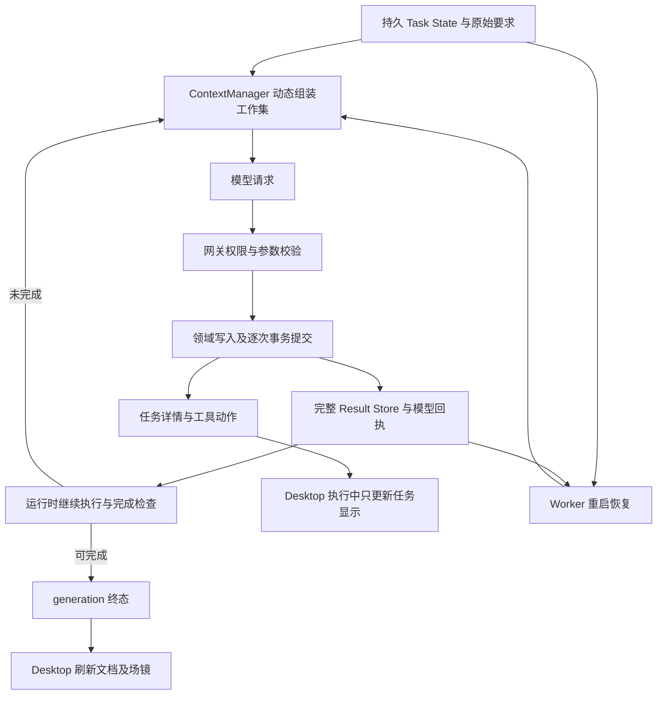

# Agent 长任务专项审计（2026-11-06）

本轮执行用户“再做一个专项的长任务审计”的要求，并核查新增现象：执行中助手已说“保存”，但文档／场镜页面似乎要等整个任务结束才更新。

本轮只审计当前代码、只读复核既有冻结运行、执行隔离测试并形成报告。未修改生产实现、项目数据或 Token 配置，未重新调用真实模型供应商，未安装、替换或重启用户桌面程序。隔离复现通过表示问题或保护得到复现，不表示修复完成。

审计仓库为 `E:/p22/xlngaiforwindowsP22`，HEAD 为 `f680f60b6e72c5692e7725cc49b420d4c8233c8c`。工作区包含大量既有未提交修改，审计版本是当前工作区，不等同于 HEAD。关键源码、测试脚本、日志与冻结证据的 SHA-256 见本文末尾的证据清单。

## 1. 结论与新增现象

当前系统已经分离了持久任务状态、完整工具结果／证据与模型工作集，也具备活动任务恢复和有界请求恢复。主要缺口是：**业务提交事实、任务进展、完成验收、跨重启监督和界面可见性尚未形成一致闭环。**

新增现象已定位到当前 Desktop 源码：正常工具执行会逐次提交 SQLite，界面却把文档和场镜的主动刷新绑定到了 generation 终态。执行中收到成功动作及 `productionUpdated=true`，只更新任务显示，不刷新资源页面。场镜隔离测试已复现；文档列表同样位于该终态收尾函数内。

因此，应区分“后台保存完成”和“当前界面显示最新版本”。不能根据助手文本或静态截图判断实际提交时间；本轮没有读取截图对应用户项目的数据库，不能声称该现场每次保存都已查证。

长任务方面，现有停滞判断仍依赖续执行指令文本和部分内存历史；完成检查能验证真实产物、版本回读和结构，但没有持久的业务语义验收结论。调整上下文窗口或 Token 阈值无法补上这些执行机制。

## 2. 证据分层与范围

| 证据 | 用途 | 限制 |
| --- | --- | --- |
| 当前工作区源码 | 判断现在仍存在的实现问题及已有保护 | 与旧冻结构建不同 |
| 当前源码隔离复现 | 验证明确条件下的行为 | 模拟供应商，不等于真实业务验收 |
| 既有冻结业务运行及 SQLite | 复核长任务轨迹、数据保留、业务质量 | 旧构建，人工止损，不是自然终态 |
| 用户截图 | 确认用户观察到的保存文案和页面状态 | 无精确提交／刷新时间，不能代替现场数据库 |

前一轮[业务执行架构审计](E:/p22/xlngaiforwindowsP22/docs/code-traces/2026-11-06-agent-business-execution-audit.md)已验证统一业务身份、幂等和事务边界的缺口，本报告直接复用其结论，不把这些当作本轮新发现。特别保留用户要求：**执行结果必须回传 Agent，让它据实决策；不能由每个工具各自决定是否重复创建。**

## 3. 当前真实生命周期



这里不存在“所有工具写入统一等任务结束才提交”的正常执行设计。问题之一是资源刷新沿终态路径传播，已提交变化没有沿同一事实及时通知资源页面。

## 4. 当前仍存在的问题

### L1 · P1：运行中保存的产物没有及时进入界面

代码依据：[App.tsx](E:/p22/xlngaiforwindowsP22/apps/desktop/src/App.tsx:1470)。

- `startAgentTaskEventPolling` 每 400ms 获取任务事件和详情；约 1505 行收到详情后只调用 `rememberAgentTask`。
- `refreshAgentDocuments`（1574 行）由 `agentDocumentRefreshStarted` 保证每 generation 只执行一次，承担终态刷新及导航。
- `production-source-updated`（1609 行）和文档列表刷新（1634 行）位于这个函数中。
- 初始 generation 已终态或 `onState` 进入非活动状态时，才调用该函数（1661、1709 行）。`onLiveActions` 只更新动作展示。
- 场镜页面监听 `production-source-updated` 才重新查询数据（2580 行起），执行中的保存回执不会触发这一链路。

**隔离复现：**模拟 running 任务，详情已是 `productionUpdated=true`，成功动作是 `scene.structure.stage`，助手文本为“第一场已经保存”。等待至少两轮任务轮询，仍没有场镜刷新事件或新增 `scene.list`；generation 转为 complete 后才发送刷新事件。1 项通过。

后台正常保存依据：[agent-provider-loop-service.ts](E:/p22/xlngaiforwindowsP22/apps/worker/src/agent-provider-loop-service.ts:1765) 的工具执行事务、同文件 764 行的完整结果保存，以及 [agent-draft-submission-service.ts](E:/p22/xlngaiforwindowsP22/apps/worker/src/agent-draft-submission-service.ts:58) 的文档事务。冻结运行在仍为 running／streaming 时已经有 6 份草稿、4 场 6 镜，也支持逐次持久化；这是独立旧运行的证据。

**影响：**已保存产物暂时不可见，用户难以核对 Agent 文案；任务很长或异常中止时尤其明显。文案本身也可能不准确，仍必须依据可信提交回执判断，不能用文字“已保存”触发页面刷新。

**建议：**统一提交事实携带项目、资源 ID、版本／变更序号，由任务事件及回执共同传播。Desktop 按版本增量失效并节流刷新，终态刷新保留兜底。复用现有未保存编辑保护，不逐次抢焦点，不让每个工具自行发 UI 刷新事件。

### L2 · P1：无进展续执行的停滞判断依赖整段指令文本

代码依据：[pi-conversation-runtime.ts](E:/p22/xlngaiforwindowsP22/apps/worker/src/pi-conversation-runtime.ts:1193)。

当前只有 `lastContinuationInstruction === error.instruction` 且本轮 `taskProgress=false` 时才停止；指令文本变化即可避开这一判断。指令中包含动态 `delivery.pending` 序列化结果，见 [agent-provider-loop-service.ts](E:/p22/xlngaiforwindowsP22/apps/worker/src/agent-provider-loop-service.ts:4139)。

另一个相关边界：Runtime 以 `role=user` 注入自动续执行（1201 行），而 [agent-context-budget.ts](E:/p22/xlngaiforwindowsP22/apps/worker/src/agent-context-budget.ts:505) 把所有 user 消息视为新工作边界，清空重复读取／准备／失败计数，无法区分真实用户新要求和系统自动催办。`taskProgress` 又依据工具名称与参数指纹，缺少统一提交 effect，详见前轮审计 F5。

**隔离复现：**5 次文字不同的续执行指令、零工具执行，允许 6 次文本模型请求。fixture 在第 6 次显式允许完成以保持有界。本测试证明判断缺口，**没有执行或证明真正无限循环，也不能单独解释冻结任务的全部循环。**

**建议：**持久监督依据待办身份、当前有效版本、问题身份、已提交 effect 和外部状态变化。诊断措辞、重新登记 checkpoint、读取相同版本和重复回执不能算新的执行进展。运行时指令要保留独立来源；停滞后应选择明确修复、等待外部状态或带未完成清单终止，不能不断换句话继续。

### L3 · P1：业务完成检查缺少针对产物版本的语义验收事实

代码依据：[production-skill-validation.ts](E:/p22/xlngaiforwindowsP22/apps/worker/src/production-skill-validation.ts:113) 与 [agent-task-deliverables.ts](E:/p22/xlngaiforwindowsP22/apps/worker/src/agent-task-deliverables.ts:675)。

固定短剧 skill 会检查真实保存产物、引用结构、timing／beats 和当前版本完整回读。存在镜头且没有 `invalidShots`、没有 `unread` 时，248 行即可返回空 pending。286 行要求模型对照原文审查内容，但没有持久化“源版本＋产物版本＋审查规则＋问题＋修复结论”的验收事实。

**隔离复现：**任务要求蓝衣、托付后不带走；已保存文字改为红衣、带走，同时提供合法引用、时序和完整回读记录，该机械验证器返回空 pending。本测试只针对该验证器，**不等于整个 Worker 端到端完成验收已经通过。**

冻结业务人工审查同样发现语义质量不达标，见第 6 节。读取过正文不等于正文合格；对白机械覆盖没有缺项也不等于自然节奏或动作连续性合格。

**建议：**由 Agent 执行有来源的语义审查，应用验证审查对象、版本和问题闭环；材料或产物更新后使关联审查失效。应用不通过硬编码剧情词替代创作判断。普通问答／查询保持可直接回答，不强制所有任务进入短剧交付流程。

### L4 · P2：恢复保留任务和结果，但重复执行监督状态没有完整延续

代码依据：[agent-context-manager.ts](E:/p22/xlngaiforwindowsP22/apps/worker/src/agent-context-manager.ts:418) 的快照与 [agent-context-budget.ts](E:/p22/xlngaiforwindowsP22/apps/worker/src/agent-context-budget.ts:586) 的监督重建。

模型／恢复快照只保留最后 32 条非 user 消息。`assertNoReadLoop` 每次从传入消息重建 Map／Set；恢复没有从完整结果历史恢复监督计数。Pi 的 `progressFingerprints`、`lastContinuationInstruction` 和输出修复指纹也在运行内存中重新初始化。恢复还会添加一条 Runtime 的 user 指令。

**隔离复现：**48 次读取 8 份不变资料；完整历史可以识别重复读取停滞，滚动快照和重建 Manager 的 recovery 不能识别早先次数。48 份完整结果均仍在 Result Store。这是监督观察窗口缺口，**不是完整结果丢失，也不是正常连续 Pi 运行一定绕过保护的证据。**

**建议：**把监督摘要与阶段／任务状态一起持久化，按提交事实更新；模型工作集可以压缩，监督不依赖保留全部模型消息。恢复后延续相同问题和进展基线，真实新用户要求应按来源明确开始新的监督边界。

### L5 · P2：模型工作集有界，Pi 内存历史及快照遍历仍增长

这是与 L4 不同的问题，不能混淆。

Pi 在 `prepareNextTurnWithContext` 中接收裁剪后的 loop context，但运行态 `agent.state.messages` 仍按 `message_end` 累积。当前 Runtime 的重复读取监督刻意扫描完整 `agent.state.messages`（435 行）；工具前快照也传入完整运行态历史（471 行），而非仅模型工作集。

依赖依据：`E:/p22/xlngaiforwindowsP22/apps/worker/node_modules/@earendil-works/pi-agent-core/dist/agent.js:390` 持续 push 消息；同目录 `agent-loop.js` 接受新的 loop context，没有同步替换 Agent 的全部运行态历史。

**真实 Pi＋当前 ContextManager 隔离复现：**40 次不同资源读取、41 次请求，模拟模型入口最多 32 条消息，快照入口最多 81 条消息。说明模型工作集裁剪没有同步限制工具前遍历范围。

**有效保护对照：**循环读取 8 份不变资料，第 25 次读取完成后、下一次模型请求前被完整历史监督拦截，模拟供应商只收到 25 次请求。因此不能把连续运行空转直接归咎于“32 条裁剪使防循环失效”。

**建议：**完整事件与结果进入持久历史；运行态只保留协议完整的工作集及独立监督摘要，快照保存增量／引用。保留防重复读取能力，不能先裁掉完整内存却仍让监督依赖它。尚未做内存压力、CPU 或耗时剖析，不将此项认定为现场 40 分钟的已证实原因。

### L6 · P2：检查点重复全量复制，归档未接入历史回退恢复

代码依据：[agent-context-store.ts](E:/p22/xlngaiforwindowsP22/packages/persistence/src/agent-context-store.ts:441)。

每个不同 checkpoint ID 都复制 `state_json` 和 `runtime_json`。自动 ID 取完整消息摘要，消息变化会产生新副本；请求前、工具前、回合后等边界都会保存。diagnostics 也逐次追加。

恢复的 `loadRuntime`（94 行）读取 `agent_context_tasks` 最新槽位。生产代码搜索只发现历史 `agent_context_checkpoints` 的写入，未发现从其选择“最近有效检查点”的恢复读取路径。当前 Task State `revision` 递增，但 `saveTask` 没有 expectedRevision CAS；这是未来统一状态写入时需明确的并发边界，本轮没有复现状态竞争，不能据此宣称现场发生覆盖。

冻结单任务有 473 个检查点，逻辑 JSON 合计 103,328,106 bytes，约 98.54 MiB。它表示重复状态负载，不等于 SQLite 实际占用，也不能单独证明耗时原因。

**建议：**保留既有历史，采用状态版本／增量和周期性完整检查点，记录完整性及最后提交事实；恢复验证最新槽位，必要时选择有效历史并重放后续已提交事实。归档清理需单独的数据保留策略，不在本次审计中删除任何记录。尚未进行断电、磁盘损坏或最新槽位损坏注入；不能把正常重启恢复描述为数据已丢失。

### L7 · P3：按消息数量裁剪可能切开合法工具批次

`snapshot` 的 `.slice(-32)` 不识别 assistant 工具调用和对应结果的整组边界；请求投影只发送与 assistant call 配对的结果，见 [agent-context-manager.ts](E:/p22/xlngaiforwindowsP22/apps/worker/src/agent-context-manager.ts:726)。

**隔离复现：**4 批，每批 8 个合法工具调用，共 36 条消息；裁剪后头部留下 5 条孤立 result，canonical turns 仅发送后 3 批的 24 个输出。全部 32 个完整结果仍在 Store。

**建议：**工作集以完整调用／结果组裁剪，必要时使用可回读的结果引用。此项是协议投影完整性和可解释性问题，不能夸大为正式产物丢失。

## 5. 已存在且应复用的保护

| 模块 | 当前能力 | 本轮判断 |
| --- | --- | --- |
| AgentContextManager／AgentContextStore | Task State、完整 Result Store、Evidence 唯一引用和版本失效、按范围回读 | 已实现，相关基线测试通过 |
| 当前 ContextManager | System 稳定、证据去重、过期版本排除 | 不应继续沿用旧阶段资料复制膨胀的指控 |
| GenerationService 862／882 行 | 只识别符合条件的活动任务；同任务、generation、session 恢复及 CAS；恢复时选择模型能力和 usage | 已实现，不等于 failed／cancelled 自动重试 |
| handler.ts 866 行 | 项目恢复时自动启动符合条件的 Pi 任务 | 已实现，不要求用户重述任务 |
| ContextManager recovery 118 行 | 用 Store 补回已完成调用；没有确定回执时返回 interrupted_execution 并要求核实 | 避免盲目重放未知外部副作用 |
| native-provider-bridge.ts 431 行 | 未收到输出时，符合分类的可重试 5xx／网络异常最多自动重试 2 次 | 已实现，有输出后不盲目重试 |
| native-provider-bridge.ts 460 行／ContextManager 926 行 | 明确上下文错误才有界整理／重试，压缩恢复最多两层 | 不应把限流、余额不足统一当作上下文超限 |
| 模型能力与请求诊断 | 当前有模型切换预算重算、Native 最终请求估算和 provider usage 分离 | 本轮不修改窗口数字，估算不能冒充实际 usage |

代码入口：[generation-service.ts](E:/p22/xlngaiforwindowsP22/apps/worker/src/generation-service.ts:862)、[handler.ts](E:/p22/xlngaiforwindowsP22/apps/worker/src/handler.ts:866)、[native-provider-bridge.ts](E:/p22/xlngaiforwindowsP22/apps/worker/src/native-provider-bridge.ts:431)。

当前工作区已不存在 `agent-task-context.ts` 的旧运行实现，也没有继续使用 `workingEvidence`／`protectedEvidence` 双份正文的旧路径。不能把历史审计中的这些问题直接写成当前未修复项。

## 6. 冻结真实业务运行复核

证据目录：`C:/Users/MSI/AppData/Local/Temp/p22-context-lifecycle-WWKmme`。本轮只读打开其中 `replay-project/project.sqlite`，未通过项目打开服务触发迁移。

任务 ID：`3a78d55e-da24-4903-8a02-f9d08061c7a9`；generation：`13e7f485-2c14-47c5-ba4d-600590548518`。

| 项目 | 核实结果 |
| --- | --- |
| 时间与终态 | 1451 秒，即 24 分 11 秒；仍 running／streaming，人工停止隔离进程，非自然完成／失败／取消 |
| 模型请求 | 台账 166 条＝2 条 lifecycle＋164 条 model；model 为 162 complete、1 failed、1 admitted |
| 供应商实际 usage | 162 条；累计输入 12,418,276，输出 38,924；单请求实际输入 23,905–98,868 |
| 业务调用审计 | 151 条，不包含所有内存工具加载；不能与 481 条 Result Store 记录混为一谈 |
| 产物 | 6 份材料草稿各 1 版本、未发布；4 场 6 镜，已有镜头部分修订已保存，无重复场镜创建 |
| Worker 恢复 | 发生过真实 Worker 重启；原请求、Task State goal、original requirement 均保留完整 9068 字符 |
| 最终任务状态 | revision 1465，completedSteps 12，generatedArtifacts 12，pending 1，runtime 消息 32 |
| 完整工作结果 | 481 条结果；content 1,126,833 bytes，arguments 152,005 bytes；Evidence 54 条 |
| 检查点与诊断 | 473 个检查点、约 98.54 MiB 逻辑 JSON；164 条诊断 |

`llm_generations.user_request` 的 500 字符是预览，不能据此认定原始要求被截断。旧 `agent_tasks.tool_call_count=0` 也不是实际业务调用总量；应查询调用审计和当前计数机制。项目 SQLite 约 140 MB 包含原有项目历史，不能全部计为本任务增长。

最后多轮以 `production.read` 和 checkpoint 为主，完成步骤仍为 12，pending 多次 0→1→0→1。冻结 review 中确认的计划分配回归曾把 pending 从 0 变为 7，但该问题已在当前源码修复；不能再次列为当前待修缺陷。

以下三项修复不在冻结构建里，已在当前源码：`episode_structure_saved` 识别、拒绝计划分配回归、现代阶段回执区分当前镜头引用范围。冻结构建清单 325 文件复核无差异，只证明证据版本一致，不证明新源码已完成真实业务验收。

业务审查结论仍为失败：自然对白时长不合理、两名蒙面人物共用合并板且缺要求章节、原文空间冲突未注明、可出镜人物引用覆盖不足、末镜讨论过的修订未保存，以及“托付”被改为“带走”。机械对白覆盖／timing 空缺检查没有报错，不推翻这些语义问题。

这轮冻结任务最后仍在准备请求，没有上下文超限终态。不能将整个长时间循环归因于 Token 预算；同样不能把它的 24 分钟当作用户此前所说 40 分钟的同一现场。该轮未自主完成，**真实业务验收未通过**。

## 7. 推荐架构调整顺序（均尚未实施）

| 顺序 | 调整 | 可验收结果 |
| --- | --- | --- |
| A | 复用前轮建议的统一业务操作身份、提交回执与 effect；本地事务内一致写入 | 重复 call 不重复创建，已提交结果不因投影失败被误报为未执行 |
| B | Task State 保存独立任务监督摘要，区分真实用户、Runtime 指令与外部变化 | 无 effect 的改写指令／checkpoint 不算进展；重启延续同一监督基线 |
| C | 保存源版本、产物版本、语义审查与问题修复结论 | 读回与结构正确不冒充内容验收；修订使相关旧审查失效 |
| D | Desktop 订阅统一已提交变化，按项目与资源版本增量刷新 | running 时能看到新保存；不覆盖 dirty 编辑、不反复切页／抢焦点 |
| E | 协议整组工作集、增量快照、历史检查点校验回退 | 模型／内存／恢复各有明确边界，完整结果和审计仍可追溯 |
| F | 故障注入及受控真实业务验收 | 提交后投影失败、Worker 重启、模型切换、有限恢复后仍可连续完成 |

这些职责应落在现有网关、ContextManager、Task State／Store、任务事件和资源刷新入口，不新增与现有基础设施功能重复的 Runtime。允许并行读取、严格保存权限／CAS、草稿与正式边界、本地 SQLite 与正文按需规则保持有效。

同一个提交事实应同时服务 Agent 决策、步骤状态、恢复监督、诊断与 Desktop 刷新，避免几套模块从文字、参数 hash 和不同回执分别猜测“保存了什么”。不建议通过固定轮数、固定更小窗口或工具私有判重来代替这个边界。

## 8. 数据兼容与迁移风险

本轮没有数据库结构变更，无需对用户数据执行迁移。后续实现建议采用增量兼容机制：

1. 新增可版本化的 operation／effect、监督及审查记录，通过旧 task、call、artifact ID 建立关联；保留旧正文、结果、计划与检查点。
2. 旧记录只能从可证实的提交和版本信息回填，不能从助手文本、参数 hash 或工具 success 标签直接推断完整业务成功与语义验收。
3. 恢复遇到旧数据缺少监督／审查时，标记信息来源和完整性，核对现有产物及未知外部任务；不能直接重做已保存步骤，也不能默认历史任务全部通过新验收。
4. 统一 effect 成为权威后，再移除旧参数进展和分散判重分支；旧身份可作映射，不保留两套并行裁决逻辑。领域校验、权限和 CAS 必须保留。
5. 资源刷新以项目／generation 身份及单调变化序号去重；旧客户端和旧任务仍有终态刷新兜底。任务切换、断线重连和多窗口不得串项目。
6. 检查点改造先验证新旧恢复路径，保留回退和完整性检测；任何历史清理均需独立保留策略，本审计不授权删除项目历史。

## 9. 本轮测试与交付状态

| 验证 | 结果 | 实际证明 |
| --- | --- | --- |
| 当前源码既有 Worker 测试 | 7 文件，288 通过 | 当前被测能力基线；不代表业务质量合格 |
| 运行中保存可见性 | 1 通过，106 跳过 | 场镜成功回执不触发运行中刷新，终态才刷新；未运行的用例不能算通过 |
| 变化指令、零 effect 续执行 | 1 通过 | 指令字符串判断存在缺口，fixture 有界结束 |
| Pi 工作集与全历史快照 | 1 通过 | 40 读取／41 请求，模型入口≤32、快照入口最大81 |
| 连续 Pi 重复读取对照 | 1 通过 | 完整运行态保护有效，25 次读取后拦截 |
| 恢复监督窗口 | 1 通过 | 48 次读取的完整结果仍在，恢复缺少早先监督次数 |
| 合法工具批次裁剪 | 1 通过 | 32 条裁剪可切开调用组，完整结果未丢 |
| 机械验收语义边界 | 1 通过 | 合法结构＋回读可通过验证器，未建立语义结论 |
| 既有冻结真实业务复核 | 业务验收失败 | 未自主完成；数据保留、重启及质量问题可追溯 |
| 本轮重新真实供应商业务验收 | 未执行 | 未增加付费调用，也没有把旧构建当作当前修复验收 |
| 本轮生产修复／迁移 | 未实施 | 只新增报告，测试脚本和证据保留在 Temp |

基线命令：

```powershell
pnpm --filter @ai-video/worker exec vitest run src/pi-conversation-runtime.test.ts src/agent-context-manager.test.ts src/agent-context-budget.test.ts src/production-skill-validation.test.ts src/agent-task-deliverables.test.ts src/native-provider-bridge.test.ts src/generation-service.test.ts --maxWorkers=2 --minWorkers=1 --reporter=dot
```

临时复现脚本使用当前真实 Runtime／ContextManager／Validator／App，供应商和前端 Worker RPC 使用测试替身。未跑全仓门禁，因为本轮没有生产代码修改。报告已做格式及差异空白校验。

保留证据：

- [证据 manifest](C:/Users/MSI/AppData/Local/Temp/p22-long-task-audit-evidence-manifest.json)
- [限定本任务的只读 DB 统计](C:/Users/MSI/AppData/Local/Temp/p22-long-task-audit-db-stats.json)
- [288 项基线测试日志](C:/Users/MSI/AppData/Local/Temp/p22-long-task-audit-baseline.log)
- [6 项后台隔离复现日志](C:/Users/MSI/AppData/Local/Temp/p22-long-task-audit-reproduction.log)
- [保存可见性复现日志](C:/Users/MSI/AppData/Local/Temp/p22-long-task-audit-save-visibility.log)
- 后台脚本：`C:/Users/MSI/AppData/Local/Temp/p22-long-task-context-audit.test.ts`、`C:/Users/MSI/AppData/Local/Temp/p22-long-task-continuation-audit.test.ts`、`C:/Users/MSI/AppData/Local/Temp/p22-long-task-quality-audit.test.ts`。
- 前端脚本：`C:/Users/MSI/AppData/Local/Temp/p22-long-task-save-visibility-audit.test.tsx`。
- 冻结运行：上述证据目录的 `business-review.json`、`business-output-review.json`、`business-outputs.json`、`verification-build.json`、`verification-build-check.json`、`verification-stopped.json`。

脚本相对导入基于原 `apps/worker/src` 或 `apps/desktop/src`。复跑时分别复制为该目录临时测试，后台使用 `agent-long-task-*-audit.tmp.test.ts`；前端使用 `App.long-task-save-audit.tmp.test.tsx` 并加 `-t 'AUDIT:'`。执行结束仅移除自己的临时测试，不改用户数据。Temp 属于本机证据位置，不应依赖它作为永久项目存储。

本轮代码审计与隔离复现已完成；生产修复、迁移、性能剖析、损坏恢复故障注入，以及当前源码真实业务重新验收，均尚未完成。
