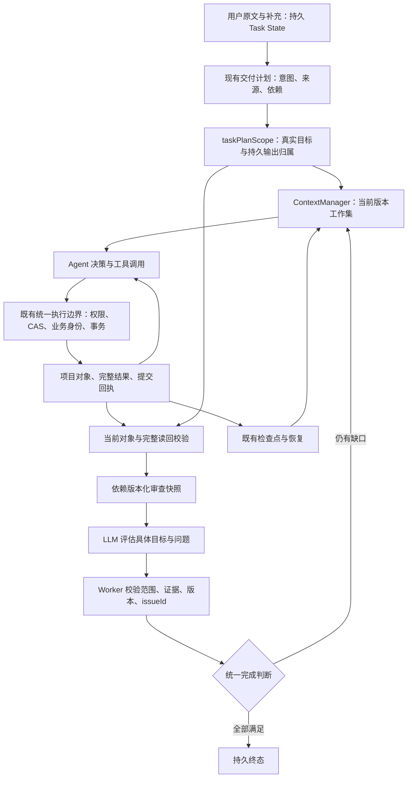

# Agent 任务合同与上下文协同重构实施记录

日期：2026-11-06 起。依据：[业务架构复审](./2026-11-06-agent-business-architecture-reaudit.md)；先行方案：[生命周期计划 R0–R6](../AGENT-EXECUTION-LIFECYCLE-IMPLEMENTATION-PLAN.md#31-业务架构复审后的实施方案2026-11-06r0r6)。

状态：R1–R5 已有代码及回归，R6 自动化门禁和交付记录已完成；具体执行批次见第 6 节。**11 月 6 日源码实施阶段未执行真实供应商验收，也未替换当时的运行实例。11 月 7 日获用户批准后已真实复验：运行时自然完成及重启恢复通过，但独立内容一致性未通过，整体业务尚未验收通过。** 新结果及 dev 重载边界见[真实供应商验收](./2026-11-07-agent-task-contract-real-acceptance.md)，下文“本轮未验证”保留原源码交付时的历史口径。

## 1. 已核实的根因与本次范围

复审发现的主要矛盾在业务定义：交付检查把本轮写入回执当作主要完成依据，Skill 又用读过的对象定义审查范围；模型推断和用户要求共享不可弱化规则；审查只感知对象自身版本，监督却不承认有效审查推进。各模块都保留了真实数据，但对范围、完成、进展的定义不一致。这会让已有对象被报告成尚未产出，也会让未读完的任务获得局部就绪提示。

此前 Task State、完整 Result Store、版本 Evidence、统一业务事务、CAS、按模型能力计量及检查点已有实现，本次复用这些基础。没有通过增加 Token 窗口、扩大重复读取次数或重写 Runtime 来处理。

## 2. 实际数据流和职责



模型判断内容语义，Worker 核验可证明的来源、权限、身份、版本、读取覆盖和问题闭环。Worker 不会因为一个读取回执自动认定内容正确。工具执行结果继续返回 Agent；大型结果的完整正文与参数仍在 Result Store，可按 resultId 分页读取。

## 3. 已实施内容及验证边界

| 范围             | 本轮实现                                                                                                                                | 自动化证据                                                               | 真实供应商 |
| ---------------- | --------------------------------------------------------------------------------------------------------------------------------------- | ------------------------------------------------------------------------ | ---------- |
| Task State       | 复用持久原文、补充、约束、决策、待办、产物及恢复状态；新增合同投影；终止时同步 executionStatus 和具体原因                               | 取消同步、具体错误码、管理器重建、SQLite 重开恢复                        | 本轮未验证 |
| 任务合同         | deliverables 增加 create/reuse/revise/verify、origin、sourceRequirementIds、dependsOn；revise 的 baselineVersions 由 Worker 取得        | 已有对象复用、真实修订与读回、用户要求保护、推断纠错、来源伪造和依赖循环 | 本轮未验证 |
| 统一范围         | 完成检查、Skill 审查、上下文工作集复用 taskPlanScope；未读或缺失对象不能被排除出已声明范围                                              | 11 镜只读 1 镜仍未就绪；普通无计划查询兼容                               | 本轮未验证 |
| Evidence         | 继续通过 ID 引用完整结果；制作分页使用真实读取版本和范围；动态投影核对已知文档指针及制作查询版本                                        | 同版本分页并存、外部修订后旧正文退出模型请求、历史完整结果保留           | 本轮未验证 |
| Result Store     | 沿用完整内容与 arguments、hash、结果版本和 resultId 范围读取；未新建摘要存储代替完整结果                                                | 原有大结果、失败参数、完整恢复测试纳入最终 Worker 全量                   | 本轮未验证 |
| ContextManager   | 按任务目标及绑定资料选择已经按需读过的证据；去除正常模式固定 8 个工具轮次截断，按实际预算缩减协议整组历史；非 pinned 工作资料可退回引用 | 历史清空／重建、1M 窗口下 11 轮短结果、大结果外置、共同来源跨多目标审查  | 本轮未验证 |
| 模型能力／预算   | 复用现有模型配置、来源、输入／输出区分、最终协议诊断；没有扩大硬限制                                                                    | 64K、128K、1M、切换模型、独立输入／输出等既有回归纳入全量                | 本轮未验证 |
| 审查依赖         | 不可变快照记录目标依赖及连续性依赖；coverage 包含相关版本；计划、绑定资料或相邻镜头变化使受影响覆盖失效                                 | 计划修改后镜头重审；无关资料覆盖保留；四镜中改第二镜只使前三镜待审       | 本轮未验证 |
| 可信进展         | 接受的新合同 hash、新目标／依赖版本 coverage、有效 issue 关闭纳入监督；重复审查、换措辞、重复 checkpoint 不算新进展                     | 监督基线重建后仍识别合法审查推进、重复不重置                             | 本轮未验证 |
| 统一执行         | 集中创建能力；编辑工具不再收到 outputId；已完成创建保留内部输出归属和兼容重放，只不再广告成新建工作                                     | 两协议 implicit→explicit 认领、重复创建重放、事务／CAS／恢复回归         | 本轮未验证 |
| 压缩／交接／恢复 | 复用完整结果、检查点、协议工作集；从合同与持久版本重建当前上下文，交接不把正文复制进 System                                             | 两协议整集模拟业务含压缩、模型切换和 SQLite 关闭重开；40 轮 Pi 内存回归  | 本轮未验证 |
| 终态             | 失败／取消保留最后执行阶段；只有 interrupted 表达恢复中；保留 AGENT_/TASK_/CONTEXT_ 具体错误码和恢复资料                                | 取消后 Task State 同步、失败原因保留、检查点与完整产物不丢失             | 本轮未验证 |

### 合同兼容规则

- 旧计划省略 intent 时，仍沿用原来的真实写入证明，不自动把一次读取改成修改完成。显式 reuse/verify 才使用已有对象及当前完整读回；revise 还要求真实写回执及相对登记基线的版本变化。
- 用户来源必须引用持久 userRequirements。用户义务的来源、意图和硬要求不能由模型静默降低。显式 model_inference 且有 revisionReason 的误推断可以纠正；用户原文仍独立保存。
- 旧无来源的逐字义务保守保留，不能直接重标 model_inference 后删除。无法自动证明来源的历史任务不自动放宽。
- 创建型工具保留内部稳定输出归属，即使对象已经保存；这样后续未绑定条目不会认领同一份隐式产物。回给模型的创建槽位只包含尚未产出的创建工作。编辑、核验和复用使用真实对象 ID。

### 读取与版本规则

完整正文保存在 Result Store。元数据读、失败读、其他任务读和过期读不能提供完成证据。制作 authoring 的 JSON 分页必须按同版本连续组装并成功解析；第一页恰好包含完整 prompt 不能代替后续 timing/references。

模型上下文投影会排除已知文档中不匹配当前 draft／显式 published 指针的正文，以及不匹配当前制作 queryVersion 的 scene/shot 读取。新正文仍需工具按需读取，不自动从数据库加载进 prompt；旧结果仍可作为历史资料按 ID 追溯。对没有可解析业务身份的旧不透明来源保留兼容读取，本轮没有假称所有来源类型均有新鲜度校验。

语义审查仍允许显式 text 视图的完整提示词读回。分页修复并不意味着所有旧 text 读取都已经验证完整 IR；格式、引用及时长还由现有结构检查和模型内容审查分别承担。

## 4. 修改文件

| 文件                                                       | 本轮职责调整                                       |
| ---------------------------------------------------------- | -------------------------------------------------- |
| `apps/worker/src/agent-task-artifacts.ts`（新增）          | 共享当前对象、版本与完整读回判断，取代重复校验     |
| `apps/worker/src/agent-task-deliverables.ts`               | 合同、来源、依赖、目标求值、输出归属和完成协调     |
| `apps/worker/src/production-skill-validation.ts`           | 统一目标清单、缺失对象、依赖图和审查就绪           |
| `apps/worker/src/agent-task-review.ts`                     | 快照依赖与逐目标覆盖失效                           |
| `apps/worker/src/agent-context-manager.ts`                 | 当前步骤工作集、新鲜度投影、分页证据和持久进展基线 |
| `apps/worker/src/agent-context-budget.ts`                  | 可信审查／合同进展去重；没有提高原重复读取阈值     |
| `apps/worker/src/agent-saved-production-receipts.ts`       | 集中创建能力声明                                   |
| `apps/worker/src/agent-business-execution.ts`              | 复用同一创建能力，保留统一事务和外部执行语义       |
| `apps/worker/src/agent-provider-loop-service.ts`           | 具体终止原因、phase、Context Task 同步             |
| `apps/worker/src/agent-task-checkpoints.ts`                | 控制回执保留意图、数量、缺读对象及修复／绑定事实   |
| `apps/worker/src/agent-tool-definitions.ts`                | 同步新合同 Schema、审查和完成说明                  |
| `apps/worker/src/production-skill-validation.test.ts`      | 合同、范围、依赖与完整分页回归                     |
| `apps/worker/src/agent-context-manager.test.ts`            | 工作集、外部修订、分页与恢复回归                   |
| `apps/worker/src/agent-context-budget.test.ts`             | 可信进展及重复审查回归                             |
| `apps/worker/src/agent-provider-loop-service.test.ts`      | 双协议 6 镜／60 秒核验修订业务与终态回归           |
| `apps/worker/src/agent-pipeline-remediation.test.ts`       | 完成创建不再广告槽位，同时验证内部认领与重放       |
| `apps/worker/scripts/audit-agent-business-architecture.ts` | 将 6 项缺陷断言转换为修复行为回归                  |
| `apps/worker/scripts/tsconfig.json`（新增）                | 审计脚本纳入类型化 lint，不关闭类型规则            |
| 计划、复审报告、本记录及项目检索计划                       | 记录后续实施和真实验证边界，保留历史审计           |

仓库实施前有大量未提交／未跟踪工作；以上是本轮范围，不将整个 git status 算作本次修改。没有重置、清理或覆盖其他工作，没有改生产 Rust 源码、package 脚本或新建并行 Runtime。

## 5. 数据迁移与运行实例

本轮没有 DDL 变更；复用现有 v75 完整结果／Evidence 与 v76 执行存储，不改真实用户项目。新增合同字段存于现有审计 JSON，快照依赖存于现有不可变 Result 记录。任务、文档、旧版本、完整工具结果、旧计划和检查点均保留。

新 Worker 与新工具 Schema 应一起启用。旧无依赖快照及 v2 隐式 coverage 不直接授予新依赖图下的覆盖；保留原问题／关闭记录，通过当前 reviewId 显式重新核验。旧计划按上节兼容语义读取，不批量重写历史来源。需要调整无法证明来源的旧义务时，应追加明确的新来源和审计，不能直接删除旧用户数据。

核实本轮运行中 Worker 为 PID 161524（`node dist/index.js`）。未重启它，未覆盖 live dist。编译输出隔离到 `%TEMP%/p22-contract-build/worker`；这只证明源码可编译，不表示当前桌面实例已经加载本轮逻辑。业务验收应在空闲时使用同一份冻结构建开始，不能中途替换构建再声称全程通过。

## 6. 测试与质量门禁

各专项存在重叠，不能相加冒充唯一测试数量。

| 检查                                                    | 实际结果                                                                                                                              |
| ------------------------------------------------------- | ------------------------------------------------------------------------------------------------------------------------------------- |
| 任务合同／Skill／Pipeline 三文件专项                    | 187 项通过；其中 Skill 38 项，含分页前缀和连续性依赖新回归                                                                            |
| 两种协议 6 镜／60 秒已有产物核验及原位修订              | 2 项通过；真实授权、SQLite 和业务工具，模型响应模拟                                                                                   |
| 两种协议整集创建、压缩、模型切换、SQLite 重开恢复与清理 | 3 项定向通过；最终全量继续覆盖                                                                                                        |
| 持久 Context Store／Execution Store                     | 11 项通过；存储生产源码本轮未改                                                                                                       |
| 外部文档／镜头修订的新鲜度                              | 2 项定向通过；最终全量继续覆盖                                                                                                        |
| 6 项架构缺陷回归脚本                                    | 全部通过；仅临时／内存项目，零供应商调用                                                                                              |
| Worker 全量及修复文件复验                               | 覆盖 91 文件、1,489 个唯一用例；全量 1,487 通过／2 失败，修正测试匹配断言后失败所属 Provider Loop 整文件 160 项通过；不是单次全量全绿 |
| ContextManager 最终整文件复验                           | 43 项通过，包含最后的过期证据提示调整                                                                                                 |
| 全仓 `pnpm typecheck`                                   | 通过                                                                                                                                  |
| 审计脚本 `tsc -p apps/worker/scripts/tsconfig.json`     | 通过                                                                                                                                  |
| 全仓 `pnpm lint`                                        | 通过                                                                                                                                  |
| Worker 隔离 TypeScript 编译                             | 通过，输出至 TEMP，未覆盖 live dist                                                                                                   |
| 本轮文件格式及 `git diff --check`                       | 全仓格式检查、本轮 Markdown 单独格式检查和最终 diff 检查通过                                                                          |
| 真实供应商完整业务                                      | 本轮未执行，未验证                                                                                                                    |

最终全量命令：

```powershell
pnpm --filter @ai-video/worker exec vitest run --maxWorkers=2 --minWorkers=1 --testTimeout=15000
pnpm typecheck
pnpm exec tsc -p apps/worker/scripts/tsconfig.json
pnpm lint
pnpm --filter @ai-video/worker exec tsc -p tsconfig.json --outDir "$env:TEMP/p22-contract-build/worker" --tsBuildInfoFile "$env:TEMP/p22-contract-build/worker.tsbuildinfo"
pnpm --filter @ai-video/worker exec tsx scripts/audit-agent-business-architecture.ts
```

本轮完整保留失败记录：首次 lint 发现脚本未纳入 TS Project、测试断言的 unsafe assignment 及未使用解构变量，已修复；首轮全量 1,482 通过／2 失败，暴露已完成创建漏内部认领，修复后 Pipeline 专项通过。外部修订回归首次测试夹具错误复用了已有任务目标、并携带旧 prompt 更新 IR，修正夹具后 2 项通过。没有通过提高读取次数或超时来掩盖失败。

增加分页、连续性和外部修订回归后，最终全量为 1,487 通过／2 失败（91 文件、1,489 项）；两项失败来自 lint 修正时将嵌套部分匹配改为普通对象，外层 `toEqual` 错误拒绝回执中的额外字段。改为 `toMatchObject` 后，失败所属 Provider Loop 整文件 160 项通过；最后提示语调整后的 ContextManager 整文件 43 项通过。组合验证覆盖全部 1,489 个唯一用例，但没有把它描述为最后一次单次全量全部通过。

原始日志保存在 TEMP：`p22-contract-worker-tests-final.log` 保留两项失败；`p22-contract-provider-final.log` 和 `p22-contract-manager-final.log` 分别保存 160 项、43 项最终通过证据。最后的隔离 TypeScript 编译及两份修改文件的定向 lint 退出码均为 0。全仓 typecheck、lint 和 format:check 的原始结果分别保存在 `p22-contract-typecheck-final.log`、`p22-contract-lint-final.log`、`p22-contract-format-final.log`。

## 7. 业务验证结果

2026-11-07 后续真实复验：一次发起后约 868 秒自然完成，保存三份 plan、四份独立制作资料及 1 场 6 镜，真实强杀后原任务自动恢复；明确范围审查、原位修订和 issue 闭环均发生。独立检查仍发现镜 3 跨产物不一致、镜 5 景别遗漏；原始 Rust 验收还因字面“60秒”断言退出 101，不能记为测试通过。此次没有再次付费重跑，R6 最终业务验收继续未通过。完整请求、构建及内容证据见[11 月 7 日记录](./2026-11-07-agent-task-contract-real-acceptance.md)。

自动化双协议业务覆盖真实对象与草稿保存：已有 6 镜／60 秒登记 verify 合同，不返回创建槽位；未读回时保留全部待办；完成读取后审查、登记问题、原位修订、显式关闭／撤回问题，再求值完成。另一组整集创建业务覆盖章节／素材读取、生成保存、上下文整理、切换模型、SQLite 关闭重开和检查点恢复，避免重复保存。

这些模型输出由测试控制，证明运行时能够处理该流程，**不证明真实模型可以自主正确规划并自然完成复杂内容任务**。本轮没有新增真实供应商调用，没有用户项目写入。此前真实业务的失败和内容差异仍保留在旧交付记录，不能用当前单元测试抹去，也不能把旧构建成绩当作当前构建验收。

## 8. 未完成与风险

1. **源码交付时真实供应商自然完成与独立内容核对未验证。** 11 月 7 日后续已验证自然完成和恢复，但独立内容核对未通过，原始 Rust 命令退出 101，详见新验收记录；不要连续付费重跑或让用户重新提供原任务。
2. **全工具声明式执行合同未完成。** 本轮集中创建能力并修正已审计的错配；部分其他领域工具仍依赖已有 withTaskScope／服务语义，不宣称所有工具都具有统一 exactly-once。外部付费任务继续 unknown/reconcile。
3. **用户要求的语义映射仍由模型提出。** sourceRequirementIds 能验证真实来源及不可弱化，不能程序证明用户每句话已被模型正确分解，也不能程序保证 LLM 审查语义质量。
4. **依赖图的业务完整性有限。** 当前支持显式 dependsOn、绑定资料、任务 plan 及相邻镜头；未推断所有远距离剧情因果。新鲜度投影复用既有制作 queryVersion，它包含场次相关状态，可能保守地使更多旧读取退出；大型场次的版本计算成本仍需真实长任务观测。
5. **旧来源不明数据保守兼容。** 不自动删除历史义务；没有可解析项目身份的旧不透明证据、media 像素事实等不在本轮新鲜度投影校验覆盖内。它们作为历史结果保留，不将其描述为已全面迁移。
6. **当前运行实例尚未加载源码修改。** 本轮仅隔离编译，不干预用户运行中的 Worker；上线／运行后验收与源码测试分开记录。
