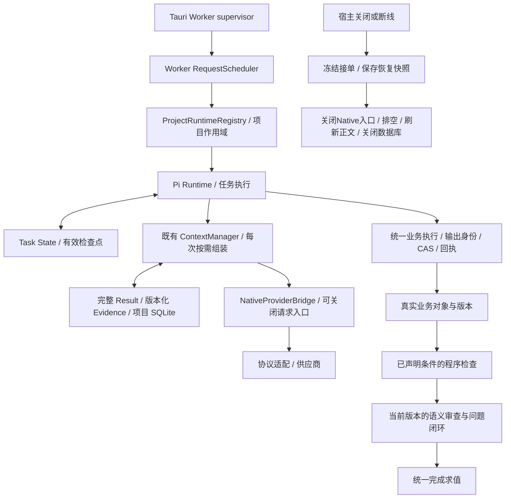

# Agent 架构修复实施记录

日期：2026-11-07。对应用户批准的“先将架构修好”。本轮在既有分层上实施生命周期、恢复和业务验收调整，没有重写 Agent Runtime。

## 1. 结论和交付边界

本轮修复整体审计中的 A1–A4，并为 A5 建立实际镜头事实、派生文档、程序条件及版本审查之间的约束。代码实现、自动化测试、实际独立进程检查、真实供应商内容验收分别记录。旧真实验收的内容失败不能被本轮模拟测试覆盖掉。

没有修改模型窗口策略或上下文阈值；用户指定的未知能力回退 512000 继续保留，仍标为 fallback，而非供应商已证实的能力。任务执行、费用和输出上限继续独立管理。

实施前工作区已有大量未提交和未跟踪变更。本轮关键文件基线保存在 `%TEMP%/agent-architecture-baseline-b728365f12dc44019e50d803ec0e5466`，下列文件清单只描述本轮增量。未 reset、清理或删除用户历史。

## 2. 原因与架构调整

| 审计问题                       | 原因                                                 | 本轮实现                                                                                                                             |
| ------------------------------ | ---------------------------------------------------- | ------------------------------------------------------------------------------------------------------------------------------------ |
| 单个请求失败连带中断任务       | 请求错误与进程故障共用替换路径，靠 Arc Drop 杀旧进程 | 本地拒绝和 IPC 等待超时保留 Worker；EOF、损坏通信才停止实例。Supervisor 持锁完成旧进程 kill/wait 后才允许替换；不自动重放业务请求    |
| 关闭被持久化为用户取消         | 宿主、stdio、HTTP、项目卸载没有共同停止语义          | 关闭、断线、重启走 suspend；明确用户取消和项目卸载仍走 cancel。先快照，再停止流、排空和关闭数据库                                    |
| 原生操作晚于 Worker 结束       | Native 流归属没有纳入 WorkerProcess 资源生命周期     | 每个 Worker 持有自己的流注册表；EOF/stop/Drop 取消所属流。注册时在锁内复验可用性，避免清理后又注册                                   |
| 有检查点却找不到恢复任务       | 自动候选发现先过滤损坏的当前 state，未使用回退       | loadSnapshot 统一解析候选与读取，任务状态和 runtime 从同一有效检查点成组回退；当前有效终态优先，不复活取消任务                       |
| 多份描述同一镜头的产物相互冲突 | 版本审查没有声明共同事实与可程序验证的义务           | 实际镜头 IR 是已声明提示词投影的来源；镜头变化使相关任务计划文档重审；数字时长、镜头字段和提示词投影用程序检查，语义质量仍由模型审查 |

## 3. 模块实现情况

| 能力           | 实现状态                                                          | 验证边界                                                                                      |
| -------------- | ----------------------------------------------------------------- | --------------------------------------------------------------------------------------------- |
| Task State     | 复用既有独立持久状态；新增停止原因、暂停及取消竞争处理            | 活动、排队、迟到工具结果、取消后立即暂停和 SQLite 重开恢复有自动测试                          |
| Evidence Store | 复用既有来源、版本、范围、hash 和有效引用；不新造第二套 Store     | 版本替换、历史正文保留和去重回归继续运行；本轮没有重写 Evidence                               |
| Result Store   | 复用完整结果、参数、hash、版本及范围读取                          | 暂停时正在执行的工具完成后再保存快照，完整结果可在重开 SQLite 后读回                          |
| ContextManager | 复用动态工作集、模型策略、去重和协议完整批次                      | 新增 suspend 快照；40 轮真实 Pi 工具循环自动测试；不自动灌入全库正文                          |
| Token Budget   | 复用模型能力、输入/输出边界、协议计量与来源标记                   | 未改生产预算数值；旧测试的 64K/16K 推断随用户已有 512K 默认同步，不以修改断言替代能力限制测试 |
| 压缩与恢复     | 既有压缩保留；恢复入口改用统一有效快照                            | 坏当前投影回退、跨模型重组、已保存产物不重建的两协议模拟业务通过                              |
| 阶段交接       | 复用阶段状态与完整结果引用                                        | 暂停不复制正文至 System；交接后损坏当前投影，能由检查点继续                                   |
| 业务验收       | 在既有 deliverables 加 typed criteria，既有审查快照加 obligations | 条件不能被语义 passed 绕过；计划顺序不影响依赖求值；独立草稿不会自动改写                      |

### 停止协议

stdio 的可信 `host.control`、stdin EOF、SIGINT/SIGTERM，以及 HTTP 的关闭信号，均接入同一 Worker 清理路径。关闭后 Scheduler 拒绝尚未开始的业务请求，保留原请求 ID，返回 `INVALID_STATE` 与 `executed:false`。已接纳的读、写和后台请求都纳入 drain；入口保留的项目引用有幂等 release。

宿主最多等待 Worker 8 秒完成协调关闭。收到持久化后的 stopped 回执，再给正常退出短暂机会，最后 stop/reap；宿主还有 10 秒退出兜底。兜底仍可能强杀卡死进程，不能宣称所有情况下都没有 kill。普通请求超时不再触发此流程，也不代表该业务未执行。

Native Bridge 的 close 先永久关闭入口再中断已有等待。已经发送的请求标为 INTERRUPTED，后续未发送的请求标为 REQUEST_NOT_SENT；两者不能混用，外部付费任务继续采用已有 unknown/reconcile。关闭不全局取消另一 Worker 的配音任务。

GenerationService 在数据库关闭前刷新未落盘正文、清除 flush timer，并阻止旧 Legacy/Native 回调继续写入；不会将宿主暂停改成用户取消。普通 Legacy 聊天不由此获得 Pi 长任务恢复能力。

### 程序验收与共同事实

`total_duration` 从当前保存镜头 IR 的数值时长求和；`shot_field` 检查每镜结构化字段，并可要求该事实出现在实际 prompt；`shot_prompt_projection` 只适用于明确声明依赖镜头的完整提示词文档，要求包含各镜最新完整 prompt。相同提示词的多个镜头需要各自出现一次，不能用一次出现冒充多镜覆盖。

这些检查读取真实对象，不改写用户正文。条件失败返回 criteriaFailures 和原位修订动作，不另建重复产物，不靠无变化写入刷新版本。独立草稿不自动获得投影约束。非法或缺失 prompt 的 IR 留在待修状态，不抛异常打断整个求值。

相关任务计划文档和实际镜头采用版本依赖；镜头修改后，旧文档审查覆盖失效。正式产物仍完整保存，审查快照通过原 Result Store 保留。程序条件只覆盖已经登记的条件；并未实现自动理解并完整分解用户每句话，也没有实现所有剧情计划文档的确定性自动渲染。文案的语义一致性仍需要模型核验。

## 4. 文件清单

| 文件                                                                                                                                                       | 本轮职责                                                             |
| ---------------------------------------------------------------------------------------------------------------------------------------------------------- | -------------------------------------------------------------------- |
| `apps/desktop/src-tauri/src/lib.rs`                                                                                                                        | 请求故障隔离、旧进程退出屏障、所属 Native 流清理、宿主停止协调及测试 |
| `apps/worker/src/index.ts`                                                                                                                                 | stdio/HTTP 停止入口、Scheduler 和绑定引用统一收尾                    |
| `apps/worker/src/handler.ts`                                                                                                                               | 停止原因下传、冻结恢复入口、暂停/取消分流和正文收尾                  |
| `apps/worker/src/project-runtime-registry.ts`                                                                                                              | 项目卸载与 Worker 关闭原因传递、保留恢复登记                         |
| `apps/worker/src/request-scheduler.ts`                                                                                                                     | 关闭接单、追踪全部 admitted promises、排空                           |
| `apps/worker/src/native-provider-bridge.ts`                                                                                                                | 永久关闭旧 Native 入口，区分已中断与未发送                           |
| `apps/worker/src/pi-conversation-runtime.ts`                                                                                                               | 活动/排队任务暂停快照、迟到结果补存、终态竞争保护                    |
| `apps/worker/src/agent-context-manager.ts`                                                                                                                 | 独立 Task State 的 recovering 状态及完整快照                         |
| `apps/worker/src/generation-service.ts`                                                                                                                    | 停止前落盘与旧回调栅栏，不冒充用户取消                               |
| `packages/persistence/src/agent-context-store.ts`                                                                                                          | 成组有效快照解析、统一恢复发现、终态优先                             |
| `apps/worker/src/agent-task-criteria.ts`（新增）                                                                                                           | 声明式程序验收与 Schema                                              |
| `apps/worker/src/agent-task-deliverables.ts`                                                                                                               | 条件注册保护、依赖验证、统一完成求值和修复回执                       |
| `apps/worker/src/agent-tool-definitions.ts`                                                                                                                | 原 checkpoint 协议兼容增加 criteria                                  |
| `apps/worker/src/agent-task-checkpoints.ts`                                                                                                                | 返回程序条件失败的实际待办                                           |
| `apps/worker/src/production-skill-validation.ts`                                                                                                           | 实际镜头与相关任务文档依赖，审查绑定条件                             |
| `apps/worker/src/agent-task-review.ts`                                                                                                                     | 审查快照保存 obligations 并参与覆盖有效性                            |
| `request-scheduler.test.ts`、`generation-service.test.ts`、`native-provider-bridge.test.ts`、`pi-native-continuation.test.ts`                              | 生命周期、故障与兼容回归；最后一个同步旧 fallback 断言               |
| `agent-context-runtime-lifecycle.test.ts`、`worker-process-lifecycle.test.ts`                                                                              | Pi 长循环、暂停/迟到结果/取消竞争和真实独立 Worker 进程              |
| `agent-task-deliverables.test.ts`、`production-skill-validation.test.ts`、`agent-provider-loop-service.test.ts`、Persistence `agent-context-store.test.ts` | 业务条件、审查依赖、两协议恢复及存储回归                             |
| 实施计划、本记录和项目检索计划验证附记                                                                                                                     | 真实范围、迁移和验收状态                                             |

`request-scheduler.test.ts` 等文件原已存在，本轮只补增量。并非所有 git dirty 文件均属于本轮。Rust fmt 检查涉及现有文件，但本轮生产 Rust 逻辑集中在 lib.rs，不将此前 llm_stream 等改动列入本轮实现。

## 5. 数据兼容与生效

无新增 DDL、无历史删除，继续使用现有项目 SQLite、完整结果表、任务状态和检查点。旧 raw 和 v2 引用快照均可读取；引用内容仍校验 hash。坏快照跳过，健康任务不会因另一任务损坏而消失。若缺少有效 runtime，不凭空自动执行。

新 criteria 为兼容可选字段；旧计划保留原有检查，不自动批量推断或重写。明确用户义务和来源不明旧义务不能静默弱化；明确模型推断允许带理由纠错。新增 obligations 可能保守地使旧审查需按当前版本重评，原通过记录、问题及关闭记录保留。

新宿主与 Worker 应配套启用。旧 Worker 不识别 host.control 时，宿主等待后走受限停止兜底，不声称它已经完成新式持久暂停。新 Worker 的旧业务 API 和权限校验保留，host.control 仅为可信 stdio 控制面，不新增普通业务绕过入口。

最终编译位于 `%TEMP%/agent-architecture-final-20261107/worker`；400 个编译文件的 SHA-256 清单为同目录上级 `manifest.json`，实际进程检查结果为 `lifecycle-smoke.json`。在隔离 AppData 创建临时项目，先保存、协调退出，再启动读回并用 EOF 退出，均 exit 0、stderr 为空、供应商调用 0 次。

核查有 `node dist/index.js` 运行中；本轮未覆盖 live Worker dist，未主动重启用户应用。Rust 源码变动可能被已有桌面开发 watcher 观察；本轮没有以用户正在运行的实例作为新版本验收，因此不能声称桌面现有实例已经加载这些修复。

## 6. 验证记录

| 门禁／验证                                                                                     | 最终结果                                  | 范围                                                                                          |
| ---------------------------------------------------------------------------------------------- | ----------------------------------------- | --------------------------------------------------------------------------------------------- |
| Worker 全量 `pnpm --filter @ai-video/worker test --maxWorkers=2 --minWorkers=1 --reporter=dot` | 92 文件，1,502 项全部通过，312.99 秒      | 最终生产源码，含上下文、生命周期、工具、业务条件及两协议恢复；供应商响应模拟                  |
| Persistence 全量                                                                               | 24 文件，101 项全部通过                   | 完整结果、任务状态、有效快照及既有存储回归                                                    |
| Rust `cargo test --lib`                                                                        | 207 passed，0 failed，5 ignored，32.82 秒 | 最终 Rust 源码；忽略的显式供应商验收不计通过                                                  |
| 全仓 `pnpm typecheck`                                                                          | 通过                                      | 所有工作区包                                                                                  |
| 全仓 `pnpm lint`                                                                               | 通过                                      | 最终生产及测试源码                                                                            |
| 全仓 `pnpm format:check`                                                                       | 通过                                      | 首次仅新增生命周期测试文件格式不通过，修正后全仓检查通过；仓库默认忽略 docs，本记录另行格式化 |
| `cargo fmt --all -- --check`                                                                   | 通过                                      | Rust 全仓格式                                                                                 |
| Worker TEMP 编译                                                                               | 通过                                      | 未覆盖 live dist；400 个编译输出的 SHA-256 再次校验，0 个不一致                               |
| 编译后独立 Worker 进程                                                                         | 协调退出、项目重开读回、EOF 退出均通过    | 隔离 AppData／SQLite；exit 0、stderr 空，供应商调用 0 次                                      |
| `git diff --check`                                                                             | 通过                                      | 既存 CRLF 提示不影响退出码；不重置或清理既存变更                                              |

新 Rust Supervisor 3 项通过，包括并发超时隔离、正常关闭和禁止替换。专项与全量存在重叠，不相加冒充唯一测试总数。未改动的 Desktop、Contracts 等包本轮运行类型／lint 门禁，没有把前轮单元测试冒称本轮重新执行。

第一轮 Worker 全量 1491 passed / 8 failed。6 项来自用户已有 512K fallback 后仍断言旧 64K，另有运行中添加/修改验收用例造成版本不一致及 Schema 布尔转换断言；随后定向测试暴露默认输出由旧 16000 推断变为 16384，保留明确配置 16000，修正缺省断言。新增 Generation 测试起初调用旧 API 参数错误、结果夹具少字段，已改为真实签名。新增 Rust 测试首次有模块限定及 pending 字段访问编译错误，修正后 3 项通过。没有为通过测试修改生产 Token 阈值或取消已有保护。

专项验证：4 文件 126 项通过（Native Bridge、独立进程、Pi 生命周期、程序条件）；Generation/Native continuation 2 文件 57 项通过。专项与全量有重叠，不相加冒充唯一测试总数。两种协议的整集业务恢复测试采用模拟供应商响应、真实工具授权/SQLite/Runtime，在阶段交接后损坏当前 state/runtime，重开项目并切到 1M 模型，继续完成产物且不重复保存。

## 7. 真实业务验收与剩余工作

本轮新增真实供应商调用为 0。此前冻结构建真实业务约 868 秒后自然完成，经历实际强杀恢复，但独立内容检查不通过，原始 Rust opt-in 退出 101；该事实仍见[真实验收报告](./2026-11-07-agent-task-contract-real-acceptance.md)，没有以本轮自动测试宣称旧内容问题已通过真实复验。

| 项目                                               | 当前状态                                                                       |
| -------------------------------------------------- | ------------------------------------------------------------------------------ |
| 本轮核心进程/任务/恢复架构                         | 已实现，有自动测试及独立编译进程验证                                           |
| 已声明时长、镜头字段、完整提示词投影的程序检查     | 已实现、已测试；真实模型是否正确登记和修复尚未复验                             |
| 修改镜头后的相关文档审查失效                       | 已实现、已测试；不自动改写用户独立草稿                                         |
| 新版本真实供应商整集内容一致性                     | 尚未验证，不宣称验收通过                                                       |
| 全工具执行语义声明于 Registry                      | 尚未全面迁移；核心输出槽位、CAS、事务与回执继续有效，不宣称全工具 exactly-once |
| 各类媒体/配音、外部下载的全部暂停与重启故障矩阵    | 尚未完整验证；已有 unknown/reconcile 保留，不能盲目重发付费任务                |
| 宿主 Worker 生命周期主动推送全部 UI 窗口           | 尚未新增；现有 Scope 校验、轮询和重连继续使用，不自动跨 epoch 重放写操作       |
| 任意自然语言要求的完整自动分解与所有剧情事实一致性 | 尚未实现程序保证；模型提议合同和语义审查仍有质量边界                           |

不能将以上尚未完成项目隐藏到“整体架构已全部验收”之中。下一次真实业务验收应使用同一冻结构建，独立核对实际 IR、依赖文档和用户要求，并保留请求账本、产物和自然终态。
