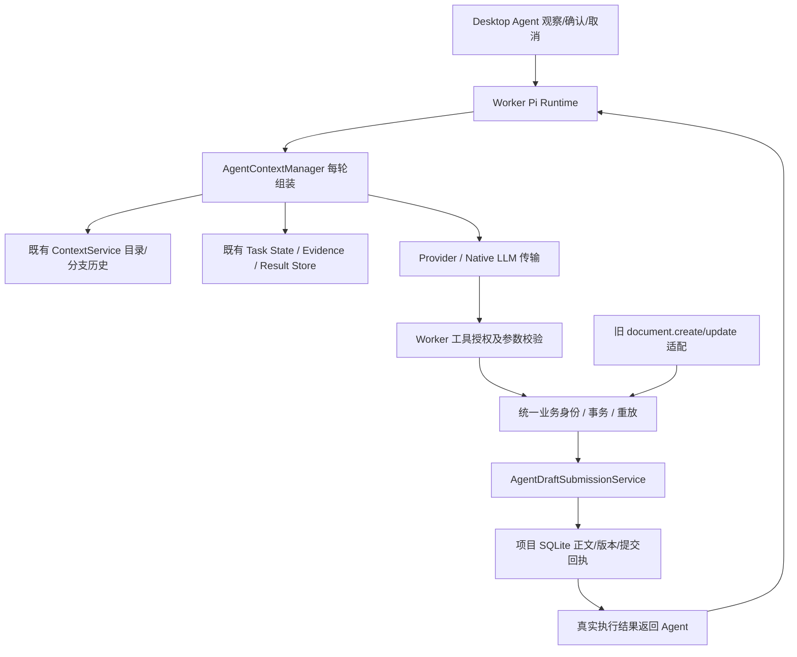

# Agent 重复执行链路退役交付记录

日期：2026-11-07。实施依据为用户批准的「统一文档业务入口 → 兼容回归 → 上下文所有权收拢 → Native Agent 退役 → 死代码清理」顺序，见[实施清单](../AGENT-LEGACY-RETIREMENT-PLAN.md)。

本次落实已有架构与产品要求，没有改变资料按需读取、草稿审核、本地 SQLite、附件不自动索引等产品决策，因此不改写对应 DOCX。前次真实供应商内容一致性未通过的事实仍见[原始验收](./2026-11-07-agent-task-contract-real-acceptance.md)；本轮没有将其改写为通过。

## 1. 根因和本轮修改

| 问题                                     | 原因                                                                                           | 本轮实现                                                                                                                     |
| ---------------------------------------- | ---------------------------------------------------------------------------------------------- | ---------------------------------------------------------------------------------------------------------------------------- |
| 文档入口维护两套写入实现                 | 旧 create/update 在 Provider Loop 中直接写正文和绑定，新 submit 使用统一业务执行身份和提交服务 | 旧入口只适配可信参数与回执标签，共用 executeAgentBusiness 和 AgentDraftSubmissionService；删除重复正文写入、绑定及引用处理   |
| 新旧工具入口交替可能绕过同一业务操作身份 | 传输工具名称和调用 ID 被误认为独立业务操作                                                     | 创建使用统一输出槽位；更新使用相同真实文档 ID、基线版本和行版本；已有提交返回原回执，参数变化返回冲突                        |
| 历史无提交身份的产物不能安全推断         | 老任务可能只留下父任务 artifact，或 child.parentTaskId 对应的文档                              | 检查这两种历史关联；无法证明新建身份时返回真实文档 ID、版本及明确修订指引，不按标题或正文猜测新建                            |
| 返回式业务拒绝可能在审计中显示成功       | 原调用层只把抛出异常视为失败                                                                   | Registry 共用失败结果判定，Loop 两入口与 Gateway 对齐 rejected / execution_conflict / failed；完整失败内容持久化并返回 Agent |
| Agent 的目录/历史有多个组装者            | GenerationService 先冻结目录和历史，Pi 又把其复制到 System，ContextManager 再叠加工作上下文    | Agent 准备只取得系统说明与作用域，目录和历史由 ContextManager 每轮调用既有 ContextService 编译；删除 Pi 冻结上下文注入       |
| 同一 Agent 有多套执行循环                | Worker Pi、桌面本地工具循环、Rust Native Agent 循环并存                                        | 有 agentTaskId 的新旧 prepared 描述统一走 Worker Pi；删除桌面和 Rust 的额外 Agent 循环及四个 Native Agent 命令               |
| 已退役实现仍要求维护分支和测试           | Router、恒定开关、无生产调用的提示词分类器及旧循环专用测试残留                                 | 删除这些实现和专用测试，保留仍有业务用途的小说意图、章节工具和普通 LLM 原生传输                                              |

没有以 Token 数字修改代替职责调整，也没有新增同职责的 Context 或执行存储服务。

## 2. 当前执行结构

普通非 Agent LLM 仍使用原生流式传输；传输本身不拥有业务工具循环。普通流意外收到 Agent 工具事件会明确失败，不在桌面私自执行业务。研究、媒体确认、多项目取消隔离和 Worker 断线后后台执行均保留。

ContextManager 每轮读取 generation_branches 的历史截止和排除集合，使用当前目录修订重新编译元数据。普通助手不自动注入文档、小说正文或附件。旧恢复快照的 runtime.context 不再与新目录/历史相叠加，仅保留已有可选 UI 定位提示；任务要求、已读工作资料及产物仍由既有持久层恢复。无 ContextService 的低层兼容入口继续接受显式 runtime.context。

## 3. 删除与兼容边界

删除的是重复执行责任，不是历史任务或业务数据：

- Rust 删除 agent_runtime_start / subscribe / cancel / confirm 注册及实现、run_agent_runtime、旧 Agent 事件和确认缓存及专用 helper。普通 llm_stream、供应商协议、请求统计、取消、Worker 通信与协调退出保留。
- Desktop 删除本地 Agent 工具循环、Native Agent 订阅确认与旧固定 16 次工具循环控制；Agent 观察、媒体选择和确认由 Worker 路径处理。
- 删除 ConversationRuntimeRouter、无效运行时开关、inferAgentDocumentIntent、inferDocumentIntent、inferShortDramaIntent 和相应测试；整个 conversation-runtime.test.ts 已删除。
- 旧 document.create_draft / update_draft 的协议名、授权检查及 draft_created / draft_updated 回执标签保留；正文写入共用新服务。生产 Worker 由子任务拥有产物、父任务继续协调；没有 systemTools 的旧低层调用保留父任务 artifact 兼容。
- 章节、reference、episode、adaptation 和结构提案有不同业务约束，不因同样「保存文档」就删除为普通重复逻辑。

以本轮各文件修改前副本 `%TEMP%/agent-retirement-baseline-u8BrO2` 对比当前文件，而非整个脏工作区的 git diff：25 个源码/测试文件，新增 808 行、删除 1,819 行，净减少 1,011 行。其中生产代码 16 文件，新增 319 行、删除 1,207 行，净减少 888 行。新增验证文档不计入该源码统计。逐文件统计位于 `%TEMP%/agent-retirement-delta.json`。

## 4. 修改文件清单

| 文件                                                | 职责                                                     |
| --------------------------------------------------- | -------------------------------------------------------- |
| apps/worker/src/agent-business-execution.ts         | 新旧统一身份、已有回执优先与历史父/子产物保护            |
| apps/worker/src/agent-draft-submission-service.ts   | 共用提交服务及旧父 artifact 兼容                         |
| apps/worker/src/agent-provider-loop-service.ts      | 旧协议适配、删除重复写入、真实失败审计                   |
| apps/worker/src/agent-tool-registry.ts              | 共用业务失败结果判定                                     |
| apps/worker/src/agent-provider-tool-gateway.ts      | 失败结果如实返回模型                                     |
| apps/worker/src/context-service.ts                  | 可选择只编说明，复用最近任务目录编译                     |
| apps/worker/src/generation-service.ts               | Agent 准备不再冻结资料目录和历史                         |
| apps/worker/src/agent-generation-preparation.ts     | 指定 Agent 上下文所有者                                  |
| apps/worker/src/agent-context-manager.ts            | 每轮动态编译目录/历史、兼容旧快照及分支边界              |
| apps/worker/src/pi-conversation-runtime.ts          | 删除冻结上下文到 System 的复制；续轮保留独立 context     |
| apps/worker/src/handler.ts                          | 注入共享 ContextService、移除无调用分类与恒定分支        |
| apps/worker/src/conversation-runtime.ts             | 删除 Router 和无效开关，保留运行时接口                   |
| apps/desktop/src/llm-client.ts                      | 统一 Worker Agent 路径，删除桌面额外执行循环             |
| apps/desktop/src/App.tsx                            | 删除无调用提示词分类器                                   |
| apps/desktop/src-tauri/src/llm_stream.rs            | 删除 Rust Agent 循环/命令/缓存及专用测试，保留普通传输   |
| apps/desktop/src-tauri/src/lib.rs                   | 删除命令注册，协调退出继续收敛普通传输                   |
| apps/worker/src/agent-provider-loop-service.test.ts | 两协议新旧创建/更新重放、冲突、CAS 与历史产物回归        |
| apps/worker/src/agent-library-retrieval.test.ts     | 统一保存后子任务来源、父子关系、待审核与父任务产物可见性 |
| apps/worker/src/agent-context-manager.test.ts       | 真实准备/编译/动态目录/分支历史整合回归                  |
| apps/worker/src/pi-conversation-runtime.test.ts     | 验证 context 独立于 System                               |
| apps/worker/src/pi-native-continuation.test.ts      | 两协议续轮、失败、补充、取消和恢复的上下文传递           |
| apps/worker/src/handler.test.ts                     | 删除退役分类器测试                                       |
| apps/worker/src/conversation-runtime.test.ts        | 删除整个 Router/开关专用测试文件                         |
| apps/desktop/src/llm-client.test.ts                 | 新旧 prepared 路由、普通流异常、确认/媒体/隔离回归       |
| apps/desktop/src/document-intent.test.ts            | 删除无生产用途分类测试，保留小说业务测试                 |

实施清单、本记录及项目检索实施计划附记同步记录范围。工作区其他既存改动不归入本轮交付。

## 5. 数据兼容与迁移

本轮没有 DDL、数据库版本升级、历史正文或审计删除。继续使用原 Task State、完整 Result、Evidence、版本、提交身份和检查点表。

已有新旧 alias 绑定继续查原 operationKey；跨入口重放保留相同文档/版本/提交回执。缺少绑定的历史产物返回 execution_conflict，模型需按真实 ID 与当前 CAS 明确更新，不能推测一个新建操作。原授权中的目标和 CAS 为可信来源，不能被旧工具参数替换。

旧 prepared 描述中的 pi / native-agent / desktop / 缺省归属，只要携带 agentTaskId 均由新版 Worker 执行。旧 native-agent 标记仍可读，不恢复退役循环。新版桌面和宿主应配套构建；旧前端直接调用已退役 Tauri Agent 命令不在混搭兼容范围内。普通 llm_stream 命令继续保留。

没有主动重启用户应用、安装客户端或回写用户项目。源码/构建通过不能证明正在运行的旧实例已加载本次修改。

## 6. 测试与验证

| 验证                                                                              | 结果                                                                                       | 证明范围                                                                   |
| --------------------------------------------------------------------------------- | ------------------------------------------------------------------------------------------ | -------------------------------------------------------------------------- |
| 全仓 pnpm test                                                                    | 2,584 项，首轮 2,583 通过 / 1 失败，原命令 exit 1；失败断言修正后该文件复测 1 项通过       | 全包回归，供应商响应模拟；没有将首轮退出码改记成功，也未对未变化包重复运行 |
| Desktop / Persistence / Contracts / Context / Domain / Adapters                   | 804 / 101 / 48 / 32 / 8 / 80 项通过                                                        | 全仓分包实际结果                                                           |
| Worker                                                                            | 首轮 91 文件，1,510 passed / 1 failed；agent-library-retrieval.test.ts 修正后 1 项复测通过 | 最终生产代码与首轮一致，最后仅修改测试归属断言并增加关系校验               |
| pnpm typecheck                                                                    | 通过                                                                                       | 所有工作区包                                                               |
| pnpm lint                                                                         | 通过                                                                                       | 最终生产/测试代码；首次新增测试的类型和 unused import 问题已修复           |
| pnpm format:check                                                                 | 通过                                                                                       | 仓库格式门禁；docs 默认被忽略，另行格式化本轮文档                          |
| pnpm build                                                                        | 通过                                                                                       | Worker 与 Desktop 编译；保留既有 Vite 大 chunk 提示                        |
| cargo test --manifest-path apps/desktop/src-tauri/Cargo.toml --lib                | 203 passed / 0 failed / 5 ignored                                                          | Rust 全量；显式真实供应商测试默认忽略，不计通过                            |
| 构建后 cargo test --manifest-path apps/desktop/src-tauri/Cargo.toml --lib worker_ | 13 passed / 0 failed / 2 ignored                                                           | 独立 Worker 进程、IPC、SQLite 往返；与全量 Rust 测试有重叠                 |
| cargo fmt --manifest-path apps/desktop/src-tauri/Cargo.toml -- --check            | 通过                                                                                       | Rust 格式                                                                  |
| git diff --check                                                                  | 通过                                                                                       | 未覆盖既存改动，原有 CRLF 提示不影响退出码                                 |
| 退役符号生产引用搜索                                                              | 无引用                                                                                     | 四个旧命令、run_agent_runtime、Router、旧开关/分类器和 withFrozenContext   |
| 最后检索整合测试调整后的 Worker typecheck / 文件 ESLint / 文件 Prettier           | 通过                                                                                       | 测试新断言无类型、Lint 或格式问题                                          |

新增测试验证：新旧创建及更新互相重放只产生一个业务提交、内容变化冲突、过期 CAS 不覆盖用户编辑，历史父 artifact/child 两种产物都不猜测新建，失败审计为 failed；准备阶段不冻结资料、改名下一轮可见、旧上下文不叠加、并行分支输出不泄漏、正文按需、UI 定位提示保留。相关场景分别覆盖 Responses 和 Chat Completions。

测试中曾出现旧 Native 续轮断言仍期待 context 复制进 System；已改为检查独立 request.context 保留内容、System 不含冻结资料，未以恢复重复注入让测试通过。

全仓首轮另发现检索整合测试仍期待文档直接归属于父任务。按统一提交后的真实模型回执修正为子任务 sourceTaskId，并新增子任务 waiting_review、父子关联、父任务 completed 和父子两侧均可见同一产物的检查，复测通过。生产写入路径没有因测试失败退回重复实现。

主要日志位于 `%TEMP%/agent-retirement-{all-tests,library-final,typecheck,lint,format,build,rust,worker-process}.log`，不相加专项/全量重叠测试冒充唯一测试总数。

## 7. 验收状态与剩余工作

| 项目                                     | 状态                                                                  |
| ---------------------------------------- | --------------------------------------------------------------------- |
| 五阶段代码实施及旧实现删除               | 已实现                                                                |
| 新旧协议、授权/CAS、回执与历史产物兼容   | 已实现、专项及全仓相关用例通过；全仓首轮 1 处旧归属断言修正后复测通过 |
| ContextManager 统一 Agent 上下文所有权   | 已实现、整合测试通过                                                  |
| 普通 LLM 原生传输、确认/媒体和多项目隔离 | 已保留，相关回归通过                                                  |
| 本轮新真实供应商整集内容一致性复验       | 尚未执行，0 次 Provider 调用                                          |
| 新安装包、用户运行实例加载新版           | 本轮未验证，未安装或替换实例                                          |
| 全工具执行语义在 Registry 中完整声明     | 本轮不扩为全部迁移，不能宣称所有工具 exactly-once                     |
| 任意自然语言交付要求的程序级完整保证     | 尚未实现；语义质量不因删除旧链路自动验收通过                          |

本轮没有验证「整集真实业务内容已达到用户要求」。当前交付证明的是统一执行、数据完整性、兼容性和退役清理；真实模型质量仍需要使用同一冻结构建独立复验。

后续收尾已完成真实供应商复验、恢复边界修复、最终全仓回归和新版安装包构建，见[最终验收记录](./2026-11-07-agent-final-acceptance.md)。该记录保留首次失败及观察超时，另行核对原任务恢复后的六镜／60秒产物；不改写本清理轮的0次供应商调用，也不表示安装或替换了用户实例。
