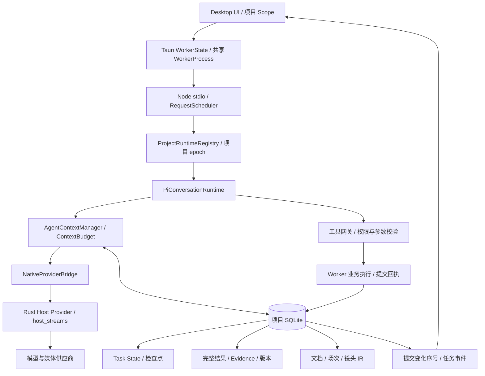

# Agent 整体架构审计：进程、任务生命周期与业务事实

日期：2026-11-07。状态：审计完成；本报告提出的调整尚未实施。

以上状态及下文“当前”均指审计时点，保留原始结论。用户随后批准实施，A1–A4 的修复与 A5 的程序条件／事实依赖调整已落地；实现、自动验证、独立进程验证及仍未通过的真实业务内容验收，分别见[架构修复实施记录](./2026-11-07-agent-architecture-repair-delivery.md)。不回写旧审计为当时已经修复。

## 1. 结论与审计范围

整体架构存在跨模块职责衔接问题。优先级最高的是共享 Worker 的故障隔离、停止原因与恢复协议，以及多份业务产物之间的事实一致性。扩大模型窗口不能解决这些问题，也没有证据表明窗口数值本身会调用 Worker 的 kill。

现有分层可以继续使用，无需重写 Agent Runtime。Task State、完整 Result Store、版本化 Evidence、动态上下文、业务提交回执和项目作用域均已存在，并且有测试和部分真实运行证据。不能继续将旧报告中已经修复的缺陷当作当前事实。

本轮沿 Desktop UI → Tauri 宿主 → Node Worker → 项目运行容器 → Pi／ContextManager → Native Provider → SQLite → 恢复与界面观察链路审计。重点复核 lib.rs、index.ts、handler.ts、项目 Registry、Pi Runtime、ContextManager、GenerationService、业务执行、任务审查、持久化和 Worker Scope。不是对全仓库每一行的穷举审查。

本轮只新增本报告，没有修改生产代码、重启用户正在运行的 Worker、访问用户项目数据或新增真实供应商请求。工作区已有大量变更，本报告不将它们归为本轮修改。

证据分为：当前源码确认、本轮隔离复现、本轮现有测试、此前冻结构建的真实供应商验收。源码推导出的风险不冒充已经发生的生产事故。

## 2. 当前真实架构



| 层 | 当前职责与可复用能力 | 主要衔接缺口 |
| --- | --- | --- |
| Desktop／Tauri | 进程启动、IPC 关联、Native Provider、退出 | 单请求失败能替换共享进程；停止协调仍围绕旧 Native Agent 注册表 |
| Worker／项目 Registry | 请求调度、项目容器、epoch、数据库访问、任务启动 | 清理函数没有接入正式宿主退出；暂停和取消没有统一停止协议 |
| Pi／GenerationService | 模型循环、流式状态、工具执行、续执行 | 依赖上层正确区分取消、关闭、重启与断线 |
| ContextManager／持久化 | 按需组装、完整结果、证据版本、检查点、监督状态 | 有历史回退，但自动候选发现尚未贯通回退逻辑 |
| 业务执行层 | 核心创建输出身份、回执重放、领域写入与提交事务 | 执行语义仍由中心名单和分支识别，尚未完整声明于 Registry |
| 业务验收层 | 产物清单、版本、依赖、明确审查范围、问题闭环 | 同一镜头的多份文本与实际 IR 没有共同事实约束 |
| UI 观察层 | 变化序号刷新、Scope 隔离、重连和任务观察 | 重启通知依赖后续 STALE_SESSION 请求与轮询 |

这些状态不是应当机械合并的一张表：Generation 记录请求和流，Task State 记录任务，提交回执记录业务效果。需要统一它们之间的生命周期协议和事实来源。

## 3. 已确认问题

### A1 · P1：请求级失败被提升为共享 Worker 的替换

源码：`apps/desktop/src-tauri/src/lib.rs:3163`、`:3231`、`:4402`、`:4560`。

`WorkerState::request` 对 `worker.request()` 的任何 Rust `Err` 都会清空当前共享进程引用。错误包含 IPC 等待超时、通信错误，也包含本地未发送前的消息大小或关联 ID 错误。有效 Worker 业务信封中的 `ok:false` 是 `Ok(value)`，不属于这条路径，不能说所有业务失败都会重启。

多数 IPC 方法使用 30 秒等待；部分媒体和声音方法另有较长等待。这是宿主 IPC 超时，不等于模型请求超时，也不是整个 Agent 的执行期限。

超时只移除宿主 pending 项，没有向 Worker 调度器发送该请求的取消或执行状态核对。随后进程最后一个 Arc 释放时，`WorkerProcess::drop` 直接 kill／wait。

由于并发调用各自持有 Arc，旧进程不一定立即退出；共享引用已被清空时，新调用又可启动新进程。代码没有“停止旧实例、确认退出、再恢复新实例”的协调屏障。由此存在旧请求继续写入、同一项目新进程遇到旧锁、任务被连带中断的风险。

**证据边界**：替换和释放控制流由源码确认；本轮未在用户进程注入故障，未声称已经复现并发双进程造成重复写入。现有项目锁、epoch 和关联 ID 保护依然有效，不能将上述风险描述为已经证明的数据损坏。

根因：缺少请求错误、通道损坏与进程死亡的分类，进程管理借助 Arc 释放完成，故障处理范围大于故障本身。

### A2 · P1：正式退出没有统一调用 Worker 清理；现有 stop 又把任务当作取消

源码：`apps/worker/src/index.ts:86`、`:257`；`apps/worker/src/handler.ts:1184`、`:1236`；`apps/worker/src/pi-conversation-runtime.ts:716`；`apps/desktop/src-tauri/src/lib.rs:4639`。

Worker 已有 `shutdownWorker()`，但搜索调用方仅发现集成脚本，没有正式宿主退出的接入。stdio 没有在输入 close／end 时协调清理；HTTP 的信号处理关闭 server 后退出，也未调用该函数。

Desktop 退出主要枚举 `LlmStreamState.interrupt_agent_runtimes()`；列表为空便直接退出。当前 Worker 内部的 Pi 任务和独立 Host Provider 流不由这份旧注册表统一列出，因此这条退出流程不能代表全部当前运行任务。

也不能简单增加一次 `shutdownWorker()` 调用就宣称修复：项目 `stop()` 调用 Pi `cancelAll()`，取消先写入 cancelled。恢复候选又要求任务仍处于可恢复运行状态。若将“应用关闭／进程重启”复用为“用户取消”，可能把本来需要恢复的任务变成终态。

根因：任务执行权已迁移到 Worker，但宿主停止协议没有同步迁移；显式取消、项目卸载、应用退出与进程恢复缺少不同持久语义。用户显式卸载项目取消其任务是已有产品行为，不应在这次改造中擅自变为自动续执行。

### A3 · P1：Native Provider 操作没有与 Worker 实例形成完整生命周期绑定

源码：`apps/desktop/src-tauri/src/lib.rs:2937`、`:3060`、`:3070`、`:3394`、`:3968`、`:4402`。

`host_streams` 是 stdout 线程持有的局部注册表，没有作为 WorkerProcess 的受管资源保存。正常流有取消句柄、显式 `provider.stream.cancel` 和结束删除逻辑，但 Worker EOF／读取错误／Drop 没有统一取消并收敛这些流。

因此 Node Worker 被替换不代表其原生网络操作同步结束。原生回调写入已关闭 stdin 会返回错误；这一点有利于最终停止，但不能替代断线时主动取消，特别是在等待供应商下一个响应事件期间。

同时 Drop 调用的是全局 `dubbing_provider::cancel_all()`，而不是仅处理旧 Worker 所属操作，资源作用域与进程作用域并不一致。

根因：业务任务属于 Worker，实际网络请求属于 Rust，缺少共同的 Worker 实例身份、操作所有权和断线收尾协议。

**尚未验证**：旧流继续存在的实际时长、与新请求重叠的费用、生产中是否发生重复扣费。本报告不将这些推断写成已发生事实。外部付费任务已有 submission_unknown／reconcile 保护，应保留，不能重启后盲目重发。

### A4 · P2：检查点能恢复，但自动发现可能先把任务排除

源码：`packages/persistence/src/agent-context-store.ts:86`、`:151`、`:199`；`apps/worker/src/generation-service.ts:862`、`:890`；`apps/worker/src/handler.ts:866`。

`loadTask()`／`loadRuntime()` 会回退历史有效检查点，且保留原始记录。但 `recoverable()` 先用当前 `state_json.executionStatus` 做 SQL 过滤，没有通过同一有效检查点解析逻辑查找候选。

本轮在纯内存 SQLite、直接导入当前源码的隔离复现中：

1. 保存 running 任务、运行快照和有效检查点，自动列表能查到任务。
2. 将当前任务状态模拟损坏为有效 JSON `{}`。
3. `loadTask()` 仍能恢复原阶段 `write`，但 `recoverable()` 不再列出这个任务。
4. 同库健康任务仍正常被发现。

这与现有测试只直接调用 loadTask／loadRuntime 的差别在于：真实自动恢复必须先通过候选发现，`resumeContextTask()` 也再次检查候选。

初次探查还尝试写入语法损坏 JSON；Schema 的 `json_valid` CHECK 正确拒绝写入。复现随后保留该保护，仅使用 Schema 允许的 `{}` 完成验证。因此不报告“正常写入 malformed JSON 会令整个项目恢复扫描异常”。

根因：快照读取回退与恢复发现是两条不同逻辑，已有恢复能力没有贯通到入口。该故障场景已复现，不代表已找到用户当前某次中断的唯一原因。

### A5 · P1：业务产物分别写入，版本审查不能保证内容一致

源码：`apps/worker/src/production-skill-validation.ts:165`、`:210`、`:224`；`apps/worker/src/agent-task-review.ts:154`、`:207`、`:280`。

当前验收从实际镜头 IR 和文档分别取内容，维护产物版本、资料引用及相邻镜头依赖。显式 reviewScope、reviewedTargetIds、原文证据和问题闭环均已实现，不能说系统完全没有审查。

但剧情计划、分镜文档、完整提示词文档和实际镜头仍可各写一份“同一镜头”的事实。镜头依赖计划，并不意味着镜头修改后所有描述该镜头的计划会被更新或自动失效。模型确认已审查覆盖所有对象，也不能程序证明内容一致。

此前冻结构建真实验收已有直接业务证据：原任务重启后自主完成、产物保存和问题闭环成立，但镜 3 的文档视角／动作与实际镜头仍不同步，镜 5 的最终提示词缺少明确景别。详见[真实验收报告](./2026-11-07-agent-task-contract-real-acceptance.md)。本轮只复核该报告和当前源码，没有新增付费运行。

根因：任务合同统一了产物身份与版本，尚未统一共同业务字段及其投影关系；可以程序核验的义务与需要 LLM 判断的创作质量，尚未充分分开。

## 4. 其他架构弱点与待验证项目

### B1 · P2：幂等裁决已集中，但工具执行语义仍靠名单

源码：`apps/worker/src/agent-business-execution.ts:19`、`:30`、`:122`；`apps/worker/src/agent-saved-production-receipts.ts:5`；`apps/worker/src/agent-system-tool-service.ts:154`；`apps/worker/src/agent-tool-registry.ts:55`。

核心创建已由 Worker 签发输出槽位，重复调用使用回执，修改使用真实 ID 和 CAS，不是每个工具自行决定是否重复创建。这部分应保留。

但统一执行器只为已列举操作生成业务 operationKey；其余调用回退为 withTaskScope，提供归属和事务，但不能由此推导出同等的跨调用重放能力。Registry 当前登记风险、权限、执行 lane 和 Schema，尚未完整登记操作身份、重放与外部恢复语义。

这是覆盖和可维护性缺口，不是本轮已经复现所有其他工具重复创建。需要按每个工具实际副作用建立覆盖矩阵，不能将 read、CAS update、local create 和 paid submit 机械套用同一判重方式。

### B2 · P2：重启后的 UI 恢复依赖后续请求发现旧 Scope

源码：`apps/desktop/src/worker-scope.ts:35`；`apps/desktop/src/App.tsx:2007`、`:2255`。

已有 STALE_SESSION 重连、任务观察恢复和两秒轮询；写操作不会自动跨 epoch 重放，这是正确保护。但原始 Tauri 通道错误与 Worker 结构化错误不同，宿主替换进程没有向各项目视图发布统一生命周期变化，恢复反馈需要后续请求触发。

建议复用现有 UI 观察入口接收宿主状态／新实例身份，保留原作用域隔离和“不自动重放业务动作”。本轮没有复现所有窗口的重连时延。

### 尚不能直接定性的项目

- Task State 存储 revision 目前主要递增，缺少 expectedRevision 条件。Manager 与 checkpoint 工具均写状态，但 Manager 已显式合并 decision 回执；不能单凭多写入点就断言正常流程必定丢决策。需要以具体交错复现验证。
- loadTask 与 loadRuntime 独立选择有效快照，恢复是否始终得到同一检查点的组合值得验证；当前已有成功回执核对，不能据此直接断言重复执行。
- 用户当前某次 Worker 强杀的精确触发必须有对应进程日志、请求 ID 和退出原因。本报告证明正式代码存在替换路径，但没有把此前隔离测试的主动 kill 当作生产事故。

## 5. 当前已实现、应复用的能力

| 能力 | 当前实现与证据 | 边界 |
| --- | --- | --- |
| 三层分离 | Task State、Result／Evidence 与 Model Context 分开保存和投影；本轮 ContextManager、持久化测试通过 | 入口恢复仍有 A4 缺口 |
| 完整工具结果 | 完整结果和参数持久化、hash、版本、范围读取；模型获得回执，明确读取时获得内容 | 不是只保存审计摘要；本轮不重复实施同类 Store |
| Evidence 版本 | 有效版本筛选、相同资料去重、外部更新后剔除失效正文 | 原始版本保留供恢复和审计 |
| 历史压缩 | Pi 内存历史归档，保留完整工具批次；检查点内容去重和历史回退 | 压缩不等于业务完成或质量合格 |
| 长任务监督 | 真实业务进展、读取基线与续执行状态持久化 | 宿主生命周期的跨层协调仍不完整 |
| 核心业务事务与幂等 | 输出身份、回执、资源变化、领域写入；大结果持久化已接入工具 continuation | 新工具语义覆盖不能依赖隐式名单扩展 |
| 多项目隔离 | 项目容器、epoch、排队引用、目录身份、只读锁定保护 | 共享 Worker 被替换仍是共同故障域 |
| 模型窗口 | 独立模型能力、输入／输出限制、模型切换重算；未知能力按用户要求回退 512000，来源 fallback | 默认不是供应商实测能力；不以该数值解释 Worker kill |
| 运行中保存可见 | 资源变化序号、dirty 编辑保护、重连补读；此前真实验收有保存后立即可见证据 | 不再将旧“必须全任务完成才展示保存”作为所有当前路径的事实 |
| 审查与问题闭环 | 明确范围、当前版本、引用证据、旧审查失效、问题关闭 | 仍存在 A5 的跨产物事实和内容遗漏 |

## 6. 推荐方案与实施顺序（尚未实施）

优先复用现有 WorkerState、ProjectRuntimeRegistry、GenerationService、AgentContextStore、AgentExecutionStore、ContextManager 与工具 Registry。无需引入新框架或第二套任务系统。

### 阶段一：进程生命周期与故障隔离

在现有 WorkerState 中建立显式进程状态和实例身份，区分请求拒绝／超时、通道损坏、进程死亡。未发送的参数和大小错误只结束该请求；超时先标注执行结果未知并核对，不能默认认为 Worker 已死或业务没有发生。

确需替换时停止旧实例接单，协调原生操作，等待退出／锁释放后再恢复；最终 kill 作为清理兜底，不能由普通请求错误的引用释放隐式决定。故障前后仍使用稳定业务身份，不能重试一次就创建新输出。

接入统一停止协议，明确 user_cancel、project_unload、host_shutdown、worker_restart、host_disconnect 等原因。需要恢复的关闭先持久化状态和检查点，再停止模型流；用户取消保留终态。清理必须幂等，不可将现有 cancelAll 原样用于所有停止原因。

Native 操作由 Worker 实例／项目／任务共同标识并受管；EOF 和退出主动收敛所属流。付费提交未知时按已有 job ID 核对，不自动重发 POST。仍需允许远端已提交任务按既有业务规则继续并重连查询。

验收：A 项目请求超时不杀 B 项目任务；本地超大请求不替换 Worker；旧实例退出后才恢复新实例；退出／取消语义不同；断线时原生句柄收敛；未知付费操作不会重发。

### 阶段二：贯通恢复入口和检查点一致性

复用现有检查点读取，形成一次有效恢复解析：候选发现、有效任务状态、运行快照、提交序号和外部任务核对使用相容的一组依据。当前槽位无效时检索历史检查点，逐任务隔离错误并保留诊断。已明确终态不从旧 running 快照擅自复活。

需要验证 state／runtime 组合及多写入状态交错；只有发现真实冲突后才选择 CAS 或单写入归并，不能无依据扩大改造。

验收：`{}` 状态故障能经自动入口恢复；当前 runtime 无效能回退；无法恢复的任务清楚报告；健康任务不受影响；已保存结果不重建；正式终态不会被旧检查点覆盖。

### 阶段三：建立业务事实与交付义务

复用现有镜头 IR 和任务合同，把时长、景别、人物／场景／道具引用、明确对白等可以结构化验证的字段形成共同事实。明确哪些文档是这些事实的投影，哪些是独立创作草稿，不能擅自把所有用户文档都改成生成视图。

投影记录事实版本；独立草稿记录依赖与待核对状态。事实改变后，让受影响文档和相关镜头进入相应核验范围。保留文档历史、用户编辑、引用和当前版本，避免静默覆盖。

系统检查数量、时长、真实引用、字段完整和版本关系；LLM 判断改编、情绪、连续性等语义质量。两种验收分别记结果，版本正确或模型自报 passed 都不能独自代表最终业务通过。

验收：镜头修改后相关提示词文档不会继续被当作已同步；必需景别缺失无法宣称全部完成；无关文档与已确认约束不被改写；真实分镜业务独立核对。

### 阶段四：执行语义登记、观察与完整业务验收

将现有中心分支中的操作身份／重放／核对策略逐步登记进 Registry；复用统一执行器与领域校验，不把判重重新分散回每个工具。同步向 UI 传递宿主生命周期，保持项目 epoch 和用户编辑保护。

每阶段先运行专项测试，再使用冻结构建进行长任务故障注入。最终真实业务需同时证明：产物逐步保存可见、任务能恢复、不重复业务操作、内容一致、明确要求没有遗漏。自然 completed、单元测试通过与真实业务验收通过分别记录。

## 7. 数据兼容和迁移

- 第一阶段优先增加生命周期协议和可选字段，不删除已有项目数据和检查点；Desktop／Worker 混合版本必须有握手和不支持能力的明确行为。
- 如需要持久实例身份或恢复原因，使用增量迁移；旧记录没有停止原因时标为 unknown 并核对，不能推定用户已取消，也不能推定可安全重发。
- 恢复入口以有效历史快照和现有提交事实重建，不修改原始损坏记录来掩盖问题；可另存修复后当前槽位和诊断。
- 现有文档不会直接从自由文本可靠迁移为分镜事实。旧文档保留原版本并标明未建立结构化关系；依据真实镜头和可核验来源逐步建立引用。不能通过猜测覆盖用户正文。
- 旧执行身份保留兼容映射。只有新统一路径、迁移和回归验证完成后，才移除被替代逻辑；不能长期保留两个同时裁决同一事实的权威入口。

## 8. 本轮测试与复现

| 执行范围 | 本轮结果 | 证明范围 |
| --- | --- | --- |
| Worker：项目集成／Registry／Scheduler／Native Bridge／Context lifecycle | 5 文件，100 项通过 | 多项目隔离、队列、桥接、四十轮工具归档等现有能力 |
| Worker：ContextManager／Task Deliverables／Production validation／Pi Runtime | 4 文件，143 项通过 | 去重、版本、恢复核对、模型切换、审查范围及现有任务循环 |
| Persistence：Context Store／Execution Store | 2 文件，11 项通过 | 完整结果、事务、幂等、检查点和直接读取回退 |
| Desktop：Worker Scope | 1 文件，2 项通过 | Scope 与旧会话隔离保护 |
| Rust：`cargo test --lib worker_ -- --nocapture` | 9 项通过，2 项真实供应商测试按默认忽略 | IPC 关联、超时、桥接、Worker 启动与往返；保留既有 unused_mut 警告 |
| 当前源码＋纯内存 SQLite 探针 | 复现 A4；Schema 拒绝 malformed JSON 的保护也验证成立 | 有检查点但自动列表漏掉无效当前状态；未修改项目 DB |

合计：265 项现有测试通过；2 项真实供应商测试忽略；另有隔离故障探针。不是全仓库质量门禁，也不是本轮完整宿主退出／故障注入验收。

主要命令：

```powershell
pnpm --filter @ai-video/worker exec vitest run src/project-runtime-integration.test.ts src/project-runtime-registry.test.ts src/request-scheduler.test.ts src/native-provider-bridge.test.ts src/agent-context-runtime-lifecycle.test.ts --maxWorkers=2 --minWorkers=1 --testTimeout=15000
pnpm --filter @ai-video/worker exec vitest run src/agent-context-manager.test.ts src/agent-task-deliverables.test.ts src/production-skill-validation.test.ts src/pi-conversation-runtime.test.ts --maxWorkers=2 --minWorkers=1 --testTimeout=15000
pnpm --filter @ai-video/persistence exec vitest run src/agent-context-store.test.ts src/agent-execution-store.test.ts --maxWorkers=2 --minWorkers=1
pnpm --filter @ai-video/desktop exec vitest run src/worker-scope.test.ts --maxWorkers=2 --minWorkers=1
# 工作目录 apps/desktop/src-tauri
cargo test --lib worker_ -- --nocapture
```

此前真实验收是[独立供应商记录](./2026-11-07-agent-task-contract-real-acceptance.md)：运行时自主完成、主动强杀恢复和数据完整性通过，业务内容一致性未通过，原始 Rust opt-in 退出 101。本轮没有把该失败改写为通过，也未以本轮模拟成绩替代真实业务结果。

## 9. 交付状态

| 项目 | 状态 |
| --- | --- |
| 当前整体架构与跨层职责复核 | 已完成源码审计 |
| A1／A2／A3 | 控制流和缺口已确认，完整宿主故障影响尚未注入验证 |
| A4 | 已隔离复现，尚未修复 |
| A5 | 当前源码和此前冻结真实业务证据支持，尚未完成共同事实改造 |
| 既有模块的专项回归 | 本轮 265 项通过 |
| 本报告推荐方案 | 已提出，尚未实施 |
| 本轮生产代码修改／数据迁移／新增真实供应商验收 | 未执行 |
